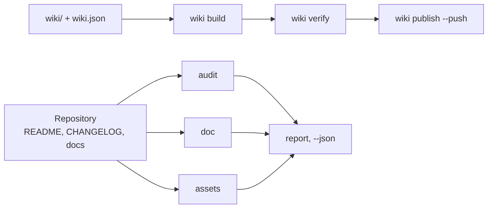

# github-agent

<!-- md-i18n:switcher -->
**In anderen Sprachen:** [English](README.md) · Deutsch · [中文](README.zh.md) · [हिन्दी](README.hi.md) · [Español](README.es.md) · [Русский](README.ru.md)

**Verwalter für GitHub-Repositories und -Wikis im Dienst von KI-Agenten: prüft README, CHANGELOG
und den Zustand der Community, erzeugt Banner und Social Preview, baut und veröffentlicht das
Wiki, kontrolliert Links, Anker und Topics — ein Befehl pro Aufgabe. Python 3, nur
Standardbibliothek.**

[](https://github.com/paulmann/github-agent/actions/workflows/ci.yml)
[](LICENSE)
[](https://www.python.org/)
[](tools/ghagent.py)
[](tests/run_tests.py)


[**Installation**](#installation) · [**Verwendung**](#verwendung) · [**Bilder**](#bilder) · [**Wiki**](https://github.com/paulmann/github-agent/wiki) · [**AGENTS.md**](AGENTS.md) · [**Changelog**](CHANGELOG.md) · [**Issues**](https://github.com/paulmann/github-agent/issues) · [**Sicherheit**](SECURITY.md) · [**Russische Fassung**](README.ru.md)

Ein Repository scheitert selten am Code, es scheitert an der Dokumentation. Dem README fehlt der
Abschnitt zur Installation, dem Changelog fehlen die Datumsangaben, das Wiki besteht aus drei
Seiten ohne Navigation, das Banner ist ein defektes Bild, die Beschreibung ein einziges Wort.
`git push` läuft durch, und der Mangel bleibt jahrelang bestehen.

Dieses Paket legt auf jede dieser Stellen einen prüfbaren Vertrag und reduziert die Arbeit auf
einen Befehl. Es schreibt keine Marketingtexte und erfindet keine Zahlen: Es prüft, was ein
Mensch geschrieben hat, und veröffentlicht nicht, was defekt ist.

> **Stand der Dokumentation.** Jede Zahl in diesem README wurde am 2026-10-24 gegen Version 1.1.0
> mit den in der Tabelle genannten Befehlen gemessen. Ausführliche Anleitungen stehen im
> [Wiki](https://github.com/paulmann/github-agent/wiki) und in [`docs/`](docs/); das Protokoll für
> Agenten ist [`AGENTS.md`](AGENTS.md).

## Inhalt

- [Was das Paket leistet](#was-das-paket-leistet)
- [In Zahlen](#in-zahlen)
- [Installation](#installation)
- [Verwendung](#verwendung)
- [Ausgeführte Prüfungen](#ausgeführte-prüfungen)
- [Bilder](#bilder)
- [Import in einen anderen Agenten](#import-in-einen-anderen-agenten)
- [Wiki als Dokumentation](#wiki-als-dokumentation)
- [Sprachen der Dokumentation](#sprachen-der-dokumentation)
- [Wie es aufgebaut ist](#wie-es-aufgebaut-ist)
- [Grenzen](#grenzen)
- [Entwicklung](#entwicklung)
- [Mitwirken](#mitwirken)
- [Lizenz](#lizenz)

---

## Was das Paket leistet

| Aufgabe | Ein Befehl |
|---|---|
| Ein Repository bewerten | `ghagent.py audit .` |
| Dokumente, Links und Anker prüfen | `ghagent.py doc --root .` |
| Geheimnisse und Maschinenpfade finden | `ghagent.py privacy --root .` |
| Banner und Social Preview erzeugen | `ghagent.py assets render --write` |
| Wiki bauen, prüfen und veröffentlichen | `ghagent.py wiki build`, `verify`, `publish --push` |
| Eine Version freigeben | `ghagent.py changelog release 1.2.0 --write` |
| Beschreibung und Topics korrigieren | `ghagent.py meta apply --repo owner/name --write` |
| Den Skill in einen anderen Agenten installieren | `ghagent.py install --profile harness --write` |

Jeder Befehl gibt Befunde als `file:line` mit einer Regel-ID aus und liefert `0` bei sauberem
Ergebnis, `1` bei Fehlern und `2` bei einem Aufruffehler. Ein Agent muss den Baum also nicht
lesen, um seinen Zustand zu erfahren: ein Befehl und ein Exit-Code genügen.

## In Zahlen

Gemessen in diesem Baum am 2026-10-24:

| Messgröße | Wert | Quelle der Messung |
|---|---:|---|
| Selbsttests | 134 | `tests/run_tests.py` |
| CLI-Befehle | 13 | `tools/ghagent.py --help` |
| Bibliotheksmodule | 11 | `tools/ghalib/*.py` |
| In diesem Baum geprüfte Regeln | 17 | `doc --json`, Feld `rules_examined` |
| Laufzeitabhängigkeiten | 0 | Importe in `tools/` |
| Dokumentierte Plattform-Fallstricke | 15 | [AGENTS.md](AGENTS.md#platform-traps) |
| Python-Zeilen | 3400 | `tools/**/*.py` |

## Installation

Benötigt wird nur Python 3.11+ (geprüft auf 3.13.15). Kein `pip install`, kein Build-Schritt.
Pillow ist optional: mit Pillow erzeugt `assets render` zusätzlich ein PNG, ohne Pillow nur das
SVG.

```bash
git clone https://github.com/paulmann/github-agent.git
cd github-agent

python tools/ghagent.py selftest
```

Die Installation des Skills in einen Agenten kopiert das Paket in das Skill-Wurzelverzeichnis des
Agenten, samt sha256-Manifest:

```bash
python tools/ghagent.py install --profile autoclaw --write   # AutoClaw2
python tools/ghagent.py install --profile harness  --write   # HARNESS
python tools/ghagent.py install --target <dir>     --write   # SagaAI and anything else
```

Prüfung und Rücknahme:

```bash
python tools/ghagent.py verify-install --profile autoclaw
python tools/ghagent.py uninstall --profile autoclaw --write
```

`uninstall` verweigert das Löschen eines Verzeichnisses ohne `.install.json`: Es darf nicht
entfernen, was ein anderes Werkzeug installiert hat.

## Verwendung

```bash
# 1. state of a local repository (exit 1 means errors)
python tools/ghagent.py audit .

# 2. the same for GitHub metadata
python tools/ghagent.py audit --repo owner/name --http

# 3. documents: BOM, CRLF, headings, tables, links, anchors, table of contents
python tools/ghagent.py doc --root .

# 4. images: render from metadata, then verify size, format and references
python tools/ghagent.py assets render --title "Project" --tagline "What it does." --write
python tools/ghagent.py assets check

# 5. wiki: build, verify, publish (without --push it is a dry run)
python tools/ghagent.py wiki build
python tools/ghagent.py wiki verify
python tools/ghagent.py wiki publish --repo owner/name --push

# 6. changelog
python tools/ghagent.py changelog check
python tools/ghagent.py changelog suggest --since v1.0.0
python tools/ghagent.py changelog release 1.1.0 --write
python tools/ghagent.py changelog notes 1.1.0

# 7. metadata: description and topics
python tools/ghagent.py meta suggest
python tools/ghagent.py meta apply --repo owner/name --description "…" --topics a,b --write

# 8. one combined report
python tools/ghagent.py report . --out AUDIT.md
```

Beispielausgabe von `audit`:

```text
[ERROR] repo.contributing        CONTRIBUTING.md is absent  hint: add CONTRIBUTING.md
[WARN ] readme.badges            only 1 badge(s)  hint: 3-8 badges: CI, release, license, runtime
[ERROR] changelog.date-missing   version 1.1.0 has no ISO date  CHANGELOG.md:14
score: 72.5% (22 scored, 1 skipped)
```

## Ausgeführte Prüfungen

| Gruppe | Regeln |
|---|---|
| Text | UTF-8 ohne BOM, LF statt CRLF, abschließender Zeilenumbruch, keine Tabulator-Einrückung |
| Struktur | genau ein `H1`, keine übersprungenen Überschriftenebenen, geschlossene Code-Fences, Sprachangabe an jeder Fence |
| Tabellen | die Zellenzahl jeder Zeile entspricht der Kopfzeile und der Trennzeile |
| Links | die relative Datei existiert, der Anker existiert (auch kyrillisch) |
| Inhaltsverzeichnis | jeder Eintrag löst auf, kein `H2` wird vergessen |
| Markup | die fünf Alert-Typen, Alternativtext an Bildern, keine Bilder über `http://` |
| Datenschutz | Token, private Schlüssel, absolute Pfade der Maschine, persönliche Adressen |
| Bilder | Banner referenziert, Vorschau ist PNG/JPG/GIF, unter 1 MB, mindestens 640×320 |
| Wiki | Manifest und Dateien stimmen überein, `Home`/`_Sidebar`/`_Footer` vorhanden, keine `.md`-Links, keine relativen Bilder |
| CHANGELOG | SemVer und ISO-Datum je Version, neueste zuerst, bekannte Typen, keine leere Version, Vergleichslinks |
| Metadaten | Beschreibung unter 200 Zeichen ohne verschenktes Präfix, 8–20 Topics in Kleinschreibung mit Bindestrichen |

Eine Regel, die null Objekte geprüft hat, gilt nicht als bestanden: Sie erscheint als
`coverage.skipped`, und ein leerer Baum ergibt `doc.no-text-files`.

## Bilder

Das Banner am Anfang dieser Datei erzeugt das Paket selbst:

```bash
python tools/ghagent.py assets render --title "github-agent" \
    --tagline "Repository and wiki steward for AI agents: one command per job." \
    --command "ghagent.py audit ." --chips "python,github,wiki,lint" --write
```

- `assets/social-preview.png` — 1280×640, unter 1 MB, bereit für **Settings → Social preview**.
- `assets/social-preview.svg` — Vektor-Zwilling für das README, keine Abhängigkeit nötig.
- `assets check` prüft Format, Bytegröße, Abmessungen, Alternativtext und dass jede referenzierte
  Datei existiert. Die Kopie im Repository ist nicht automatisch die Social Preview: Dieser Upload
  ist ein manueller Schritt, und die Prüfung gibt die Erinnerung daran aus.

## Import in einen anderen Agenten

| Agent | Skill-Wurzel | Vorgehen |
|---|---|---|
| AutoClaw2 | `%USERPROFILE%\.pi\agent\skills` | `install --profile autoclaw --write`, dann den Block aus `snippet` in die `AGENTS.md` des Agenten einfügen |
| HARNESS | `%USERPROFILE%\.dsh\skills` | `install --profile harness --write`, derselbe Block |
| SagaAI | beliebiges Verzeichnis | `install --target <dir> --write` und den Block aus `snippet --target <dir>` |

Der Block aus `snippet` nennt den Pfad des Pakets, den Prüfbefehl und eine Regel: eine Aufgabe,
ein Befehl. Nach dem Import muss der Agent `verify-install` ausführen und `0` erhalten; alles
andere bedeutet, dass die installierte Kopie nicht die geprüfte ist. Einzelheiten:
[docs/IMPORT.md](docs/IMPORT.md).

## Wiki als Dokumentation

Das Wiki wird aus dem Repository gepflegt: Die Seiten liegen in `wiki/`, die Reihenfolge bestimmt
`wiki/wiki.json`. `wiki build` schreibt Links für den Namensraum des Wikis um — interne Links
verlieren `.md`, Links in den Repository-Baum werden absolut, und ein relatives Bild ist ein
Fehler, weil das Wiki-Repository den Projektbaum nicht sieht.

Gebaut und geprüft mit den Befehlen des Pakets selbst. Die Veröffentlichung verlangt eine Aktion
in der GitHub-Oberfläche: `<repo>.wiki.git` entsteht erst, wenn eine erste Seite gespeichert
wurde, und `git push` kann es nicht anlegen — `wiki publish` liefert dann `wiki.remote-missing`
mit diesem Schritt.

## Sprachen der Dokumentation

Englische Dateien sind maßgeblich; russische Übersetzungen tragen das Suffix `.ru.md`, die
Konvention, die GitHub selbst verwendet (`README.ru.md`, `AGENTS.ru.md`, `wiki/01-Why.ru.md`).

| Englisch | Russisch |
|---|---|
| [README.md](README.md) | [README.ru.md](README.ru.md) |
| [AGENTS.md](AGENTS.md) | [AGENTS.ru.md](AGENTS.ru.md) |
| [CHANGELOG.md](CHANGELOG.md) | [CHANGELOG.ru.md](CHANGELOG.ru.md) |
| [CONTRIBUTING.md](CONTRIBUTING.md) | [CONTRIBUTING.ru.md](CONTRIBUTING.ru.md) |
| [SECURITY.md](SECURITY.md) | [SECURITY.ru.md](SECURITY.ru.md) |
| [SUPPORT.md](SUPPORT.md) | [SUPPORT.ru.md](SUPPORT.ru.md) |
| [CODE_OF_CONDUCT.md](CODE_OF_CONDUCT.md) | [CODE_OF_CONDUCT.ru.md](CODE_OF_CONDUCT.ru.md) |
| [GOVERNANCE.md](GOVERNANCE.md) | [GOVERNANCE.ru.md](GOVERNANCE.ru.md) |

Übersetzungen werden im selben Commit wie das Original aktualisiert. Eine Übersetzung, die
stillschweigend hinterherhinkt, ist ein Dokumentationsfehler, und das Wiki führt beide Sätze:
englische Seiten als maßgebliche, russische als `*.ru.md`-Seiten in einer eigenen
Navigationsgruppe.

## Wie es aufgebaut ist



| Komponente | Zuständigkeit |
|---|---|
| `tools/ghagent.py` | Argumentparsing, Exit-Codes, Zusammenbau des Berichts |
| `tools/ghalib/mdcheck.py` | Markdown, Links, Anker, Datenschutz |
| `tools/ghalib/audit.py` | Pflichtdateien, Verträge für README und Changelog, Bewertung |
| `tools/ghalib/assets.py` | Banner und Social Preview: erzeugen, prüfen, vorschlagen |
| `tools/ghalib/wiki.py` | Manifest, Umschreiben von Links, Sidebar und Footer, Veröffentlichung |
| `tools/ghalib/changelog.py` | Keep a Changelog 2.0.0, Freigabe, Entwurf aus Commits |
| `tools/ghalib/meta.py` | Beschreibung, Topics, Homepage |
| `tools/ghalib/install.py` | Installation des Skills, sha256-Manifest, Abweichungen, Entfernung |
| `tests/run_tests.py` | 134 Selbsttests mit Fixtures und Ködern |

Anker folgen den Regeln von GitHub: Kleinschreibung, Satzzeichen entfallen, Leerzeichen werden zu
Bindestrichen, eine wiederholte Überschrift erhält `-1`. Die Regel wurde an einem echten
Inhaltsverzeichnis geprüft: Ein Gedankenstrich in einer Überschrift erzeugt einen doppelten
Bindestrich.

## Grenzen

- `audit --repo` und `meta` benötigen `gh` oder `GITHUB_TOKEN`. Ohne sie liefert der Befehl einen
  Fehler statt eines leeren Erfolgs.
- Externe Links werden nicht abgerufen: Geprüft werden relative Pfade, Anker und Struktur. Ein
  Netzwerk-Crawl ist eine eigene Entscheidung, kein Nebeneffekt eines Linters.
- Wiki-Seiten sind über Suchmaschinen kaum auffindbar: Laut GitHub-Dokumentation werden nur Wikis
  mit 500+ Sternen und abgeschalteter öffentlicher Bearbeitung indexiert. Für Auffindbarkeit ist
  GitHub Pages zu verwenden.
- `changelog suggest` ist ein Entwurf. Er weiß nicht, was für einen Nutzer zählt.
- Das Rendern von PNG benötigt Pillow. Ohne Pillow entsteht nur das SVG, und die Prüfung sagt,
  warum kein PNG vorliegt, statt eine fertige Social Preview vorzugeben.

## Entwicklung

```bash
python tools/ghagent.py selftest
python tests/run_tests.py
python tools/ghagent.py doc --root .
python tools/ghagent.py audit .
python tools/ghagent.py assets check
```

Eine neue Regel kommt mit einer Fixture, die ohne sie fehlschlägt, und mit einem Köder, der still
bleiben muss. Eine Regel ohne Fixture wird entfernt: Eine Prüfung, die sich nicht belegen lässt,
ist schlechter als keine Prüfung.

## Mitwirken

Vor einem Pull Request müssen `python tests/run_tests.py` und
`python tools/ghagent.py doc --root .` grün sein. Eine Änderung, ein Grund. Regeln:
[CONTRIBUTING.md](CONTRIBUTING.md), Sicherheitsrichtlinie: [SECURITY.md](SECURITY.md).

## Lizenz

[MIT](LICENSE).
