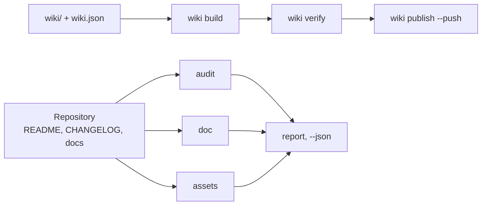

# github-agent

github-agent ist ein Kommandozeilen-Verwalter in Python für GitHub-Repositories und ihre Wikis:
Er bewertet README, CHANGELOG und die Community-Verträge, prüft Dokumente, Links, Anker und
Tabellen, sucht nach preisgegebenen Geheimnissen, erzeugt Banner und Social Preview und hält das
Wiki im Repository — ein Befehl pro Aufgabe.

<!-- md-i18n:switcher -->
**In anderen Sprachen:** [English](README.md) · Deutsch · [中文](README.zh.md) · [हिन्दी](README.hi.md) · [Español](README.es.md) · [Русский](README.ru.md)

[](https://github.com/paulmann/github-agent/actions/workflows/ci.yml)
[](https://www.python.org/)
[](LICENSE)
[](pyproject.toml)
[](tests/run_tests.py)


[**Installation**](#installation) · [**Verwendung**](#verwendung) · [**Wiki**](https://github.com/paulmann/github-agent/wiki) · [**AGENTS.md**](AGENTS.md) · [**MIGRATION.md**](MIGRATION.md) · [**Packaging**](docs/PACKAGING.md) · [**Changelog**](CHANGELOG.md) · [**Issues**](https://github.com/paulmann/github-agent/issues) · [**Sicherheit**](SECURITY.md) · [**Russische Fassung**](README.ru.md)

Ein Repository scheitert selten am Code, es scheitert an der Dokumentation. Dem README fehlt der
Abschnitt zur Installation, dem Changelog fehlen die Datumsangaben, das Wiki besteht aus drei
Seiten ohne Navigation, das Banner ist ein defektes Bild, die Beschreibung ein einziges Wort.
`git push` läuft durch, und der Mangel bleibt jahrelang bestehen.

Dieses Paket legt auf jede dieser Stellen einen prüfbaren Vertrag und reduziert die Arbeit auf
einen Befehl. Es schreibt keine Marketingtexte und erfindet keine Zahlen: Es prüft, was ein
Mensch geschrieben hat, und veröffentlicht nicht, was defekt ist.

> **Stand der Dokumentation.** Jede Zahl in diesem README wurde am 2026-10-30 gegen Version 1.2.0
> mit den in der Tabelle genannten Befehlen gemessen. Ausführliche Anleitungen stehen im
> [Wiki](https://github.com/paulmann/github-agent/wiki) und in [`docs/`](docs/IMPORT.md); das
> Protokoll für Agenten ist [`AGENTS.md`](AGENTS.md), die Hinweise zu Paketierung und Migration
> stehen in [`docs/PACKAGING.md`](docs/PACKAGING.md) und [`MIGRATION.md`](MIGRATION.md).

> **Für Agenten.** Beginnen Sie mit [`AGENTS.md`](AGENTS.md): wo das Paket liegt, wie sich die
> Unversehrtheit der Installation belegen lässt und welcher einzelne Befehl die jeweilige
> Mehrdatei-Untersuchung ersetzt.

## Inhalt

- [Installation](#installation)
- [Verwendung](#verwendung)
- [Was das Paket leistet](#was-das-paket-leistet)
- [In Zahlen](#in-zahlen)
- [Ausgeführte Prüfungen](#ausgeführte-prüfungen)
- [Bilder](#bilder)
- [Import in einen anderen Agenten](#import-in-einen-anderen-agenten)
- [Wiki als Dokumentation](#wiki-als-dokumentation)
- [Sprachen der Dokumentation](#sprachen-der-dokumentation)
- [Wie es aufgebaut ist](#wie-es-aufgebaut-ist)
- [Grenzen](#grenzen)
- [Entwicklung](#entwicklung)
- [Mitwirken](#mitwirken)
- [Lizenz](#lizenz)

---

## Installation

Erforderlich ist Python 3.11 oder neuer; die CI führt die Testsuite auf 3.11 und 3.13 aus. Es gibt
keine Laufzeitabhängigkeiten. Es gibt vier Installationswege, und sie sind nicht austauschbar: Die
Paketmanager installieren die CLI, während der Klon der Weg für
`ghagent install --profile ... --write` ist, weil das Wheel nur die CLI enthält.

### Paketmanager

```bash
uv tool install github-agent        # uv, isolierte Tool-Umgebung
pipx install github-agent           # pipx, isolierte virtuelle Umgebung
pip install github-agent            # pip in die aktive Umgebung
ghagent --version
```

> **PyPI-Status.** Diese Befehle funktionieren ab der ersten Veröffentlichung: Trusted Publishing
> richtet der Repository-Eigentümer ein, und der Workflow `Publish` wird manuell gestartet. Bis
> dahin das Wheel aus dem [letzten Release](https://github.com/paulmann/github-agent/releases/latest)
> installieren oder den Quelltext-Klon weiter unten verwenden — beide liefern dasselbe
> `ghagent`-Kommando.

Das Konsolenskript heißt `ghagent`, das Paket auf PyPI heißt `github-agent`.

### Optionales PNG

`assets render` schreibt immer das SVG. Für die PNG-Ausgabe wird Pillow benötigt, das ein
optionales Extra ist:

```bash
pip install "github-agent[png]"
uv tool install --with pillow github-agent
```

Ohne Pillow sagt der Befehl, warum kein PNG vorliegt, statt eine fertige Social Preview
vorzugeben.

### Aus dem Quelltext (Klon)

Der Klon ist der zweite Installationsweg und der einzige, der `tests/`, `skills/`, `reference/`,
`wiki/` und die Vorlagen mitbringt; deshalb benötigen `install`, `verify-install`, `snippet` und
`uninstall` ihn. Eine editierbare Installation fügt dem Checkout den Befehl `ghagent` hinzu:

```bash
git clone https://github.com/paulmann/github-agent.git
cd github-agent
pip install -e .
python tools/ghagent.py selftest
```

### Docker

Das Repository enthält ein `Dockerfile`; bauen Sie es lokal und binden Sie das zu prüfende
Repository unter `/repo` ein, dem Arbeitsverzeichnis des Images:

```bash
docker build -t ghagent .
docker run --rm -v "$PWD:/repo" ghagent audit .
```

Unter Windows PowerShell lautet derselbe Mount `-v "${PWD}:/repo"`. Der Einstiegspunkt ist
`ghagent`, daher ist das erste Argument nach dem Image-Namen der Befehl. Als Teil von 1.2.0 wird
kein Registry-Image veröffentlicht, und die CI baut den Container nicht: Der Tag ist eine lokale
Konvention. Siehe [examples/docker.md](examples/docker.md).

### GitHub Action

Die zusammengesetzte Action installiert das Paket aus ihrem eigenen Checkout; sie hängt also nicht
von einer PyPI-Veröffentlichung ab und funktioniert, sobald der Tag existiert:

```yaml
- uses: actions/checkout@v4
- uses: paulmann/github-agent@v1.2.0    # den Release-Tag festlegen
  with:
    command: audit .
    min-score: "80"
```

| Eingabe | Standard | Zweck |
|---|---|---|
| `command` | `audit . --min-score 80` | jeder `ghagent`-Befehl, ohne den Programmnamen |
| `min-score` | `80` | Score-Schwelle, angewendet nur wenn `command` mit `audit` beginnt und kein Flag übergibt |
| `working-directory` | `.` | Verzeichnis des Repositories, in dem der Befehl läuft, relativ zu `$GITHUB_WORKSPACE` |
| `python-version` | `3.13` | von `actions/setup-python` installierte Interpreterversion |
| `github-token` | `${{ github.token }}` | als `GITHUB_TOKEN` für Metadatenbefehle exportiert |

Für einen Befehl, der kein Audit ist, führt die Action genau die angegebene Argumentzeichenkette
aus, zum Beispiel `command: doc --root .`. Es gibt keine Ausgaben: Der Exit-Code des Schritts ist
das Ergebnis (`0` sauber, `1` Befunde, `2` Aufruf- oder Umgebungsproblem). Ein vollständiger
Workflow, einschließlich eines zweiten Jobs mit `doc` und einer Docker-Alternative, steht in
[examples/ci-usage.md](examples/ci-usage.md).

### pre-commit

Das Repository ist zugleich eine Quelle für pre-commit-Hooks; die Hooks heißen `ghagent-doc`,
`ghagent-audit`, `ghagent-privacy` und `ghagent-changelog`:

```yaml
repos:
  - repo: https://github.com/paulmann/github-agent
    rev: v1.2.0     # Platzhalter: den Release-Tag festlegen, dem Sie trauen
    hooks:
      - id: ghagent-doc
      - id: ghagent-audit
      - id: ghagent-privacy
      - id: ghagent-changelog
```

Installieren Sie die Hooks mit `pre-commit install` in das nutzende Repository. Die vollständige
Konfigurationsdatei ist [examples/pre-commit-config.yaml](examples/pre-commit-config.yaml); die
Hook-Definitionen stehen in [.pre-commit-hooks.yaml](.pre-commit-hooks.yaml). Die Hooks brauchen
einen veröffentlichten Tag, weil pre-commit das Werkzeug aus dem getaggten Baum baut.

### Geprüfte Installation

Nach jeder Installation beantwortet ein Befehl, ob die CLI der freigegebene Build ist:

```bash
ghagent --version     # gibt die Version aus, zum Beispiel github-agent 1.2.0
ghagent audit .       # 0 sauber, 1 Befunde auf Fehlerstufe, 2 Aufruf- oder Umgebungsproblem
```

In einem Klon läuft die vollständige Selbsttest-Suite; das Wheel enthält nur die CLI, daher endet
`ghagent selftest` dort mit `2` und einem Hinweis auf den Klon, statt ein falsches `PASS` zu
melden:

```bash
git clone https://github.com/paulmann/github-agent.git
cd github-agent
python tools/ghagent.py selftest    # 173/173 Prüfungen bestanden
```

## Verwendung

```bash
ghagent audit .                    # Bewertet die Hygiene des Repositories, Exit 1 bei Fehlern
ghagent doc --root .               # Markdown, Links, Anker, Tabellen, Inhaltsverzeichnis
ghagent privacy --root .           # Token, private Schlüssel, Maschinenpfade, persönliche Adressen
ghagent assets render --write      # Banner und Social Preview aus den Metadaten des Repositories
ghagent assets check               # Format, Abmessungen, Alternativtext, referenzierte Dateien
ghagent wiki build                 # schreibt Links für den Namensraum des Wikis um
ghagent wiki verify                # jeder interne Link löst auf
ghagent changelog check            # Keep a Changelog und SemVer
ghagent changelog release 1.2.0 --write
ghagent meta suggest               # Beschreibung und Topics
```

Jeder Befehl akzeptiert `--json`; Befunde erscheinen als `file:line` mit einer Regel-ID, sodass der
Aufrufer keinen Fließtext auswerten muss.

| Exit-Code | Bedeutung |
|---|---|
| `0` | keine Befunde auf Fehlerstufe |
| `1` | Befunde auf Fehlerstufe, jeder mit `file:line` ausgegeben |
| `2` | Aufruf- oder Umgebungsproblem: falscher Pfad, fehlende Datei, fehlendes `gh` oder Token |

Beispielausgabe von `audit`, aus einem absichtlich fehlerhaften Repository und nicht aus diesem
Baum:

```text
[ERROR] repo.contributing        CONTRIBUTING.md is absent  hint: add CONTRIBUTING.md
[WARN ] readme.badges            only 1 badge(s)  hint: 3-8 badges: CI, release, license, runtime
[ERROR] changelog.date-missing   version 1.1.0 has no ISO date  CHANGELOG.md:14
score: 72.5% (22 scored, 1 skipped)
```

## Was das Paket leistet

| Aufgabe | Ein Befehl |
|---|---|
| Ein Repository bewerten | `ghagent audit .` |
| Dokumente, Links und Anker prüfen | `ghagent doc --root .` |
| Geheimnisse und Maschinenpfade finden | `ghagent privacy --root .` |
| Banner und Social Preview erzeugen | `ghagent assets render --write` |
| Wiki bauen, prüfen und veröffentlichen | `ghagent wiki build`, `verify`, `publish --push` |
| Eine Version freigeben | `ghagent changelog release 1.2.0 --write` |
| Beschreibung und Topics korrigieren | `ghagent meta apply --repo owner/name --write` |
| Den Skill in einen anderen Agenten installieren | `ghagent install --profile harness --write` |

Die CLI hat 13 Befehle; die Tabelle nennt die jeden Tag genutzten. Die übrigen (`report`,
`snippet`, `verify-install`, `uninstall`, `selftest`, `assets suggest`, `changelog suggest`,
`changelog notes`, `meta suggest`, `wiki init`, `wiki publish`) stehen mit ihren Flags in
[`AGENTS.md`](AGENTS.md).

## In Zahlen

In diesem Baum am 2026-10-30 gegen Version 1.2.0 gemessen:

| Messgröße | Wert | Quelle der Messung |
|---|---:|---|
| Selbsttests | 173 | `python tests/run_tests.py` |
| CLI-Befehle | 13 | `ghagent --help` |
| Bibliotheksmodule | 11 | `tools/ghalib/*.py` |
| In diesem Baum geprüfte Dokumentregeln | 17 | `ghagent doc --json`, Feld `rules_examined` |
| Laufzeitabhängigkeiten | 0 | `pyproject.toml`, `dependencies = []` |
| Dokumentierte Plattform-Fallstricke | 15 | die Fallstricktabelle in [docs/RULES.md](docs/RULES.md#platform-traps) |
| Python-Zeilen | 4176 | `wc -l tools/ghagent.py tools/ghalib/*.py` |

## Ausgeführte Prüfungen

| Gruppe | Regeln |
|---|---|
| Text | UTF-8 ohne BOM, LF statt CRLF, abschließender Zeilenumbruch, keine Tabulator-Einrückung |
| Struktur | genau ein `H1`, keine übersprungenen Überschriftenebenen, geschlossene Code-Fences, Sprachangabe an jeder Fence |
| Tabellen | die Zellenzahl jeder Zeile entspricht der Kopfzeile und der Trennzeile |
| Links | die relative Datei existiert, der Anker existiert (auch kyrillisch) |
| Inhaltsverzeichnis | jeder Eintrag löst auf, kein `H2` wird vergessen |
| Markup | die fünf Alert-Typen, Alternativtext an Bildern, keine Bilder über `http://` |
| Datenschutz | Token, private Schlüssel, absolute Pfade der Maschine, persönliche Adressen |
| Bilder | Banner referenziert, Vorschau ist PNG/JPG/GIF, unter 1 MB, mindestens 640×320 |
| Wiki | Manifest und Dateien stimmen überein, `Home`/`_Sidebar`/`_Footer` vorhanden, keine `.md`-Links, keine relativen Bilder |
| CHANGELOG | SemVer und ISO-Datum je Version, neueste zuerst, bekannte Typen, keine leere Version, Vergleichslinks |
| Agenten-Datei | die kanonische `AGENTS.md` im Wurzelverzeichnis bleibt eine Landkarte: über 120 Zeilen sind eine Warnung, Details gehören nach `docs/` |
| Metadaten | Beschreibung unter 200 Zeichen ohne verschenktes Präfix, 8–20 Topics in Kleinschreibung mit Bindestrichen |

Eine Regel, die null Objekte geprüft hat, gilt nicht als bestanden: Sie erscheint als
`coverage.skipped`, und ein leerer Baum ergibt `doc.no-text-files`.

## Bilder

Das Banner am Anfang dieser Datei erzeugt das Paket selbst:

```bash
ghagent assets render --title "github-agent" \
    --tagline "Repository and wiki steward for AI agents: one command per job." \
    --command "ghagent audit ." --chips "python,github,wiki,lint" --write
```

- `assets/social-preview.png` — 1280×640, unter 1 MB, bereit für **Settings → Social preview**.
- `assets/social-preview.svg` — Vektor-Zwilling für das README, keine Abhängigkeit nötig.
- `assets check` prüft Format, Bytegröße, Abmessungen, Alternativtext und dass jede referenzierte
  Datei existiert. Die Kopie im Repository ist nicht automatisch die Social Preview: Dieser Upload
  ist ein manueller Schritt, und die Prüfung gibt die Erinnerung daran aus.

## Import in einen anderen Agenten

| Agent | Skill-Wurzel | Vorgehen |
|---|---|---|
| AutoClaw2 | `%USERPROFILE%\.pi\agent\skills` | `install --profile autoclaw --write`, dann den Block aus `snippet` in die `AGENTS.md` des Agenten einfügen |
| HARNESS | `%USERPROFILE%\.dsh\skills` | `install --profile harness --write`, derselbe Block |
| SagaAI | beliebiges Verzeichnis | `install --target <dir> --write` und den Block aus `snippet --target <dir>` |

Der Block aus `snippet` nennt den Pfad des Pakets, den Prüfbefehl und eine Regel: eine Aufgabe,
ein Befehl. Nach dem Import muss der Agent `verify-install` ausführen und `0` erhalten; alles
andere bedeutet, dass die installierte Kopie nicht die geprüfte ist. Dies ist der einzige
Arbeitsablauf, der den Klon statt des Wheels benötigt, weil das Wheel nur die CLI enthält.
Einzelheiten: [docs/IMPORT.md](docs/IMPORT.md).

## Wiki als Dokumentation

Das Wiki wird aus dem Repository gepflegt: Die Seiten liegen in `wiki/`, die Reihenfolge bestimmt
`wiki/wiki.json`. `wiki build` schreibt Links für den Namensraum des Wikis um — interne Links
verlieren `.md`, Links in den Repository-Baum werden absolut, und ein relatives Bild ist ein
Fehler, weil das Wiki-Repository den Projektbaum nicht sieht.

Gebaut und geprüft mit den Befehlen des Pakets selbst. Die Veröffentlichung verlangt eine Aktion
in der GitHub-Oberfläche: `<repo>.wiki.git` entsteht erst, wenn eine erste Seite gespeichert
wurde, und `git push` kann es nicht anlegen — `wiki publish` liefert dann `wiki.remote-missing`
mit diesem Schritt. Der vollständige Arbeitsablauf steht in [docs/WIKI.md](docs/WIKI.md).

## Sprachen der Dokumentation

Englische Dateien sind maßgeblich; russische Übersetzungen tragen das Suffix `.ru.md`, die
Konvention, die GitHub selbst verwendet (`README.ru.md`, `AGENTS.ru.md`, `wiki/01-Why.ru.md`).

| Englisch | Russisch |
|---|---|
| [README.md](README.md) | [README.ru.md](README.ru.md) |
| [AGENTS.md](AGENTS.md) | [AGENTS.ru.md](AGENTS.ru.md) |
| [CHANGELOG.md](CHANGELOG.md) | [CHANGELOG.ru.md](CHANGELOG.ru.md) |
| [CONTRIBUTING.md](CONTRIBUTING.md) | [CONTRIBUTING.ru.md](CONTRIBUTING.ru.md) |
| [SECURITY.md](SECURITY.md) | [SECURITY.ru.md](SECURITY.ru.md) |
| [SUPPORT.md](SUPPORT.md) | [SUPPORT.ru.md](SUPPORT.ru.md) |
| [CODE_OF_CONDUCT.md](CODE_OF_CONDUCT.md) | [CODE_OF_CONDUCT.ru.md](CODE_OF_CONDUCT.ru.md) |
| [GOVERNANCE.md](GOVERNANCE.md) | [GOVERNANCE.ru.md](GOVERNANCE.ru.md) |

Übersetzungen werden im selben Commit wie das Original aktualisiert. Eine Übersetzung, die
stillschweigend hinterherhinkt, ist ein Dokumentationsfehler, und das Wiki führt beide Sätze:
englische Seiten als maßgebliche, russische als `*.ru.md`-Seiten in einer eigenen
Navigationsgruppe.

## Wie es aufgebaut ist



| Komponente | Zuständigkeit |
|---|---|
| `tools/ghagent.py` | Argumentparsing, Exit-Codes, Zusammenbau des Berichts |
| `tools/ghalib/mdcheck.py` | Markdown, Links, Anker, Datenschutz |
| `tools/ghalib/audit.py` | Pflichtdateien, Verträge für README und Changelog, Bewertung |
| `tools/ghalib/assets.py` | Banner und Social Preview: erzeugen, prüfen, vorschlagen |
| `tools/ghalib/wiki.py` | Manifest, Umschreiben von Links, Sidebar und Footer, Veröffentlichung |
| `tools/ghalib/changelog.py` | Keep a Changelog 2.0.0, Freigabe, Entwurf aus Commits |
| `tools/ghalib/meta.py` | Beschreibung, Topics, Homepage |
| `tools/ghalib/install.py` | Installation des Skills, sha256-Manifest, Abweichungen, Entfernung |
| `tools/ghalib/report.py` | Befunde, Schweregrade, Markdown- und `--json`-Ausgabe |
| `tools/ghalib/config.py`, `tools/ghalib/util.py` | `.ghagent.json`, Pfade, Text-Ein-/Ausgabe, Anker |
| `tests/run_tests.py` | 173 Selbsttests mit Fixtures und Ködern |

Anker folgen den Regeln von GitHub: Kleinschreibung, Satzzeichen entfallen, Leerzeichen werden zu
Bindestrichen, eine wiederholte Überschrift erhält `-1`. Die Regel wurde an einem echten
Inhaltsverzeichnis geprüft: Ein Gedankenstrich in einer Überschrift erzeugt einen doppelten
Bindestrich. Hinweise zum Aufbau: [docs/ARCHITECTURE.md](docs/ARCHITECTURE.md).

## Grenzen

- `audit --repo` und `meta` benötigen `gh` oder `GITHUB_TOKEN`. Ohne sie liefert der Befehl einen
  Fehler statt eines leeren Erfolgs.
- Externe Links werden nicht abgerufen: Geprüft werden relative Pfade, Anker und Struktur. Ein
  Netzwerk-Crawl ist eine eigene Entscheidung, kein Nebeneffekt eines Linters.
- Wiki-Seiten sind über Suchmaschinen kaum auffindbar: Laut GitHub-Dokumentation werden nur Wikis
  mit 500+ Sternen und abgeschalteter öffentlicher Bearbeitung indexiert. Für Auffindbarkeit ist
  GitHub Pages zu verwenden.
- `changelog suggest` ist ein Entwurf. Er weiß nicht, was für einen Nutzer zählt.
- Das Rendern von PNG benötigt Pillow. Ohne Pillow entsteht nur das SVG, und die Prüfung sagt,
  warum kein PNG vorliegt, statt eine fertige Social Preview vorzugeben.

## Entwicklung

```bash
python tools/ghagent.py selftest
python tests/run_tests.py
python tools/ghagent.py doc --root .
python tools/ghagent.py audit .
python tools/ghagent.py assets check
```

Eine neue Regel kommt mit einer Fixture, die ohne sie fehlschlägt, und mit einem Köder, der still
bleiben muss. Eine Regel ohne Fixture wird entfernt: Eine Prüfung, die sich nicht belegen lässt,
ist schlechter als keine Prüfung. Paketierung und Wheel-Layout sind in
[docs/PACKAGING.md](docs/PACKAGING.md) beschrieben; die Änderungen von 1.1.0 → 1.2.0 stehen in
[MIGRATION.md](MIGRATION.md).

## Mitwirken

Vor einem Pull Request müssen `python tests/run_tests.py` und
`python tools/ghagent.py doc --root .` grün sein. Eine Änderung, ein Grund. Regeln:
[CONTRIBUTING.md](CONTRIBUTING.md), Sicherheitsrichtlinie: [SECURITY.md](SECURITY.md).

## Lizenz

[MIT](LICENSE).
