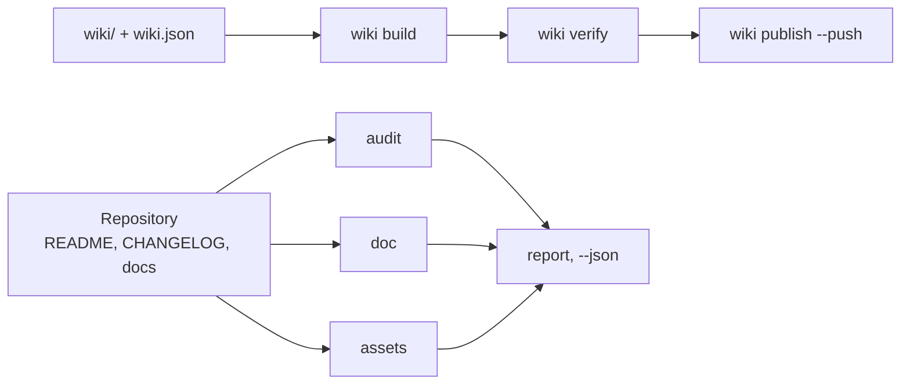

# github-agent

<!-- md-i18n:switcher -->
**En otros idiomas:** [English](README.md) · [Deutsch](README.de.md) · [中文](README.zh.md) · [हिन्दी](README.hi.md) · Español · [Русский](README.ru.md)

**Gestor de repositorios y wikis de GitHub para agentes de IA: audita el README, el CHANGELOG y la salud de la comunidad, genera el banner y la vista previa social, construye y publica la wiki, comprueba enlaces, anclas y temas — una orden por tarea. Python 3, solo biblioteca estándar.**

[](https://github.com/paulmann/github-agent/actions/workflows/ci.yml)
[](LICENSE)
[](https://www.python.org/)
[](tools/ghagent.py)
[](tests/run_tests.py)


[**Instalación**](#instalación) · [**Uso**](#uso) · [**Imágenes**](#imágenes) · [**Wiki**](https://github.com/paulmann/github-agent/wiki) · [**AGENTS.md**](AGENTS.md) · [**Changelog**](CHANGELOG.md) · [**Issues**](https://github.com/paulmann/github-agent/issues) · [**Seguridad**](SECURITY.md) · [**Versión en ruso**](README.ru.md)

Un repositorio rara vez falla por el código; falla por la documentación. El README no tiene
sección de instalación, el changelog no tiene fechas, la wiki son tres páginas sin navegación,
el banner es una imagen rota, la descripción es una sola palabra. `git push` funciona, así que
el defecto vive durante años.

Este paquete impone un contrato verificable en cada uno de esos puntos y reduce el trabajo a una
orden. No escribe texto de marketing ni inventa cifras: comprueba lo que escribió una persona y
se niega a publicar lo que está roto.

> **Estado de la documentación.** Cada cifra de este README se midió el 2026-10-24 sobre la
> versión 1.1.0 con las órdenes indicadas en la tabla. Las guías extensas están en la
> [Wiki](https://github.com/paulmann/github-agent/wiki) y en [`docs/`](docs/); el protocolo para
> agentes es [`AGENTS.md`](AGENTS.md).

## Contenido

- [Qué hace el paquete](#qué-hace-el-paquete)
- [En cifras](#en-cifras)
- [Instalación](#instalación)
- [Uso](#uso)
- [Comprobaciones que se ejecutan](#comprobaciones-que-se-ejecutan)
- [Imágenes](#imágenes)
- [Importar en otro agente](#importar-en-otro-agente)
- [La wiki como documentación](#la-wiki-como-documentación)
- [Idiomas de la documentación](#idiomas-de-la-documentación)
- [Cómo está construido](#cómo-está-construido)
- [Limitaciones](#limitaciones)
- [Desarrollo](#desarrollo)
- [Contribuir](#contribuir)
- [Licencia](#licencia)

---

## Qué hace el paquete

| Tarea | Una orden |
|---|---|
| Puntuar un repositorio | `ghagent.py audit .` |
| Revisar documentos, enlaces y anclas | `ghagent.py doc --root .` |
| Encontrar secretos y rutas de la máquina | `ghagent.py privacy --root .` |
| Generar el banner y la vista previa social | `ghagent.py assets render --write` |
| Construir, verificar y publicar la wiki | `ghagent.py wiki build`, `verify`, `publish --push` |
| Publicar una versión | `ghagent.py changelog release 1.2.0 --write` |
| Corregir la descripción y los temas | `ghagent.py meta apply --repo owner/name --write` |
| Instalar la skill en otro agente | `ghagent.py install --profile harness --write` |

Cada orden imprime los hallazgos como `file:line` con el identificador de la regla y devuelve
`0` si todo está limpio, `1` si hay errores y `2` ante un problema de uso. Por eso un agente no
necesita leer el árbol para conocer su estado: bastan una orden y un código de salida.

## En cifras

Medido en este árbol el 2026-10-24:

| Ámbito | Valor | Fuente de la medición |
|---|---:|---|
| Autopruebas | 134 | `tests/run_tests.py` |
| Órdenes de la CLI | 13 | `tools/ghagent.py --help` |
| Módulos de la biblioteca | 11 | `tools/ghalib/*.py` |
| Reglas examinadas en este árbol | 17 | `doc --json`, campo `rules_examined` |
| Dependencias en tiempo de ejecución | 0 | imports en `tools/` |
| Trampas de la plataforma registradas | 15 | [AGENTS.md](AGENTS.md#platform-traps) |
| Líneas de Python | 3400 | `tools/**/*.py` |

## Instalación

Solo se requiere Python 3.11+ (verificado en 3.13.15). Sin `pip install`, sin paso de
compilación. Pillow es opcional: con él, `assets render` produce además un PNG; sin él, solo el
SVG.

```bash
git clone https://github.com/paulmann/github-agent.git
cd github-agent

python tools/ghagent.py selftest
```

Instalar la skill en un agente copia el paquete en la raíz de skills del agente, con un
manifiesto sha256:

```bash
python tools/ghagent.py install --profile autoclaw --write   # AutoClaw2
python tools/ghagent.py install --profile harness  --write   # HARNESS
python tools/ghagent.py install --target <dir>     --write   # SagaAI and anything else
```

Verificación y reversión:

```bash
python tools/ghagent.py verify-install --profile autoclaw
python tools/ghagent.py uninstall --profile autoclaw --write
```

`uninstall` se niega a borrar un directorio que no tenga `.install.json`: no debe eliminar lo que
instaló otra herramienta.

## Uso

```bash
# 1. state of a local repository (exit 1 means errors)
python tools/ghagent.py audit .

# 2. the same for GitHub metadata
python tools/ghagent.py audit --repo owner/name --http

# 3. documents: BOM, CRLF, headings, tables, links, anchors, table of contents
python tools/ghagent.py doc --root .

# 4. images: render from metadata, then verify size, format and references
python tools/ghagent.py assets render --title "Project" --tagline "What it does." --write
python tools/ghagent.py assets check

# 5. wiki: build, verify, publish (without --push it is a dry run)
python tools/ghagent.py wiki build
python tools/ghagent.py wiki verify
python tools/ghagent.py wiki publish --repo owner/name --push

# 6. changelog
python tools/ghagent.py changelog check
python tools/ghagent.py changelog suggest --since v1.0.0
python tools/ghagent.py changelog release 1.1.0 --write
python tools/ghagent.py changelog notes 1.1.0

# 7. metadata: description and topics
python tools/ghagent.py meta suggest
python tools/ghagent.py meta apply --repo owner/name --description "…" --topics a,b --write

# 8. one combined report
python tools/ghagent.py report . --out AUDIT.md
```

Ejemplo de salida de `audit`:

```text
[ERROR] repo.contributing        CONTRIBUTING.md is absent  hint: add CONTRIBUTING.md
[WARN ] readme.badges            only 1 badge(s)  hint: 3-8 badges: CI, release, license, runtime
[ERROR] changelog.date-missing   version 1.1.0 has no ISO date  CHANGELOG.md:14
score: 72.5% (22 scored, 1 skipped)
```

## Comprobaciones que se ejecutan

| Grupo | Reglas |
|---|---|
| Texto | UTF-8 sin BOM, LF en lugar de CRLF, salto de línea final, sin sangría con tabuladores |
| Estructura | un único `H1`, sin niveles de encabezado saltados, bloques de código cerrados, idioma en cada bloque |
| Tablas | el número de celdas de cada fila coincide con el encabezado y el separador |
| Enlaces | el archivo relativo existe, el ancla existe (incluido el cirílico) |
| Índice | cada entrada resuelve, ningún `H2` queda olvidado |
| Marcado | los cinco tipos de alerta, texto alternativo en las imágenes, ninguna imagen por `http://` |
| Privacidad | tokens, claves privadas, rutas absolutas de la máquina, direcciones personales |
| Imágenes | banner referenciado, la vista previa es PNG/JPG/GIF, menos de 1 MB, al menos 640×320 |
| Wiki | el manifiesto y los archivos coinciden, `Home`/`_Sidebar`/`_Footer` presentes, sin enlaces `.md`, sin imágenes relativas |
| CHANGELOG | SemVer y fecha ISO por versión, la más reciente primero, tipos conocidos, sin versión vacía, enlaces de comparación |
| Metadatos | descripción de menos de 200 caracteres sin prefijo inútil, de 8 a 20 temas en minúsculas con guiones |

Una regla que examinó cero objetos no se considera superada: se informa como `coverage.skipped`,
y un árbol vacío es `doc.no-text-files`.

## Imágenes

El banner de la parte superior de este archivo lo genera el propio paquete:

```bash
python tools/ghagent.py assets render --title "github-agent" \
    --tagline "Repository and wiki steward for AI agents: one command per job." \
    --command "ghagent.py audit ." --chips "python,github,wiki,lint" --write
```

- `assets/social-preview.png` — 1280×640, menos de 1 MB, listo para **Settings → Social preview**.
- `assets/social-preview.svg` — gemelo vectorial para el README, sin dependencias.
- `assets check` verifica formato, tamaño en bytes, dimensiones, texto alternativo y que exista
  cada archivo referenciado. La copia del repositorio no es la vista previa social de forma
  automática: esa carga es un paso manual, y la comprobación imprime el recordatorio.

## Importar en otro agente

| Agente | Raíz de skills | Qué hacer |
|---|---|---|
| AutoClaw2 | `%USERPROFILE%\.pi\agent\skills` | `install --profile autoclaw --write`, luego pegar el bloque `snippet` en su `AGENTS.md` |
| HARNESS | `%USERPROFILE%\.dsh\skills` | `install --profile harness --write`, el mismo bloque |
| SagaAI | cualquier directorio | `install --target <dir> --write` y el bloque de `snippet --target <dir>` |

El bloque `snippet` indica la ruta del paquete, la orden de verificación y una regla: una tarea,
una orden. Tras la importación, el agente debe ejecutar `verify-install` y obtener `0`; cualquier
otra cosa significa que la copia instalada no es la probada. Detalles:
[docs/IMPORT.md](docs/IMPORT.md).

## La wiki como documentación

La wiki se mantiene desde el repositorio: las páginas viven en `wiki/` y el orden lo fija
`wiki/wiki.json`. `wiki build` reescribe los enlaces para el espacio de nombres de la wiki — los
enlaces internos pierden `.md`, los enlaces al árbol del repositorio se vuelven absolutos y una
imagen relativa es un error, porque el repositorio de la wiki no ve el árbol del proyecto.

Construida y verificada con las órdenes del propio paquete. La publicación requiere una acción en
la interfaz de GitHub: `<repo>.wiki.git` no existe hasta que se guarda una primera página, y
`git push` no puede crearlo — en ese caso `wiki publish` devuelve `wiki.remote-missing` junto con
ese paso.

## Idiomas de la documentación

Los archivos en inglés son la versión canónica; las traducciones al ruso llevan el sufijo
`.ru.md`, la convención que usa GitHub (`README.ru.md`, `AGENTS.ru.md`, `wiki/01-Why.ru.md`).

| Inglés | Ruso |
|---|---|
| [README.md](README.md) | [README.ru.md](README.ru.md) |
| [AGENTS.md](AGENTS.md) | [AGENTS.ru.md](AGENTS.ru.md) |
| [CHANGELOG.md](CHANGELOG.md) | [CHANGELOG.ru.md](CHANGELOG.ru.md) |
| [CONTRIBUTING.md](CONTRIBUTING.md) | [CONTRIBUTING.ru.md](CONTRIBUTING.ru.md) |
| [SECURITY.md](SECURITY.md) | [SECURITY.ru.md](SECURITY.ru.md) |
| [SUPPORT.md](SUPPORT.md) | [SUPPORT.ru.md](SUPPORT.ru.md) |
| [CODE_OF_CONDUCT.md](CODE_OF_CONDUCT.md) | [CODE_OF_CONDUCT.ru.md](CODE_OF_CONDUCT.ru.md) |
| [GOVERNANCE.md](GOVERNANCE.md) | [GOVERNANCE.ru.md](GOVERNANCE.ru.md) |

Las traducciones se actualizan en el mismo commit que el original. Una traducción que se queda
atrás en silencio es un defecto de documentación, y la wiki lleva ambos conjuntos: páginas en
inglés como canónicas y páginas en ruso como `*.ru.md` en su propio grupo de navegación.

## Cómo está construido



| Componente | Responsabilidad |
|---|---|
| `tools/ghagent.py` | análisis de argumentos, códigos de salida, composición del informe |
| `tools/ghalib/mdcheck.py` | markdown, enlaces, anclas, privacidad |
| `tools/ghalib/audit.py` | archivos obligatorios, contratos de README y changelog, puntuación |
| `tools/ghalib/assets.py` | banner y vista previa social: generar, comprobar, sugerir |
| `tools/ghalib/wiki.py` | manifiesto, reescritura de enlaces, barra lateral y pie, publicación |
| `tools/ghalib/changelog.py` | Keep a Changelog 2.0.0, release, borrador a partir de los commits |
| `tools/ghalib/meta.py` | descripción, temas, página principal |
| `tools/ghalib/install.py` | instalación de la skill, manifiesto sha256, deriva, eliminación |
| `tests/run_tests.py` | 134 autopruebas con fixtures y señuelos |

Las anclas siguen las reglas de GitHub: minúsculas, se elimina la puntuación, los espacios pasan a
guiones y un encabezado repetido recibe `-1`. La regla se verificó contra un índice real: un guion
largo en un encabezado produce un doble guion.

## Limitaciones

- `audit --repo` y `meta` necesitan `gh` o `GITHUB_TOKEN`. Sin ellos, la orden devuelve un error en
  lugar de un éxito vacío.
- Los enlaces externos no se descargan: se comprueban las rutas relativas, las anclas y la
  estructura. Rastrear la red es una decisión aparte, no un efecto secundario de un linter.
- Las páginas de la wiki apenas se descubren en los buscadores: según la documentación de GitHub,
  solo se indexan las wikis con 500 estrellas o más y la edición pública desactivada. Para el
  descubrimiento, usa GitHub Pages.
- `changelog suggest` es un borrador. No sabe qué le importa a un usuario.
- La generación de PNG necesita Pillow. Sin él se produce el SVG y la comprobación explica por qué
  no hay PNG, en lugar de fingir que la vista previa social está lista.

## Desarrollo

```bash
python tools/ghagent.py selftest
python tests/run_tests.py
python tools/ghagent.py doc --root .
python tools/ghagent.py audit .
python tools/ghagent.py assets check
```

Una regla nueva llega con un fixture que falla sin ella y un señuelo que debe permanecer en
silencio. Una regla sin fixture se elimina: una comprobación que no se puede demostrar es peor que
ninguna.

## Contribuir

Antes de un pull request, `python tests/run_tests.py` y `python tools/ghagent.py doc --root .`
deben estar en verde. Un cambio, una razón. Reglas: [CONTRIBUTING.md](CONTRIBUTING.md); política
de seguridad: [SECURITY.md](SECURITY.md).

## Licencia

[MIT](LICENSE).
