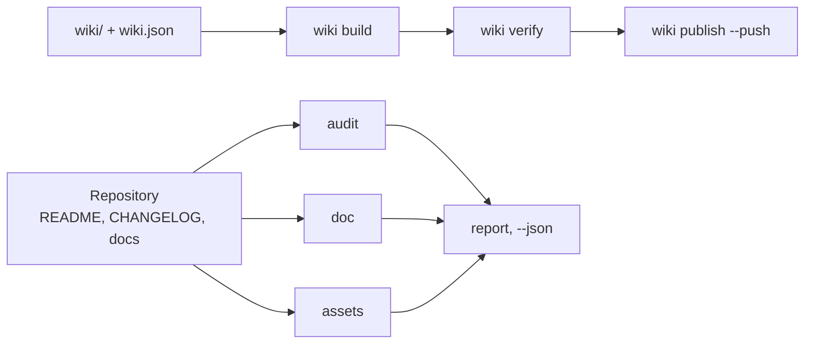

# github-agent

github-agent es un gestor de línea de órdenes escrito en Python para repositorios de GitHub y sus
wikis: puntúa el README, el CHANGELOG y los contratos de la comunidad, revisa documentos, enlaces,
anclas y tablas, busca secretos filtrados, genera el banner y la vista previa social y mantiene la
wiki en el repositorio — una orden por tarea.

<!-- md-i18n:switcher -->
**En otros idiomas:** [English](README.md) · [Deutsch](README.de.md) · [中文](README.zh.md) · [हिन्दी](README.hi.md) · Español · [Русский](README.ru.md)

[](https://github.com/paulmann/github-agent/actions/workflows/ci.yml)
[](https://www.python.org/)
[](LICENSE)
[](pyproject.toml)
[](tests/run_tests.py)


[**Instalación**](#instalación) · [**Uso**](#uso) · [**Wiki**](https://github.com/paulmann/github-agent/wiki) · [**AGENTS.md**](AGENTS.md) · [**MIGRATION.md**](MIGRATION.md) · [**Empaquetado**](docs/PACKAGING.md) · [**Changelog**](CHANGELOG.md) · [**Issues**](https://github.com/paulmann/github-agent/issues) · [**Seguridad**](SECURITY.md) · [**Versión en ruso**](README.ru.md)

Un repositorio rara vez falla por el código; falla por la documentación. El README no tiene
sección de instalación, el changelog no tiene fechas, la wiki son tres páginas sin navegación,
el banner es una imagen rota, la descripción es una sola palabra. `git push` funciona, así que
el defecto vive durante años.

Este paquete impone un contrato verificable en cada uno de esos puntos y reduce el trabajo a una
orden. No escribe texto de marketing ni inventa cifras: comprueba lo que escribió una persona y
se niega a publicar lo que está roto.

> **Estado de la documentación.** Cada cifra de este README se midió el 2026-10-30 sobre la
> versión 1.2.0 con las órdenes indicadas en la tabla. Las guías extensas están en la
> [Wiki](https://github.com/paulmann/github-agent/wiki) y en [`docs/`](docs/IMPORT.md); el protocolo
> para agentes es [`AGENTS.md`](AGENTS.md), y las notas de empaquetado y migración están en
> [`docs/PACKAGING.md`](docs/PACKAGING.md) y [`MIGRATION.md`](MIGRATION.md).

> **Para agentes.** Empiece por [`AGENTS.md`](AGENTS.md): dónde vive el paquete, cómo demostrar que
> la instalación está intacta y qué única orden sustituye cada investigación de varios archivos.

## Contenido

- [Instalación](#instalación)
- [Uso](#uso)
- [Qué hace el paquete](#qué-hace-el-paquete)
- [En cifras](#en-cifras)
- [Comprobaciones que se ejecutan](#comprobaciones-que-se-ejecutan)
- [Imágenes](#imágenes)
- [Importar en otro agente](#importar-en-otro-agente)
- [La wiki como documentación](#la-wiki-como-documentación)
- [Idiomas de la documentación](#idiomas-de-la-documentación)
- [Cómo está construido](#cómo-está-construido)
- [Limitaciones](#limitaciones)
- [Desarrollo](#desarrollo)
- [Contribuir](#contribuir)
- [Licencia](#licencia)

---

## Instalación

Se requiere Python 3.11 o posterior; la CI ejecuta la suite en 3.11 y 3.13. No hay dependencias en
tiempo de ejecución. Existen cuatro vías de instalación y no son intercambiables: los gestores de
paquetes instalan la CLI, mientras que el clon es lo que necesita
`ghagent install --profile ... --write`, porque la wheel solo contiene la CLI.

### Gestores de paquetes

```bash
uv tool install github-agent        # uv, entorno de herramientas aislado
pipx install github-agent           # pipx, entorno virtual aislado
pip install github-agent            # pip en el entorno activo
ghagent --version
```

> **Estado de PyPI.** Estos comandos funcionan a partir de la primera publicación: Trusted
> Publishing lo configura el propietario del repositorio y el flujo `Publish` se lanza a mano.
> Hasta entonces, instala la wheel de la [última versión](https://github.com/paulmann/github-agent/releases/latest)
> o usa el clon de código fuente de más abajo: ambos proporcionan el mismo comando `ghagent`.

El script de consola es `ghagent`; el paquete en PyPI es `github-agent`.

### Soporte PNG opcional

`assets render` siempre escribe el SVG. La salida PNG necesita Pillow, que es un extra opcional:

```bash
pip install "github-agent[png]"
uv tool install --with pillow github-agent
```

Sin Pillow la orden explica por qué no hay PNG en lugar de fingir que la vista previa social está
lista.

### Desde el código fuente (clon)

El clon es la segunda vía de instalación y la única que incluye `tests/`, `skills/`, `reference/`,
`wiki/` y las plantillas, así que también es la que necesitan `install`, `verify-install`, `snippet`
y `uninstall`. Una instalación editable añade la orden `ghagent` al checkout:

```bash
git clone https://github.com/paulmann/github-agent.git
cd github-agent
pip install -e .
python tools/ghagent.py selftest
```

### Docker

El repositorio incluye un `Dockerfile`; constrúyalo en local y monte el repositorio bajo prueba en
`/repo`, que es el directorio de trabajo de la imagen:

```bash
docker build -t ghagent .
docker run --rm -v "$PWD:/repo" ghagent audit .
```

En Windows PowerShell el mismo montaje es `-v "${PWD}:/repo"`. El punto de entrada es `ghagent`,
así que el primer argumento tras el nombre de la imagen es la orden. No se publica ninguna imagen
de registro como parte de 1.2.0 y la CI no construye el contenedor: la etiqueta es una convención
local. Véase [examples/docker.md](examples/docker.md).

### GitHub Action

La acción compuesta instala el paquete desde su propio checkout, así que no depende de una
publicación en PyPI y funciona en cuanto existe la etiqueta:

```yaml
- uses: actions/checkout@v4
- uses: paulmann/github-agent@v1.2.0    # fije la etiqueta de la versión
  with:
    command: audit .
    min-score: "80"
```

| Entrada | Valor predeterminado | Propósito |
|---|---|---|
| `command` | `audit . --min-score 80` | cualquier orden de `ghagent`, sin el nombre del programa |
| `min-score` | `80` | umbral de puntuación, aplicado solo cuando `command` empieza por `audit` y no pasa ningún indicador |
| `working-directory` | `.` | directorio del repositorio donde se ejecuta la orden, relativo a `$GITHUB_WORKSPACE` |
| `python-version` | `3.13` | intérprete instalado por `actions/setup-python` |
| `github-token` | `${{ github.token }}` | exportado como `GITHUB_TOKEN` para las órdenes de metadatos |

Para una orden que no sea de auditoría, la acción ejecuta exactamente la cadena de argumentos dada,
por ejemplo `command: doc --root .`. No hay salidas: el código de salida del paso es el resultado
(`0` limpio, `1` hallazgos, `2` problema de uso o de entorno). Un flujo de trabajo completo, con un
segundo trabajo que ejecuta `doc` y una alternativa con Docker, está en
[examples/ci-usage.md](examples/ci-usage.md).

### pre-commit

El repositorio también es fuente de hooks de pre-commit; los hooks son `ghagent-doc`,
`ghagent-audit`, `ghagent-privacy` y `ghagent-changelog`:

```yaml
repos:
  - repo: https://github.com/paulmann/github-agent
    rev: v1.2.0     # marcador: fije la etiqueta de versión en la que confíe
    hooks:
      - id: ghagent-doc
      - id: ghagent-audit
      - id: ghagent-privacy
      - id: ghagent-changelog
```

Instale los hooks en el repositorio consumidor con `pre-commit install`. El archivo completo del
consumidor es [examples/pre-commit-config.yaml](examples/pre-commit-config.yaml); las definiciones
de los hooks están en [.pre-commit-hooks.yaml](.pre-commit-hooks.yaml). Los hooks necesitan una
etiqueta publicada, porque pre-commit construye la herramienta desde el árbol etiquetado.

### Instalación verificada

Tras cualquier instalación, una orden responde si la CLI es la compilación publicada:

```bash
ghagent --version     # imprime la versión, por ejemplo github-agent 1.2.0
ghagent audit .       # 0 limpio, 1 hallazgos de nivel de error, 2 problema de uso o de entorno
```

En un clon se ejecuta la suite completa de autopruebas; la wheel solo contiene la CLI, así que allí
`ghagent selftest` termina con `2` y un mensaje que remite al clon, en lugar de informar un `PASS`
falso:

```bash
git clone https://github.com/paulmann/github-agent.git
cd github-agent
python tools/ghagent.py selftest    # 173/173 pruebas superadas
```

## Uso

```bash
ghagent audit .                    # puntúa la higiene del repositorio, salida 1 si hay errores
ghagent doc --root .               # markdown, enlaces, anclas, tablas, índice
ghagent privacy --root .           # tokens, claves privadas, rutas de la máquina, direcciones personales
ghagent assets render --write      # banner y vista previa social a partir de los metadatos del repositorio
ghagent assets check               # formato, dimensiones, texto alternativo, archivos referenciados
ghagent wiki build                 # reescribe enlaces para el espacio de nombres de la wiki
ghagent wiki verify                # todo enlace interno resuelve
ghagent changelog check            # Keep a Changelog y SemVer
ghagent changelog release 1.2.0 --write
ghagent meta suggest               # descripción y temas
```

Todas las órdenes aceptan `--json`; los hallazgos se imprimen como `file:line` con un identificador
de regla, así que quien llama no necesita analizar prosa.

| Código de salida | Significado |
|---|---|
| `0` | sin hallazgos de nivel de error |
| `1` | hallazgos de nivel de error, cada uno impreso con `file:line` |
| `2` | problema de uso o de entorno: ruta incorrecta, archivo ausente, falta `gh` o el token |

Ejemplo de salida de `audit`, de un repositorio que falla a propósito y no de este árbol:

```text
[ERROR] repo.contributing        CONTRIBUTING.md is absent  hint: add CONTRIBUTING.md
[WARN ] readme.badges            only 1 badge(s)  hint: 3-8 badges: CI, release, license, runtime
[ERROR] changelog.date-missing   version 1.1.0 has no ISO date  CHANGELOG.md:14
score: 72.5% (22 scored, 1 skipped)
```

## Qué hace el paquete

| Tarea | Una orden |
|---|---|
| Puntuar un repositorio | `ghagent audit .` |
| Revisar documentos, enlaces y anclas | `ghagent doc --root .` |
| Encontrar secretos y rutas de la máquina | `ghagent privacy --root .` |
| Generar el banner y la vista previa social | `ghagent assets render --write` |
| Construir, verificar y publicar la wiki | `ghagent wiki build`, `verify`, `publish --push` |
| Publicar una versión | `ghagent changelog release 1.2.0 --write` |
| Corregir la descripción y los temas | `ghagent meta apply --repo owner/name --write` |
| Instalar la skill en otro agente | `ghagent install --profile harness --write` |

La CLI tiene 13 órdenes; la tabla nombra las de uso diario. El resto (`report`, `snippet`,
`verify-install`, `uninstall`, `selftest`, `assets suggest`, `changelog suggest`,
`changelog notes`, `meta suggest`, `wiki init`, `wiki publish`) se enumera con sus indicadores en
[`AGENTS.md`](AGENTS.md).

## En cifras

Medido en este árbol el 2026-10-30 sobre la versión 1.2.0:

| Ámbito | Valor | Fuente de la medición |
|---|---:|---|
| Autopruebas | 173 | `python tests/run_tests.py` |
| Órdenes de la CLI | 13 | `ghagent --help` |
| Módulos de la biblioteca | 11 | `tools/ghalib/*.py` |
| Reglas de documento examinadas en este árbol | 17 | `ghagent doc --json`, campo `rules_examined` |
| Dependencias en tiempo de ejecución | 0 | `pyproject.toml`, `dependencies = []` |
| Trampas de la plataforma registradas | 15 | la tabla de trampas en [docs/RULES.md](docs/RULES.md#platform-traps) |
| Líneas de Python | 4176 | `wc -l tools/ghagent.py tools/ghalib/*.py` |

## Comprobaciones que se ejecutan

| Grupo | Reglas |
|---|---|
| Texto | UTF-8 sin BOM, LF en lugar de CRLF, salto de línea final, sin sangría con tabuladores |
| Estructura | un único `H1`, sin niveles de encabezado saltados, bloques de código cerrados, idioma en cada bloque |
| Tablas | el número de celdas de cada fila coincide con el encabezado y el separador |
| Enlaces | el archivo relativo existe, el ancla existe (incluido el cirílico) |
| Índice | cada entrada resuelve, ningún `H2` queda olvidado |
| Marcado | los cinco tipos de alerta, texto alternativo en las imágenes, ninguna imagen por `http://` |
| Privacidad | tokens, claves privadas, rutas absolutas de la máquina, direcciones personales |
| Imágenes | banner referenciado, la vista previa es PNG/JPG/GIF, menos de 1 MB, al menos 640×320 |
| Wiki | el manifiesto y los archivos coinciden, `Home`/`_Sidebar`/`_Footer` presentes, sin enlaces `.md`, sin imágenes relativas |
| CHANGELOG | SemVer y fecha ISO por versión, la más reciente primero, tipos conocidos, sin versión vacía, enlaces de comparación |
| Archivo de agentes | el `AGENTS.md` canónico de la raíz sigue siendo un mapa: más de 120 líneas es una advertencia y el detalle pertenece a `docs/` |
| Metadatos | descripción de menos de 200 caracteres sin prefijo inútil, de 8 a 20 temas en minúsculas con guiones |

Una regla que examinó cero objetos no se considera superada: se informa como `coverage.skipped`,
y un árbol vacío es `doc.no-text-files`.

## Imágenes

El banner de la parte superior de este archivo lo genera el propio paquete:

```bash
ghagent assets render --title "github-agent" \
    --tagline "Repository and wiki steward for AI agents: one command per job." \
    --command "ghagent audit ." --chips "python,github,wiki,lint" --write
```

- `assets/social-preview.png` — 1280×640, menos de 1 MB, listo para **Settings → Social preview**.
- `assets/social-preview.svg` — gemelo vectorial para el README, sin dependencias.
- `assets check` verifica formato, tamaño en bytes, dimensiones, texto alternativo y que exista
  cada archivo referenciado. La copia del repositorio no es la vista previa social de forma
  automática: esa carga es un paso manual, y la comprobación imprime el recordatorio.

## Importar en otro agente

| Agente | Raíz de skills | Qué hacer |
|---|---|---|
| AutoClaw2 | `%USERPROFILE%\.pi\agent\skills` | `install --profile autoclaw --write`, luego pegar el bloque `snippet` en su `AGENTS.md` |
| HARNESS | `%USERPROFILE%\.dsh\skills` | `install --profile harness --write`, el mismo bloque |
| SagaAI | cualquier directorio | `install --target <dir> --write` y el bloque de `snippet --target <dir>` |

El bloque `snippet` indica la ruta del paquete, la orden de verificación y una regla: una tarea,
una orden. Tras la importación, el agente debe ejecutar `verify-install` y obtener `0`; cualquier
otra cosa significa que la copia instalada no es la probada. Esta es la única vía que necesita el
clon en lugar de la wheel, porque la wheel solo contiene la CLI. Detalles:
[docs/IMPORT.md](docs/IMPORT.md).

## La wiki como documentación

La wiki se mantiene desde el repositorio: las páginas viven en `wiki/` y el orden lo fija
`wiki/wiki.json`. `wiki build` reescribe los enlaces para el espacio de nombres de la wiki — los
enlaces internos pierden `.md`, los enlaces al árbol del repositorio se vuelven absolutos y una
imagen relativa es un error, porque el repositorio de la wiki no ve el árbol del proyecto.

Construida y verificada con las órdenes del propio paquete. La publicación requiere una acción en
la interfaz de GitHub: `<repo>.wiki.git` no existe hasta que se guarda una primera página, y
`git push` no puede crearlo — en ese caso `wiki publish` devuelve `wiki.remote-missing` junto con
ese paso. El flujo completo está en [docs/WIKI.md](docs/WIKI.md).

## Idiomas de la documentación

Los archivos en inglés son la versión canónica; las traducciones al ruso llevan el sufijo
`.ru.md`, la convención que usa GitHub (`README.ru.md`, `AGENTS.ru.md`, `wiki/01-Why.ru.md`).

| Inglés | Ruso |
|---|---|
| [README.md](README.md) | [README.ru.md](README.ru.md) |
| [AGENTS.md](AGENTS.md) | [AGENTS.ru.md](AGENTS.ru.md) |
| [CHANGELOG.md](CHANGELOG.md) | [CHANGELOG.ru.md](CHANGELOG.ru.md) |
| [CONTRIBUTING.md](CONTRIBUTING.md) | [CONTRIBUTING.ru.md](CONTRIBUTING.ru.md) |
| [SECURITY.md](SECURITY.md) | [SECURITY.ru.md](SECURITY.ru.md) |
| [SUPPORT.md](SUPPORT.md) | [SUPPORT.ru.md](SUPPORT.ru.md) |
| [CODE_OF_CONDUCT.md](CODE_OF_CONDUCT.md) | [CODE_OF_CONDUCT.ru.md](CODE_OF_CONDUCT.ru.md) |
| [GOVERNANCE.md](GOVERNANCE.md) | [GOVERNANCE.ru.md](GOVERNANCE.ru.md) |

Las traducciones se actualizan en el mismo commit que el original. Una traducción que se queda
atrás en silencio es un defecto de documentación, y la wiki lleva ambos conjuntos: páginas en
inglés como canónicas y páginas en ruso como `*.ru.md` en su propio grupo de navegación.

## Cómo está construido



| Componente | Responsabilidad |
|---|---|
| `tools/ghagent.py` | análisis de argumentos, códigos de salida, composición del informe |
| `tools/ghalib/mdcheck.py` | markdown, enlaces, anclas, privacidad |
| `tools/ghalib/audit.py` | archivos obligatorios, contratos de README y changelog, puntuación |
| `tools/ghalib/assets.py` | banner y vista previa social: generar, comprobar, sugerir |
| `tools/ghalib/wiki.py` | manifiesto, reescritura de enlaces, barra lateral y pie, publicación |
| `tools/ghalib/changelog.py` | Keep a Changelog 2.0.0, release, borrador a partir de los commits |
| `tools/ghalib/meta.py` | descripción, temas, página principal |
| `tools/ghalib/install.py` | instalación de la skill, manifiesto sha256, deriva, eliminación |
| `tools/ghalib/report.py` | hallazgos, gravedades, salida en Markdown y `--json` |
| `tools/ghalib/config.py`, `tools/ghalib/util.py` | `.ghagent.json`, rutas, E/S de texto, anclas |
| `tests/run_tests.py` | 173 autopruebas con fixtures y señuelos |

Las anclas siguen las reglas de GitHub: minúsculas, se elimina la puntuación, los espacios pasan a
guiones y un encabezado repetido recibe `-1`. La regla se verificó contra un índice real: un guion
largo en un encabezado produce un doble guion. Notas de arquitectura:
[docs/ARCHITECTURE.md](docs/ARCHITECTURE.md).

## Limitaciones

- `audit --repo` y `meta` necesitan `gh` o `GITHUB_TOKEN`. Sin ellos, la orden devuelve un error en
  lugar de un éxito vacío.
- Los enlaces externos no se descargan: se comprueban las rutas relativas, las anclas y la
  estructura. Rastrear la red es una decisión aparte, no un efecto secundario de un linter.
- Las páginas de la wiki apenas se descubren en los buscadores: según la documentación de GitHub,
  solo se indexan las wikis con 500 estrellas o más y la edición pública desactivada. Para el
  descubrimiento, usa GitHub Pages.
- `changelog suggest` es un borrador. No sabe qué le importa a un usuario.
- La generación de PNG necesita Pillow. Sin él se produce el SVG y la comprobación explica por qué
  no hay PNG, en lugar de fingir que la vista previa social está lista.

## Desarrollo

```bash
python tools/ghagent.py selftest
python tests/run_tests.py
python tools/ghagent.py doc --root .
python tools/ghagent.py audit .
python tools/ghagent.py assets check
```

Una regla nueva llega con un fixture que falla sin ella y un señuelo que debe permanecer en
silencio. Una regla sin fixture se elimina: una comprobación que no se puede demostrar es peor que
ninguna. El empaquetado y el diseño de la wheel se describen en
[docs/PACKAGING.md](docs/PACKAGING.md); los cambios de 1.1.0 → 1.2.0 están en
[MIGRATION.md](MIGRATION.md).

## Contribuir

Antes de un pull request, `python tests/run_tests.py` y `python tools/ghagent.py doc --root .`
deben estar en verde. Un cambio, una razón. Reglas: [CONTRIBUTING.md](CONTRIBUTING.md); política
de seguridad: [SECURITY.md](SECURITY.md).

## Licencia

[MIT](LICENSE).
