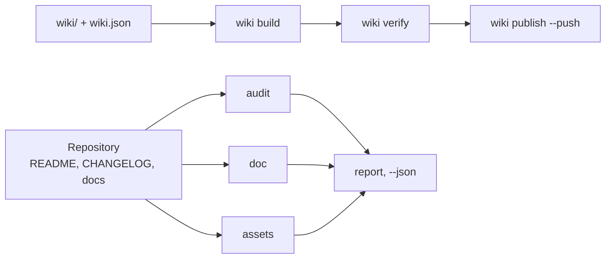

# github-agent

<!-- md-i18n:switcher -->
**अन्य भाषाओं में:** [English](README.md) · [Deutsch](README.de.md) · [中文](README.zh.md) · हिन्दी · [Español](README.es.md) · [Русский](README.ru.md)

**AI एजेंटों के लिए GitHub रिपॉज़िटरी और विकि का संचालक: README, CHANGELOG और समुदाय-स्वास्थ्य
का ऑडिट करता है, बैनर और सोशल प्रीव्यू रेंडर करता है, विकि बनाता और प्रकाशित करता है, लिंक,
एंकर और विषयों की जाँच करता है — हर काम के लिए एक कमांड। Python 3, केवल मानक लाइब्रेरी।**

[](https://github.com/paulmann/github-agent/actions/workflows/ci.yml)
[](LICENSE)
[](https://www.python.org/)
[](tools/ghagent.py)
[](tests/run_tests.py)


[**इंस्टॉलेशन**](#इंस्टॉलेशन) · [**उपयोग**](#उपयोग) · [**चित्र**](#चित्र) · [**विकि**](https://github.com/paulmann/github-agent/wiki) · [**AGENTS.md**](AGENTS.md) · [**Changelog**](CHANGELOG.md) · [**मुद्दे**](https://github.com/paulmann/github-agent/issues) · [**सुरक्षा**](SECURITY.md) · [**Русская версия**](README.ru.md)

रिपॉज़िटरी कोड पर कम ही विफल होती है; वह दस्तावेज़ पर विफल होती है। README में इंस्टॉलेशन खंड
नहीं है, changelog में तारीखें नहीं हैं, विकि नेविगेशन के बिना तीन पृष्ठों की है, बैनर एक टूटी हुई छवि है,
विवरण एक ही शब्द है। `git push` सफल हो जाता है, इसलिए दोष वर्षों तक जीवित रहता है।

यह पैक इनमें से हर जगह पर एक सत्यापन-योग्य अनुबंध रखता है और काम को एक कमांड तक सीमित कर
देता है। यह मार्केटिंग कॉपी नहीं लिखता और संख्याएँ नहीं गढ़ता: यह जाँचता है कि मनुष्य ने क्या
लिखा, और जो टूटा है उसे प्रकाशित करने से मना कर देता है।

> **दस्तावेज़ की स्थिति।** इस README का हर आँकड़ा 2026-10-24 को संस्करण 1.1.0 के विरुद्ध, तालिका
> में नामित कमांडों से मापा गया। विस्तृत मार्गदर्शिकाएँ
> [Wiki](https://github.com/paulmann/github-agent/wiki) और [`docs/`](docs/) में रहती हैं; एजेंटों
> के लिए प्रोटोकॉल [`AGENTS.md`](AGENTS.md) है।

## विषय-सूची

- [यह पैक क्या करता है](#यह-पैक-क्या-करता-है)
- [संख्याओं में](#संख्याओं-में)
- [इंस्टॉलेशन](#इंस्टॉलेशन)
- [उपयोग](#उपयोग)
- [कौन-सी जाँचें चलती हैं](#कौन-सी-जाँचें-चलती-हैं)
- [चित्र](#चित्र)
- [दूसरे एजेंट में आयात](#दूसरे-एजेंट-में-आयात)
- [दस्तावेज़ के रूप में विकि](#दस्तावेज़-के-रूप-में-विकि)
- [दस्तावेज़ की भाषाएँ](#दस्तावेज़-की-भाषाएँ)
- [यह कैसे बना है](#यह-कैसे-बना-है)
- [सीमाएँ](#सीमाएँ)
- [विकास](#विकास)
- [योगदान](#योगदान)
- [लाइसेंस](#लाइसेंस)

---

## यह पैक क्या करता है

| काम | एक कमांड |
|---|---|
| रिपॉज़िटरी को अंक देना | `ghagent.py audit .` |
| दस्तावेज़ों, लिंकों और एंकरों का लिंट | `ghagent.py doc --root .` |
| सीक्रेट और मशीन पथ खोजना | `ghagent.py privacy --root .` |
| बैनर और सोशल प्रीव्यू रेंडर करना | `ghagent.py assets render --write` |
| विकि बनाना, सत्यापित करना और प्रकाशित करना | `ghagent.py wiki build`, `verify`, `publish --push` |
| संस्करण जारी करना | `ghagent.py changelog release 1.2.0 --write` |
| विवरण और विषय ठीक करना | `ghagent.py meta apply --repo owner/name --write` |
| स्किल को दूसरे एजेंट में इंस्टॉल करना | `ghagent.py install --profile harness --write` |

हर कमांड निष्कर्ष `file:line` के रूप में नियम-आईडी के साथ छापता है, और लौटाता है `0` — स्वच्छ,
`1` — त्रुटियों के साथ, `2` — कॉल में गड़बड़ी पर। इसलिए एजेंट को अपनी स्थिति जानने के लिए पूरा
ट्री पढ़ने की ज़रूरत नहीं: एक कमांड और एक एग्ज़िट कोड पर्याप्त हैं।

## संख्याओं में

इस ट्री में 2026-10-24 को मापा गया:

| पक्ष | मान | माप का स्रोत |
|---|---:|---|
| स्वयं-परीक्षण | 134 | `tests/run_tests.py` |
| CLI कमांड | 13 | `tools/ghagent.py --help` |
| लाइब्रेरी मॉड्यूल | 11 | `tools/ghalib/*.py` |
| इस ट्री पर जाँचे गए नियम | 17 | `doc --json`, फ़ील्ड `rules_examined` |
| रनटाइम निर्भरताएँ | 0 | `tools/` में आयात |
| दर्ज किए गए प्लेटफ़ॉर्म जाल | 15 | [AGENTS.md](AGENTS.md#platform-traps) |
| Python पंक्तियाँ | 3400 | `tools/**/*.py` |

## इंस्टॉलेशन

केवल Python 3.11+ चाहिए (3.13.15 पर सत्यापित)। कोई `pip install` नहीं, कोई बिल्ड चरण नहीं।
Pillow वैकल्पिक है: उसके साथ `assets render` PNG भी बनाता है, उसके बिना केवल SVG।

```bash
git clone https://github.com/paulmann/github-agent.git
cd github-agent

python tools/ghagent.py selftest
```

किसी एजेंट में स्किल इंस्टॉल करने पर यह पैक उस एजेंट के स्किल रूट में कॉपी हो जाता है, sha256
मैनिफ़ेस्ट के साथ:

```bash
python tools/ghagent.py install --profile autoclaw --write   # AutoClaw2
python tools/ghagent.py install --profile harness  --write   # HARNESS
python tools/ghagent.py install --target <dir>     --write   # SagaAI and anything else
```

सत्यापन और वापसी:

```bash
python tools/ghagent.py verify-install --profile autoclaw
python tools/ghagent.py uninstall --profile autoclaw --write
```

`uninstall` ऐसी निर्देशिका हटाने से मना कर देता है जिसमें `.install.json` नहीं है: उसे वह नहीं
हटाना चाहिए जो किसी दूसरे उपकरण ने इंस्टॉल किया हो।

## उपयोग

```bash
# 1. state of a local repository (exit 1 means errors)
python tools/ghagent.py audit .

# 2. the same for GitHub metadata
python tools/ghagent.py audit --repo owner/name --http

# 3. documents: BOM, CRLF, headings, tables, links, anchors, table of contents
python tools/ghagent.py doc --root .

# 4. images: render from metadata, then verify size, format and references
python tools/ghagent.py assets render --title "Project" --tagline "What it does." --write
python tools/ghagent.py assets check

# 5. wiki: build, verify, publish (without --push it is a dry run)
python tools/ghagent.py wiki build
python tools/ghagent.py wiki verify
python tools/ghagent.py wiki publish --repo owner/name --push

# 6. changelog
python tools/ghagent.py changelog check
python tools/ghagent.py changelog suggest --since v1.0.0
python tools/ghagent.py changelog release 1.1.0 --write
python tools/ghagent.py changelog notes 1.1.0

# 7. metadata: description and topics
python tools/ghagent.py meta suggest
python tools/ghagent.py meta apply --repo owner/name --description "…" --topics a,b --write

# 8. one combined report
python tools/ghagent.py report . --out AUDIT.md
```

`audit` के आउटपुट का उदाहरण:

```text
[ERROR] repo.contributing        CONTRIBUTING.md is absent  hint: add CONTRIBUTING.md
[WARN ] readme.badges            only 1 badge(s)  hint: 3-8 badges: CI, release, license, runtime
[ERROR] changelog.date-missing   version 1.1.0 has no ISO date  CHANGELOG.md:14
score: 72.5% (22 scored, 1 skipped)
```

## कौन-सी जाँचें चलती हैं

| समूह | नियम |
|---|---|
| पाठ | BOM के बिना UTF-8, CRLF के बजाय LF, अंत में नई पंक्ति, टैब से इंडेंट नहीं |
| संरचना | एक `H1`, शीर्षक-स्तर नहीं छूटते, कोड फ़ेंस बंद, हर फ़ेंस पर भाषा |
| तालिकाएँ | हर पंक्ति की कोशिकाओं की संख्या शीर्षलेख और विभाजक से मेल खाती है |
| लिंक | सापेक्ष फ़ाइल मौजूद है, एंकर मौजूद है (सिरिलिक सहित) |
| विषय-सूची | हर प्रविष्टि खुलती है, कोई `H2` भूला नहीं जाता |
| मार्कअप | पाँच अलर्ट प्रकार, छवियों पर alt टेक्स्ट, `http://` से कोई छवि नहीं |
| गोपनीयता | टोकन, निजी कुंजियाँ, मशीन के निरपेक्ष पथ, व्यक्तिगत पते |
| चित्र | बैनर संदर्भित है, प्रीव्यू PNG/JPG/GIF है, 1 MB से कम, कम से कम 640×320 |
| विकि | मैनिफ़ेस्ट और फ़ाइलें सहमत, `Home`/`_Sidebar`/`_Footer` मौजूद, `.md` लिंक नहीं, सापेक्ष छवि नहीं |
| CHANGELOG | हर संस्करण पर SemVer और ISO तारीख, नवीनतम सबसे ऊपर, ज्ञात प्रकार, खाली संस्करण नहीं, तुलना लिंक |
| मेटाडेटा | विवरण 200 अक्षरों से कम, बिना बेकार उपसर्ग, 8–20 छोटे-अक्षर हाइफ़न-युक्त विषय |

जिस नियम ने एक भी ऑब्जेक्ट नहीं देखा, वह पास नहीं माना जाता: उसे `coverage.skipped` के रूप में दर्ज
किया जाता है, और खाली ट्री `doc.no-text-files` होती है।

## चित्र

इस फ़ाइल के शीर्ष पर बैनर पैक स्वयं बनाता है:

```bash
python tools/ghagent.py assets render --title "github-agent" \
    --tagline "Repository and wiki steward for AI agents: one command per job." \
    --command "ghagent.py audit ." --chips "python,github,wiki,lint" --write
```

- `assets/social-preview.png` — 1280×640, 1 MB से कम, **Settings → Social preview** के लिए तैयार।
- `assets/social-preview.svg` — README के लिए वेक्टर जुड़वाँ, किसी निर्भरता की ज़रूरत नहीं।
- `assets check` प्रारूप, बाइट आकार, माप, alt टेक्स्ट और यह जाँचता है कि हर संदर्भित फ़ाइल मौजूद
  है। रिपॉज़िटरी में रखी प्रति अपने आप सोशल प्रीव्यू नहीं बनती: वह अपलोड मैनुअल चरण है, और जाँच
  उसकी याद दिलाती है।

## दूसरे एजेंट में आयात

| एजेंट | स्किल रूट | क्या करना है |
|---|---|---|
| AutoClaw2 | `%USERPROFILE%\.pi\agent\skills` | `install --profile autoclaw --write`, फिर `snippet` ब्लॉक उसके `AGENTS.md` में चिपकाएँ |
| HARNESS | `%USERPROFILE%\.dsh\skills` | `install --profile harness --write`, वही ब्लॉक |
| SagaAI | कोई भी निर्देशिका | `install --target <dir> --write` और `snippet --target <dir>` से मिला ब्लॉक |

`snippet` ब्लॉक पैक का पथ, सत्यापन कमांड और एक नियम बताता है: एक काम, एक कमांड। आयात के बाद
एजेंट को `verify-install` चलाकर `0` पाना चाहिए; कुछ और मिलने का अर्थ है कि इंस्टॉल की गई प्रति
परीक्षित प्रति नहीं है। विवरण: [docs/IMPORT.md](docs/IMPORT.md)।

## दस्तावेज़ के रूप में विकि

विकि रिपॉज़िटरी से ही बनाए रखी जाती है: पृष्ठ `wiki/` में रहते हैं, क्रम `wiki/wiki.json` तय
करता है। `wiki build` विकि नेमस्पेस के लिए लिंक फिर से लिखता है — आंतरिक लिंक से `.md` हट जाता
है, रिपॉज़िटरी ट्री की ओर जाने वाले लिंक निरपेक्ष हो जाते हैं, और सापेक्ष छवि त्रुटि है क्योंकि
विकि रिपॉज़िटरी प्रोजेक्ट ट्री नहीं देख सकती।

पैक के अपने कमांडों से बनाई और सत्यापित। प्रकाशन के लिए GitHub इंटरफ़ेस में एक क्रिया चाहिए:
पहला पृष्ठ सहेजे जाने तक `<repo>.wiki.git` मौजूद नहीं होता, और `git push` उसे बना नहीं सकता —
तब `wiki publish` उस चरण के साथ `wiki.remote-missing` लौटाता है।

## दस्तावेज़ की भाषाएँ

अंग्रेज़ी फ़ाइलें मूल हैं; रूसी अनुवादों पर `.ru.md` प्रत्यय रहता है — वही परंपरा जो GitHub
स्वयं उपयोग करता है (`README.ru.md`, `AGENTS.ru.md`, `wiki/01-Why.ru.md`)।

| अंग्रेज़ी | रूसी |
|---|---|
| [README.md](README.md) | [README.ru.md](README.ru.md) |
| [AGENTS.md](AGENTS.md) | [AGENTS.ru.md](AGENTS.ru.md) |
| [CHANGELOG.md](CHANGELOG.md) | [CHANGELOG.ru.md](CHANGELOG.ru.md) |
| [CONTRIBUTING.md](CONTRIBUTING.md) | [CONTRIBUTING.ru.md](CONTRIBUTING.ru.md) |
| [SECURITY.md](SECURITY.md) | [SECURITY.ru.md](SECURITY.ru.md) |
| [SUPPORT.md](SUPPORT.md) | [SUPPORT.ru.md](SUPPORT.ru.md) |
| [CODE_OF_CONDUCT.md](CODE_OF_CONDUCT.md) | [CODE_OF_CONDUCT.ru.md](CODE_OF_CONDUCT.ru.md) |
| [GOVERNANCE.md](GOVERNANCE.md) | [GOVERNANCE.ru.md](GOVERNANCE.ru.md) |

अनुवाद मूल के उसी कमिट में अद्यतन होते हैं। चुपचाप पीछे छूटा अनुवाद दस्तावेज़ का दोष है, और
विकि दोनों सेट रखती है: अंग्रेज़ी पृष्ठ मूल के रूप में, रूसी `*.ru.md` पृष्ठ अपने अलग नेविगेशन
समूह में।

## यह कैसे बना है



| घटक | ज़िम्मेदारी |
|---|---|
| `tools/ghagent.py` | आर्ग्युमेंट पार्सिंग, एग्ज़िट कोड, रिपोर्ट संयोजन |
| `tools/ghalib/mdcheck.py` | markdown, लिंक, एंकर, गोपनीयता |
| `tools/ghalib/audit.py` | अनिवार्य फ़ाइलें, README और changelog अनुबंध, अंक |
| `tools/ghalib/assets.py` | बैनर और सोशल प्रीव्यू: रेंडर, जाँच, सुझाव |
| `tools/ghalib/wiki.py` | मैनिफ़ेस्ट, लिंक का पुनर्लेखन, साइडबार और फ़ुटर, प्रकाशन |
| `tools/ghalib/changelog.py` | Keep a Changelog 2.0.0, रिलीज़, कमिटों से मसौदा |
| `tools/ghalib/meta.py` | विवरण, विषय, होमपेज |
| `tools/ghalib/install.py` | स्किल इंस्टॉलेशन, sha256 मैनिफ़ेस्ट, विचलन, हटाना |
| `tests/run_tests.py` | फ़िक्स्चर और जाल-फ़ाइलों सहित 134 स्वयं-परीक्षण |

एंकर GitHub के नियमों का पालन करते हैं: छोटे अक्षर, विराम-चिह्न हटते हैं, स्थान हाइफ़न बनते हैं,
दोहराया गया शीर्षक `-1` पाता है। यह नियम जीवंत विषय-सूची पर जाँचा गया: शीर्षक में em dash दोहरा
हाइफ़न बनाता है।

## सीमाएँ

- `audit --repo` और `meta` को `gh` या `GITHUB_TOKEN` चाहिए। उनके बिना कमांड खाली सफलता के बजाय
  त्रुटि लौटाता है।
- बाहरी लिंक नहीं खींचे जाते: सापेक्ष पथ, एंकर और संरचना जाँची जाती है। नेटवर्क क्रॉल अलग निर्णय
  है, लिंटर का दुष्प्रभाव नहीं।
- विकि पृष्ठ खोज इंजनों के ज़रिए लगभग नहीं मिलते: GitHub के दस्तावेज़ के अनुसार केवल 500+ स्टार
  और सार्वजनिक संपादन बंद वाली विकियाँ अनुक्रमित होती हैं। खोजे जाने के लिए GitHub Pages का
  उपयोग करें।
- `changelog suggest` एक मसौदा है। यह नहीं जानता कि उपयोगकर्ता के लिए क्या महत्वपूर्ण है।
- PNG रेंडरिंग के लिए Pillow चाहिए। उसके बिना SVG बनता है और जाँच बताती है कि PNG क्यों नहीं है,
  बजाय यह दिखाने के कि सोशल प्रीव्यू तैयार है।

## विकास

```bash
python tools/ghagent.py selftest
python tests/run_tests.py
python tools/ghagent.py doc --root .
python tools/ghagent.py audit .
python tools/ghagent.py assets check
```

नया नियम ऐसे फ़िक्स्चर के साथ आता है जो उसके बिना विफल होता है, और ऐसी जाल-फ़ाइल के साथ जो चुप
रहनी चाहिए। बिना फ़िक्स्चर वाला नियम हटा दिया जाता है: जिस जाँच को सिद्ध न किया जा सके, वह जाँच
न होने से बुरी है।

## योगदान

पुल रिक्वेस्ट से पहले `python tests/run_tests.py` और `python tools/ghagent.py doc --root .` हरे
होने चाहिए। एक बदलाव, एक कारण। नियम: [CONTRIBUTING.md](CONTRIBUTING.md), सुरक्षा
नीति: [SECURITY.md](SECURITY.md)।

## लाइसेंस

[MIT](LICENSE).
