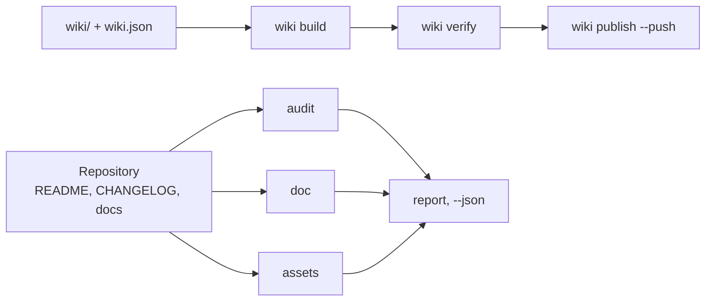

# github-agent

github-agent, GitHub रिपॉज़िटरी और उनकी विकि के लिए एक Python कमांड-लाइन संचालक है: यह README,
CHANGELOG और समुदाय के अनुबंधों को अंक देता है, दस्तावेज़, लिंक, एंकर और तालिकाओं का लिंट करता है,
लीक हुए सीक्रेट खोजता है, बैनर और सोशल प्रीव्यू रेंडर करता है और विकि को रिपॉज़िटरी में रखता है —
हर काम के लिए एक कमांड।

<!-- md-i18n:switcher -->
**अन्य भाषाओं में:** [English](README.md) · [Deutsch](README.de.md) · [中文](README.zh.md) · हिन्दी · [Español](README.es.md) · [Русский](README.ru.md)

[](https://github.com/paulmann/github-agent/actions/workflows/ci.yml)
[](https://www.python.org/)
[](LICENSE)
[](pyproject.toml)
[](tests/run_tests.py)


[**इंस्टॉलेशन**](#इंस्टॉलेशन) · [**उपयोग**](#उपयोग) · [**विकि**](https://github.com/paulmann/github-agent/wiki) · [**AGENTS.md**](AGENTS.md) · [**MIGRATION.md**](MIGRATION.md) · [**पैकेजिंग**](docs/PACKAGING.md) · [**Changelog**](CHANGELOG.md) · [**मुद्दे**](https://github.com/paulmann/github-agent/issues) · [**सुरक्षा**](SECURITY.md) · [**Русская версия**](README.ru.md)

रिपॉज़िटरी कोड पर कम ही विफल होती है; वह दस्तावेज़ पर विफल होती है। README में इंस्टॉलेशन खंड
नहीं है, changelog में तारीखें नहीं हैं, विकि नेविगेशन के बिना तीन पृष्ठों की है, बैनर एक टूटी हुई छवि है,
विवरण एक ही शब्द है। `git push` सफल हो जाता है, इसलिए दोष वर्षों तक जीवित रहता है।

यह पैक इनमें से हर जगह पर एक सत्यापन-योग्य अनुबंध रखता है और काम को एक कमांड तक सीमित कर
देता है। यह मार्केटिंग कॉपी नहीं लिखता और संख्याएँ नहीं गढ़ता: यह जाँचता है कि मनुष्य ने क्या
लिखा, और जो टूटा है उसे प्रकाशित करने से मना कर देता है।

> **दस्तावेज़ की स्थिति।** इस README का हर आँकड़ा 2026-10-30 को संस्करण 1.2.1 के विरुद्ध, तालिका
> में नामित कमांडों से मापा गया। विस्तृत मार्गदर्शिकाएँ
> [Wiki](https://github.com/paulmann/github-agent/wiki) और [`docs/`](docs/IMPORT.md) में रहती हैं;
> एजेंटों के लिए प्रोटोकॉल [`AGENTS.md`](AGENTS.md) है, और पैकेजिंग व माइग्रेशन के नोट
> [`docs/PACKAGING.md`](docs/PACKAGING.md) तथा [`MIGRATION.md`](MIGRATION.md) में हैं।

> **एजेंटों के लिए।** [`AGENTS.md`](AGENTS.md) से शुरू करें: पैक कहाँ रहता है, इंस्टॉलेशन का
> अक्षुण्ण होना कैसे सिद्ध करें, और कौन-सा एक कमांड हर बहु-फ़ाइल जाँच का स्थान लेता है।

## विषय-सूची

- [इंस्टॉलेशन](#इंस्टॉलेशन)
- [उपयोग](#उपयोग)
- [यह पैक क्या करता है](#यह-पैक-क्या-करता-है)
- [संख्याओं में](#संख्याओं-में)
- [कौन-सी जाँचें चलती हैं](#कौन-सी-जाँचें-चलती-हैं)
- [चित्र](#चित्र)
- [दूसरे एजेंट में आयात](#दूसरे-एजेंट-में-आयात)
- [दस्तावेज़ के रूप में विकि](#दस्तावेज़-के-रूप-में-विकि)
- [दस्तावेज़ की भाषाएँ](#दस्तावेज़-की-भाषाएँ)
- [यह कैसे बना है](#यह-कैसे-बना-है)
- [सीमाएँ](#सीमाएँ)
- [विकास](#विकास)
- [योगदान](#योगदान)
- [लाइसेंस](#लाइसेंस)

---

## इंस्टॉलेशन

Python 3.11 या नया चाहिए; CI सुइट को 3.11 और 3.13 पर चलाता है। कोई रनटाइम निर्भरता नहीं है। चार
इंस्टॉलेशन पथ हैं, और वे एक-दूसरे के विकल्प नहीं हैं: पैकेज प्रबंधक CLI इंस्टॉल करते हैं, जबकि
क्लोन वह है जो `ghagent install --profile ... --write` को चाहिए, क्योंकि wheel में केवल CLI होती है।

### पैकेज प्रबंधक

```bash
uv tool install github-agent-cli        # uv, अलग टूल वातावरण
pipx install github-agent-cli           # pipx, अलग आभासी वातावरण
pip install github-agent-cli            # सक्रिय वातावरण में pip
ghagent --version
```

> **PyPI स्थिति।** ये कमांड पहली बार प्रकाशित होने के बाद ही काम करेंगे: Trusted Publishing रिपॉज़िटरी
> के मालिक द्वारा सेट किया जाता है और `Publish` वर्कफ़्लो मैन्युअल रूप से चलाया जाता है। तब तक
> [नवीनतम रिलीज़](https://github.com/paulmann/github-agent/releases/latest) से wheel इंस्टॉल करें या
> नीचे दिए सोर्स क्लोन का उपयोग करें — दोनों से वही `ghagent` कमांड मिलता है।

कंसोल स्क्रिप्ट का नाम `ghagent` है; PyPI पर पैकेज का नाम `github-agent` है।

### वैकल्पिक PNG समर्थन

`assets render` हमेशा SVG लिखता है। PNG आउटपुट के लिए Pillow चाहिए, जो एक वैकल्पिक अतिरिक्त है:

```bash
pip install "github-agent-cli[png]"
uv tool install --with pillow github-agent-cli
```

Pillow के बिना कमांड बताता है कि PNG क्यों नहीं बना, सोशल प्रीव्यू को तैयार दिखाने के बजाय।

### स्रोत से (क्लोन)

क्लोन दूसरा इंस्टॉलेशन पथ है और अकेला ऐसा है जिसमें `tests/`, `skills/`, `reference/`, `wiki/`
और टेम्पलेट होते हैं; इसलिए `install`, `verify-install`, `snippet` और `uninstall` को यही चाहिए।
एडिटेबल इंस्टॉल चेकआउट में `ghagent` कमांड जोड़ देता है:

```bash
git clone https://github.com/paulmann/github-agent.git
cd github-agent
pip install -e .
python tools/ghagent.py selftest
```

### Docker

रिपॉज़िटरी में `Dockerfile` है; इसे स्थानीय रूप से बनाएँ और जाँची जाने वाली रिपॉज़िटरी को `/repo`
पर माउंट करें, जो इमेज की कार्य निर्देशिका है:

```bash
docker build -t ghagent .
docker run --rm -v "$PWD:/repo" ghagent audit .
```

Windows PowerShell में वही माउंट `-v "${PWD}:/repo"` है। एंट्री पॉइंट `ghagent` है, इसलिए इमेज के
नाम के बाद पहला आर्ग्युमेंट ही कमांड है। 1.2.1 के भाग के रूप में कोई रजिस्ट्री इमेज प्रकाशित नहीं
होती और CI कंटेनर नहीं बनाता: टैग एक स्थानीय परंपरा है। देखें
[examples/docker.md](examples/docker.md)।

### GitHub Action

यह कंपोज़िट action पैक को अपने ही चेकआउट से इंस्टॉल करता है, इसलिए यह PyPI रिलीज़ पर निर्भर नहीं है
और टैग मौजूद होते ही काम करता है:

```yaml
- uses: actions/checkout@v4
- uses: paulmann/github-agent@v1.2.1    # रिलीज़ टैग पिन करें
  with:
    command: audit .
    min-score: "80"
```

| इनपुट | डिफ़ॉल्ट | उद्देश्य |
|---|---|---|
| `command` | `audit . --min-score 80` | कोई भी `ghagent` कमांड, प्रोग्राम का नाम छोड़कर |
| `min-score` | `80` | स्कोर सीमा, केवल तब लागू जब `command` `audit` से शुरू हो और कोई फ़्लैग न दे |
| `working-directory` | `.` | वह रिपॉज़िटरी निर्देशिका जिसमें कमांड चलता है, `$GITHUB_WORKSPACE` के सापेक्ष |
| `python-version` | `3.13` | `actions/setup-python` द्वारा इंस्टॉल किया गया इंटरप्रेटर |
| `github-token` | `${{ github.token }}` | मेटाडेटा कमांडों के लिए `GITHUB_TOKEN` के रूप में निर्यात |

गैर-audit कमांड के लिए action ठीक वही आर्ग्युमेंट स्ट्रिंग चलाता है, उदाहरण के लिए
`command: doc --root .`। कोई आउटपुट नहीं होता: चरण का एग्ज़िट कोड ही परिणाम है (`0` स्वच्छ,
`1` निष्कर्ष, `2` उपयोग या वातावरण की समस्या)। एक पूरा वर्कफ़्लो, जिसमें `doc` चलाने वाला दूसरा
जॉब और Docker विकल्प शामिल है, [examples/ci-usage.md](examples/ci-usage.md) में है।

### pre-commit

यह रिपॉज़िटरी pre-commit हुक का स्रोत भी है; हुक हैं `ghagent-doc`, `ghagent-audit`,
`ghagent-privacy` और `ghagent-changelog`:

```yaml
repos:
  - repo: https://github.com/paulmann/github-agent
    rev: v1.2.1     # प्लेसहोल्डर: वह रिलीज़ टैग पिन करें जिस पर आप भरोसा करते हैं
    hooks:
      - id: ghagent-doc
      - id: ghagent-audit
      - id: ghagent-privacy
      - id: ghagent-changelog
```

`pre-commit install` से हुक को उपभोक्ता रिपॉज़िटरी में इंस्टॉल करें। पूरी उपभोक्ता फ़ाइल
[examples/pre-commit-config.yaml](examples/pre-commit-config.yaml) है; हुक परिभाषाएँ
[.pre-commit-hooks.yaml](.pre-commit-hooks.yaml) में हैं। हुक को प्रकाशित टैग चाहिए, क्योंकि
pre-commit टूल को टैग किए गए ट्री से बनाता है।

### सत्यापित इंस्टॉलेशन

किसी भी इंस्टॉल के बाद एक कमांड बताता है कि CLI जारी किया गया बिल्ड है या नहीं:

```bash
ghagent --version     # संस्करण छापता है, उदाहरण के लिए github-agent 1.2.1
ghagent audit .       # 0 स्वच्छ, 1 त्रुटि-स्तर के निष्कर्ष, 2 उपयोग या वातावरण की समस्या
```

क्लोन में पूरा स्वयं-परीक्षण सुइट चलता है; wheel में केवल CLI होती है, इसलिए वहाँ
`ghagent selftest` `2` के साथ बंद होता है और क्लोन की ओर संकेत देता है, झूठा `PASS` नहीं दिखाता:

```bash
git clone https://github.com/paulmann/github-agent.git
cd github-agent
python tools/ghagent.py selftest    # 173/173 जाँचें पास
```

## उपयोग

```bash
ghagent audit .                    # रिपॉज़िटरी स्वच्छता को अंक दें, त्रुटि पर एग्ज़िट 1
ghagent doc --root .               # markdown, लिंक, एंकर, तालिकाएँ, विषय-सूची
ghagent privacy --root .           # टोकन, निजी कुंजियाँ, मशीन पथ, व्यक्तिगत पते
ghagent assets render --write      # रिपॉज़िटरी मेटाडेटा से बैनर और सोशल प्रीव्यू
ghagent assets check               # प्रारूप, माप, alt टेक्स्ट, संदर्भित फ़ाइलें
ghagent wiki build                 # विकि नेमस्पेस के लिए लिंक फिर से लिखें
ghagent wiki verify                # हर आंतरिक लिंक खुलता है
ghagent changelog check            # Keep a Changelog और SemVer
ghagent changelog release 1.2.0 --write
ghagent meta suggest               # विवरण और विषय
```

हर कमांड `--json` स्वीकार करता है; निष्कर्ष `file:line` के रूप में नियम-आईडी के साथ छपते हैं,
इसलिए कॉलर को गद्य पढ़ने की ज़रूरत नहीं।

| एग्ज़िट कोड | अर्थ |
|---|---|
| `0` | त्रुटि-स्तर पर कोई निष्कर्ष नहीं |
| `1` | त्रुटि-स्तर के निष्कर्ष, हर एक `file:line` के साथ छपा |
| `2` | उपयोग या वातावरण की समस्या: गलत पथ, गायब फ़ाइल, गायब `gh` या टोकन |

`audit` के आउटपुट का उदाहरण, एक जान-बूझकर विफल रिपॉज़िटरी से, इस ट्री से नहीं:

```text
[ERROR] repo.contributing        CONTRIBUTING.md is absent  hint: add CONTRIBUTING.md
[WARN ] readme.badges            only 1 badge(s)  hint: 3-8 badges: CI, release, license, runtime
[ERROR] changelog.date-missing   version 1.1.0 has no ISO date  CHANGELOG.md:14
score: 72.5% (22 scored, 1 skipped)
```

## यह पैक क्या करता है

| काम | एक कमांड |
|---|---|
| रिपॉज़िटरी को अंक देना | `ghagent audit .` |
| दस्तावेज़ों, लिंकों और एंकरों का लिंट | `ghagent doc --root .` |
| सीक्रेट और मशीन पथ खोजना | `ghagent privacy --root .` |
| बैनर और सोशल प्रीव्यू रेंडर करना | `ghagent assets render --write` |
| विकि बनाना, सत्यापित करना और प्रकाशित करना | `ghagent wiki build`, `verify`, `publish --push` |
| संस्करण जारी करना | `ghagent changelog release 1.2.0 --write` |
| विवरण और विषय ठीक करना | `ghagent meta apply --repo owner/name --write` |
| स्किल को दूसरे एजेंट में इंस्टॉल करना | `ghagent install --profile harness --write` |

CLI में 13 कमांड हैं; तालिका रोज़ काम आने वाले कमांड बताती है। बाकी (`report`, `snippet`,
`verify-install`, `uninstall`, `selftest`, `assets suggest`, `changelog suggest`,
`changelog notes`, `meta suggest`, `wiki init`, `wiki publish`) अपने फ़्लैग के साथ
[`AGENTS.md`](AGENTS.md) में सूचीबद्ध हैं।

## संख्याओं में

इस ट्री में 2026-10-30 को संस्करण 1.2.1 के विरुद्ध मापा गया:

| पक्ष | मान | माप का स्रोत |
|---|---:|---|
| स्वयं-परीक्षण | 173 | `python tests/run_tests.py` |
| CLI कमांड | 13 | `ghagent --help` |
| लाइब्रेरी मॉड्यूल | 11 | `tools/ghalib/*.py` |
| इस ट्री पर जाँचे गए दस्तावेज़ नियम | 17 | `ghagent doc --json`, फ़ील्ड `rules_examined` |
| रनटाइम निर्भरताएँ | 0 | `pyproject.toml`, `dependencies = []` |
| दर्ज किए गए प्लेटफ़ॉर्म जाल | 15 | [docs/RULES.md](docs/RULES.md#platform-traps) में जाल तालिका |
| Python पंक्तियाँ | 4176 | `wc -l tools/ghagent.py tools/ghalib/*.py` |

## कौन-सी जाँचें चलती हैं

| समूह | नियम |
|---|---|
| पाठ | BOM के बिना UTF-8, CRLF के बजाय LF, अंत में नई पंक्ति, टैब से इंडेंट नहीं |
| संरचना | एक `H1`, शीर्षक-स्तर नहीं छूटते, कोड फ़ेंस बंद, हर फ़ेंस पर भाषा |
| तालिकाएँ | हर पंक्ति की कोशिकाओं की संख्या शीर्षलेख और विभाजक से मेल खाती है |
| लिंक | सापेक्ष फ़ाइल मौजूद है, एंकर मौजूद है (सिरिलिक सहित) |
| विषय-सूची | हर प्रविष्टि खुलती है, कोई `H2` भूला नहीं जाता |
| मार्कअप | पाँच अलर्ट प्रकार, छवियों पर alt टेक्स्ट, `http://` से कोई छवि नहीं |
| गोपनीयता | टोकन, निजी कुंजियाँ, मशीन के निरपेक्ष पथ, व्यक्तिगत पते |
| चित्र | बैनर संदर्भित है, प्रीव्यू PNG/JPG/GIF है, 1 MB से कम, कम से कम 640×320 |
| विकि | मैनिफ़ेस्ट और फ़ाइलें सहमत, `Home`/`_Sidebar`/`_Footer` मौजूद, `.md` लिंक नहीं, सापेक्ष छवि नहीं |
| CHANGELOG | हर संस्करण पर SemVer और ISO तारीख, नवीनतम सबसे ऊपर, ज्ञात प्रकार, खाली संस्करण नहीं, तुलना लिंक |
| एजेंट फ़ाइल | रूट की मानक `AGENTS.md` एक नक्शे के रूप में रहती है: 120 पंक्तियों से अधिक पर चेतावनी, विवरण `docs/` में |
| मेटाडेटा | विवरण 200 अक्षरों से कम, बिना बेकार उपसर्ग, 8–20 छोटे-अक्षर हाइफ़न-युक्त विषय |

जिस नियम ने एक भी ऑब्जेक्ट नहीं देखा, वह पास नहीं माना जाता: उसे `coverage.skipped` के रूप में दर्ज
किया जाता है, और खाली ट्री `doc.no-text-files` होती है।

## चित्र

इस फ़ाइल के शीर्ष पर बैनर पैक स्वयं बनाता है:

```bash
ghagent assets render --title "github-agent" \
    --tagline "Repository and wiki steward for AI agents: one command per job." \
    --command "ghagent audit ." --chips "python,github,wiki,lint" --write
```

- `assets/social-preview.png` — 1280×640, 1 MB से कम, **Settings → Social preview** के लिए तैयार।
- `assets/social-preview.svg` — README के लिए वेक्टर जुड़वाँ, किसी निर्भरता की ज़रूरत नहीं।
- `assets check` प्रारूप, बाइट आकार, माप, alt टेक्स्ट और यह जाँचता है कि हर संदर्भित फ़ाइल मौजूद
  है। रिपॉज़िटरी में रखी प्रति अपने आप सोशल प्रीव्यू नहीं बनती: वह अपलोड मैनुअल चरण है, और जाँच
  उसकी याद दिलाती है।

## दूसरे एजेंट में आयात

| एजेंट | स्किल रूट | क्या करना है |
|---|---|---|
| AutoClaw2 | `%USERPROFILE%\.pi\agent\skills` | `install --profile autoclaw --write`, फिर `snippet` ब्लॉक उसके `AGENTS.md` में चिपकाएँ |
| HARNESS | `%USERPROFILE%\.dsh\skills` | `install --profile harness --write`, वही ब्लॉक |
| SagaAI | कोई भी निर्देशिका | `install --target <dir> --write` और `snippet --target <dir>` से मिला ब्लॉक |

`snippet` ब्लॉक पैक का पथ, सत्यापन कमांड और एक नियम बताता है: एक काम, एक कमांड। आयात के बाद
एजेंट को `verify-install` चलाकर `0` पाना चाहिए; कुछ और मिलने का अर्थ है कि इंस्टॉल की गई प्रति
परीक्षित प्रति नहीं है। यही एक ऐसा वर्कफ़्लो है जिसे wheel के बजाय क्लोन चाहिए, क्योंकि wheel में
केवल CLI होती है। विवरण: [docs/IMPORT.md](docs/IMPORT.md)।

## दस्तावेज़ के रूप में विकि

विकि रिपॉज़िटरी से ही बनाए रखी जाती है: पृष्ठ `wiki/` में रहते हैं, क्रम `wiki/wiki.json` तय
करता है। `wiki build` विकि नेमस्पेस के लिए लिंक फिर से लिखता है — आंतरिक लिंक से `.md` हट जाता
है, रिपॉज़िटरी ट्री की ओर जाने वाले लिंक निरपेक्ष हो जाते हैं, और सापेक्ष छवि त्रुटि है क्योंकि
विकि रिपॉज़िटरी प्रोजेक्ट ट्री नहीं देख सकती।

पैक के अपने कमांडों से बनाई और सत्यापित। प्रकाशन के लिए GitHub इंटरफ़ेस में एक क्रिया चाहिए:
पहला पृष्ठ सहेजे जाने तक `<repo>.wiki.git` मौजूद नहीं होता, और `git push` उसे बना नहीं सकता —
तब `wiki publish` उस चरण के साथ `wiki.remote-missing` लौटाता है। पूरा वर्कफ़्लो
[docs/WIKI.md](docs/WIKI.md) में है।

## दस्तावेज़ की भाषाएँ

अंग्रेज़ी फ़ाइलें मूल हैं; रूसी अनुवादों पर `.ru.md` प्रत्यय रहता है — वही परंपरा जो GitHub
स्वयं उपयोग करता है (`README.ru.md`, `AGENTS.ru.md`, `wiki/01-Why.ru.md`)।

| अंग्रेज़ी | रूसी |
|---|---|
| [README.md](README.md) | [README.ru.md](README.ru.md) |
| [AGENTS.md](AGENTS.md) | [AGENTS.ru.md](AGENTS.ru.md) |
| [CHANGELOG.md](CHANGELOG.md) | [CHANGELOG.ru.md](CHANGELOG.ru.md) |
| [CONTRIBUTING.md](CONTRIBUTING.md) | [CONTRIBUTING.ru.md](CONTRIBUTING.ru.md) |
| [SECURITY.md](SECURITY.md) | [SECURITY.ru.md](SECURITY.ru.md) |
| [SUPPORT.md](SUPPORT.md) | [SUPPORT.ru.md](SUPPORT.ru.md) |
| [CODE_OF_CONDUCT.md](CODE_OF_CONDUCT.md) | [CODE_OF_CONDUCT.ru.md](CODE_OF_CONDUCT.ru.md) |
| [GOVERNANCE.md](GOVERNANCE.md) | [GOVERNANCE.ru.md](GOVERNANCE.ru.md) |

अनुवाद मूल के उसी कमिट में अद्यतन होते हैं। चुपचाप पीछे छूटा अनुवाद दस्तावेज़ का दोष है, और
विकि दोनों सेट रखती है: अंग्रेज़ी पृष्ठ मूल के रूप में, रूसी `*.ru.md` पृष्ठ अपने अलग नेविगेशन
समूह में।

## यह कैसे बना है



| घटक | ज़िम्मेदारी |
|---|---|
| `tools/ghagent.py` | आर्ग्युमेंट पार्सिंग, एग्ज़िट कोड, रिपोर्ट संयोजन |
| `tools/ghalib/mdcheck.py` | markdown, लिंक, एंकर, गोपनीयता |
| `tools/ghalib/audit.py` | अनिवार्य फ़ाइलें, README और changelog अनुबंध, अंक |
| `tools/ghalib/assets.py` | बैनर और सोशल प्रीव्यू: रेंडर, जाँच, सुझाव |
| `tools/ghalib/wiki.py` | मैनिफ़ेस्ट, लिंक का पुनर्लेखन, साइडबार और फ़ुटर, प्रकाशन |
| `tools/ghalib/changelog.py` | Keep a Changelog 2.0.0, रिलीज़, कमिटों से मसौदा |
| `tools/ghalib/meta.py` | विवरण, विषय, होमपेज |
| `tools/ghalib/install.py` | स्किल इंस्टॉलेशन, sha256 मैनिफ़ेस्ट, विचलन, हटाना |
| `tools/ghalib/report.py` | निष्कर्ष, गंभीरता, Markdown और `--json` आउटपुट |
| `tools/ghalib/config.py`, `tools/ghalib/util.py` | `.ghagent.json`, पथ, टेक्स्ट इनपुट/आउटपुट, एंकर |
| `tests/run_tests.py` | फ़िक्स्चर और जाल-फ़ाइलों सहित 173 स्वयं-परीक्षण |

एंकर GitHub के नियमों का पालन करते हैं: छोटे अक्षर, विराम-चिह्न हटते हैं, स्थान हाइफ़न बनते हैं,
दोहराया गया शीर्षक `-1` पाता है। यह नियम जीवंत विषय-सूची पर जाँचा गया: शीर्षक में em dash दोहरा
हाइफ़न बनाता है। आर्किटेक्चर नोट्स: [docs/ARCHITECTURE.md](docs/ARCHITECTURE.md)।

## सीमाएँ

- `audit --repo` और `meta` को `gh` या `GITHUB_TOKEN` चाहिए। उनके बिना कमांड खाली सफलता के बजाय
  त्रुटि लौटाता है।
- बाहरी लिंक नहीं खींचे जाते: सापेक्ष पथ, एंकर और संरचना जाँची जाती है। नेटवर्क क्रॉल अलग निर्णय
  है, लिंटर का दुष्प्रभाव नहीं।
- विकि पृष्ठ खोज इंजनों के ज़रिए लगभग नहीं मिलते: GitHub के दस्तावेज़ के अनुसार केवल 500+ स्टार
  और सार्वजनिक संपादन बंद वाली विकियाँ अनुक्रमित होती हैं। खोजे जाने के लिए GitHub Pages का
  उपयोग करें।
- `changelog suggest` एक मसौदा है। यह नहीं जानता कि उपयोगकर्ता के लिए क्या महत्वपूर्ण है।
- PNG रेंडरिंग के लिए Pillow चाहिए। उसके बिना SVG बनता है और जाँच बताती है कि PNG क्यों नहीं बना,
  सोशल प्रीव्यू को तैयार दिखाने के बजाय।

## विकास

```bash
python tools/ghagent.py selftest
python tests/run_tests.py
python tools/ghagent.py doc --root .
python tools/ghagent.py audit .
python tools/ghagent.py assets check
```

नया नियम ऐसे फ़िक्स्चर के साथ आता है जो उसके बिना विफल होता है, और ऐसी जाल-फ़ाइल के साथ जो चुप
रहनी चाहिए। बिना फ़िक्स्चर वाला नियम हटा दिया जाता है: जिस जाँच को सिद्ध न किया जा सके, वह जाँच
न होने से बुरी है। पैकेजिंग और wheel लेआउट [docs/PACKAGING.md](docs/PACKAGING.md) में वर्णित हैं;
1.1.0 → 1.2.0 के बदलाव [MIGRATION.md](MIGRATION.md) में हैं।

## योगदान

पुल रिक्वेस्ट से पहले `python tests/run_tests.py` और `python tools/ghagent.py doc --root .` हरे
होने चाहिए। एक बदलाव, एक कारण। नियम: [CONTRIBUTING.md](CONTRIBUTING.md), सुरक्षा
नीति: [SECURITY.md](SECURITY.md)।

## लाइसेंस

[MIT](LICENSE).
