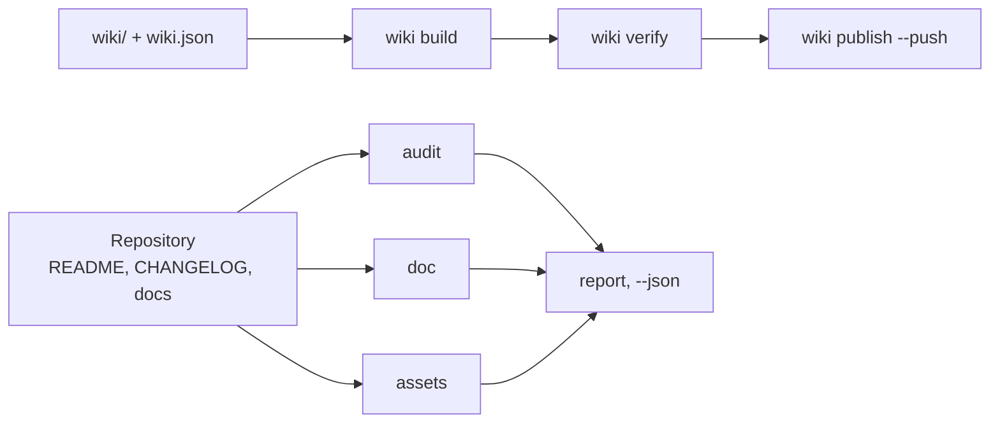

# github-agent

github-agent is a Python command-line steward for GitHub repositories and their wikis: it
scores the README, CHANGELOG and community contracts, lints documents, links, anchors and
tables, scans for leaked secrets, renders the banner and social preview, and keeps the wiki in
the repository — one command per job.

<!-- md-i18n:switcher -->
**Read this in:** English · [Deutsch](README.de.md) · [中文](README.zh.md) · [हिन्दी](README.hi.md) · [Español](README.es.md) · [Русский](README.ru.md)

[](https://github.com/paulmann/github-agent/actions/workflows/ci.yml)
[](https://pypi.org/project/github-agent-cli/)
[](https://www.python.org/)
[](LICENSE)
[](pyproject.toml)
[](tests/run_tests.py)


[**Installation**](#installation) · [**Usage**](#usage) · [**Wiki**](https://github.com/paulmann/github-agent/wiki) · [**AGENTS.md**](AGENTS.md) · [**MIGRATION.md**](MIGRATION.md) · [**Packaging**](docs/PACKAGING.md) · [**Changelog**](CHANGELOG.md) · [**Issues**](https://github.com/paulmann/github-agent/issues) · [**Security**](SECURITY.md) · [**Русская версия**](README.ru.md)

A repository rarely fails on code; it fails on documentation. The README has no installation
section, the changelog has no dates, the wiki is three pages without navigation, the banner is
a broken image, the description is one word. `git push` succeeds, so the defect lives for years.

This pack puts a verifiable contract on each of those places and reduces the work to one
command. It does not write marketing copy and does not invent numbers: it checks what a human
wrote and refuses to publish what is broken.

> **Documentation status.** Every number in this README was measured on 2026-10-30 against
> version 1.2.0 with the commands named in the table. Long guides live in the
> [Wiki](https://github.com/paulmann/github-agent/wiki) and [`docs/`](docs/IMPORT.md); the
> protocol for agents is [`AGENTS.md`](AGENTS.md), the packaging and migration notes are
> [`docs/PACKAGING.md`](docs/PACKAGING.md) and [`MIGRATION.md`](MIGRATION.md).

> **For agents.** Start with [`AGENTS.md`](AGENTS.md): where the pack lives, how to prove the
> installation is intact, and the single command that replaces each multi-file investigation.

## Contents

- [Installation](#installation)
- [Usage](#usage)
- [What the pack does](#what-the-pack-does)
- [In numbers](#in-numbers)
- [Checks that run](#checks-that-run)
- [Images](#images)
- [Import into another agent](#import-into-another-agent)
- [Wiki as documentation](#wiki-as-documentation)
- [Languages of the documentation](#languages-of-the-documentation)
- [How it is built](#how-it-is-built)
- [Limitations](#limitations)
- [Development](#development)
- [Contributing](#contributing)
- [License](#license)

---

## Installation

Python 3.11 or newer is required; CI runs the suite on 3.11 and 3.13. There are no runtime
dependencies. Four install paths exist, and they are not interchangeable: the package managers
install the CLI, while the clone is what `ghagent install --profile ... --write` needs because
the wheel ships only the CLI.

### Package managers

```bash
uv tool install github-agent-cli        # uv, isolated tool environment
pipx install github-agent-cli           # pipx, isolated virtual environment
pip install github-agent-cli            # pip into the active environment
brew install paulmann/homebrew-github-agent-cli/github-agent-cli   # macOS and Linux
scoop bucket add github-agent-cli https://github.com/paulmann/scoop-github-agent-cli
scoop install github-agent-cli                                     # Windows
ghagent --version
```

> **Published on PyPI.** `github-agent-cli` 1.2.2 has been available since 2026-10-30:
> <https://pypi.org/project/github-agent-cli/>. The wheel ships the CLI only; the pack
> (skills, tests, reference, wiki sources) comes from the clone below.

The console script is `ghagent`; the distribution name is `github-agent`.

### Optional PNG support

`assets render` always writes the SVG. PNG output needs Pillow, which is an optional extra:

```bash
pip install "github-agent-cli[png]"
uv tool install --with pillow github-agent-cli
```

Without Pillow the command says why no PNG exists instead of pretending a social preview is
ready.

### From source (clone)

The clone is the second install path and the only one that carries `tests/`, `skills/`,
`reference/`, `wiki/` and the templates, so it is also the one that `install`, `verify-install`,
`snippet` and `uninstall` need. An editable install adds the `ghagent` command to the checkout:

```bash
git clone https://github.com/paulmann/github-agent.git
cd github-agent
pip install -e .
python tools/ghagent.py selftest
```

### Docker

The repository ships a `Dockerfile`; build it locally and mount the repository under test at
`/repo`, which is the image working directory:

```bash
docker build -t ghagent .
docker run --rm -v "$PWD:/repo" ghagent audit .
```

On Windows PowerShell the same mount is `-v "${PWD}:/repo"`. The entry point is `ghagent`, so
the first argument after the image name is the command. No registry image is published as part
of 1.2.0 and CI does not build the container: the tag is a local convention. See
[examples/docker.md](examples/docker.md).

### GitHub Action

The composite action installs the pack from its own checkout, so it does not depend on a PyPI
release and works as soon as the tag exists:

```yaml
- uses: actions/checkout@v7
- uses: paulmann/github-agent@v1.2.2    # pin the release tag
  with:
    command: audit .
    min-score: "80"
```

| Input | Default | Purpose |
|---|---|---|
| `command` | `audit . --min-score 80` | any `ghagent` command, without the program name |
| `min-score` | `80` | score threshold, applied only when `command` starts with `audit` and passes no flag |
| `working-directory` | `.` | repository directory the command runs in, relative to `$GITHUB_WORKSPACE` |
| `python-version` | `3.13` | interpreter installed by `actions/setup-python` |
| `github-token` | `${{ github.token }}` | exported as `GITHUB_TOKEN` for metadata commands |

For a non-audit command the action runs exactly the given argument string, for example
`command: doc --root .`. There are no outputs: the step exit code is the result (`0` clean,
`1` findings, `2` usage or environment problem). A complete workflow, including a second job
that runs `doc` and a Docker alternative, is in [examples/ci-usage.md](examples/ci-usage.md).

### pre-commit

The repository is also a pre-commit hook source; the hooks are `ghagent-doc`,
`ghagent-audit`, `ghagent-privacy` and `ghagent-changelog`:

```yaml
repos:
  - repo: https://github.com/paulmann/github-agent
    rev: v1.2.2     # placeholder: pin the release tag you decide to trust
    hooks:
      - id: ghagent-doc
      - id: ghagent-audit
      - id: ghagent-privacy
      - id: ghagent-changelog
```

Install the hooks into the consuming repository with `pre-commit install`. The full consumer
file is [examples/pre-commit-config.yaml](examples/pre-commit-config.yaml); the hook
definitions are in [.pre-commit-hooks.yaml](.pre-commit-hooks.yaml). The hooks need a released
tag, because pre-commit builds the tool from the tagged tree.

### Verified installation

After any install, one command answers whether the CLI is the released build:

```bash
ghagent --version     # prints the version, for example github-agent 1.2.2
ghagent audit .       # 0 clean, 1 findings at error level, 2 usage or environment problem
```

In a clone the full self-test suite runs; the wheel ships the CLI only, so `ghagent selftest`
there exits `2` with a message that points at the clone rather than reporting a false `PASS`:

```bash
git clone https://github.com/paulmann/github-agent.git
cd github-agent
python tools/ghagent.py selftest    # 173/173 checks passed
```

## Usage

```bash
ghagent audit .                    # score repository hygiene, exit 1 on errors
ghagent doc --root .               # markdown, links, anchors, tables, table of contents
ghagent privacy --root .           # tokens, private keys, machine paths, personal addresses
ghagent assets render --write      # banner and social preview from the repository metadata
ghagent assets check               # format, dimensions, alt text, referenced files
ghagent wiki build                 # rewrite links for the wiki namespace
ghagent wiki verify                # every internal link resolves
ghagent changelog check            # Keep a Changelog and SemVer
ghagent changelog release 1.2.0 --write
ghagent meta suggest               # description and topics
```

Every check command accepts `--json`; findings print as `file:line` with a rule id, so a caller
does not need to parse prose. `selftest` runs the suite, and `report` writes the combined markdown
file, so neither needs the machine format.

| Exit code | Meaning |
|---|---|
| `0` | no findings at error level |
| `1` | findings at error level, each printed with `file:line` |
| `2` | usage or environment problem: wrong path, missing file, missing `gh` or token |

Example `audit` output, from a deliberately failing repository and not from this tree:

```text
[ERROR] repo.contributing        CONTRIBUTING.md is absent  hint: add CONTRIBUTING.md
[WARN ] readme.badges            only 1 badge(s)  hint: 3-8 badges: CI, release, license, runtime
[ERROR] changelog.date-missing   version 1.1.0 has no ISO date  CHANGELOG.md:14
score: 72.5% (22 scored, 1 skipped)
```

## What the pack does

| Job | One command |
|---|---|
| Score a repository | `ghagent audit .` |
| Lint documents, links and anchors | `ghagent doc --root .` |
| Find secrets and machine paths | `ghagent privacy --root .` |
| Render the banner and social preview | `ghagent assets render --write` |
| Build, verify and publish the wiki | `ghagent wiki build`, `verify`, `publish --push` |
| Release a version | `ghagent changelog release 1.2.0 --write` |
| Fix description and topics | `ghagent meta apply --repo owner/name --write` |
| Install the skill into another agent | `ghagent install --profile harness --write` |

The CLI has 13 commands; the table names the ones used every day. The rest (`report`,
`snippet`, `verify-install`, `uninstall`, `selftest`, `assets suggest`, `changelog suggest`,
`changelog notes`, `meta suggest`, `wiki init`, `wiki publish`) carry their flags in
`ghagent --help`; the recurring jobs are mapped in [`AGENTS.md`](AGENTS.md).

## In numbers

Measured in this tree on 2026-10-30 against version 1.2.2:

| Surface | Value | Measurement source |
|---|---:|---|
| Self-tests | 173 | `python tests/run_tests.py` |
| CLI commands | 13 | `ghagent --help` |
| Library modules | 11 | `tools/ghalib/*.py` |
| Document rules examined on this tree | 17 | `ghagent doc --json`, field `rules_examined` |
| Runtime dependencies | 0 | `pyproject.toml`, `dependencies = []` |
| Platform traps recorded | 15 | the traps table in [docs/RULES.md](docs/RULES.md) |
| Python lines | 4176 | `wc -l tools/ghagent.py tools/ghalib/*.py` |

## Checks that run

| Group | Rules |
|---|---|
| Text | UTF-8 without BOM, LF instead of CRLF, final newline, no tab indentation |
| Structure | one `H1`, no skipped heading levels, closed code fences, language on every fence |
| Tables | the cell count of every row matches the header and the separator |
| Links | the relative file exists, the anchor exists (including Cyrillic) |
| Table of contents | every entry resolves, no `H2` is forgotten |
| Markup | the five alert types, alt text on images, no images over `http://` |
| Privacy | tokens, private keys, absolute machine paths, personal addresses |
| Images | banner referenced, preview is PNG/JPG/GIF, under 1 MB, at least 640×320 |
| Wiki | manifest and files agree, `Home`/`_Sidebar`/`_Footer` present, no `.md` links, no relative images |
| CHANGELOG | SemVer and ISO date per version, newest first, known types, no empty version, comparison links |
| Agents file | the canonical root `AGENTS.md` stays a map: above 120 lines is a warning and detail belongs in `docs/` |
| Metadata | description under 200 characters without a wasted prefix, 8–20 lowercase-hyphenated topics |

A rule that examined zero objects is not passed: it is reported as `coverage.skipped`, and an
empty tree is `doc.no-text-files`.

## Images

The banner at the top of this file is generated by the pack itself:

```bash
ghagent assets render --title "github-agent" \
    --tagline "Repository and wiki steward for AI agents: one command per job." \
    --command "ghagent audit ." --chips "python,github,wiki,lint" --write
```

- `assets/social-preview.png` — 1280×640, under 1 MB, ready for **Settings → Social preview**.
- `assets/social-preview.svg` — vector twin for the README, no dependency needed.
- `assets check` verifies format, byte size, dimensions, alt text and that every referenced file
  exists. The repository copy is not the social preview automatically: that upload is a manual
  step, and the check prints the reminder.

## Import into another agent

| Agent | Skill root | What to do |
|---|---|---|
| AutoClaw2 | `%USERPROFILE%\.pi\agent\skills` | `install --profile autoclaw --write`, then paste the `snippet` block into its `AGENTS.md` |
| HARNESS | `%USERPROFILE%\.dsh\skills` | `install --profile harness --write`, same block |
| SagaAI | any directory | `install --target <dir> --write` and the block from `snippet --target <dir>` |

The `snippet` block names the pack path, the verification command and one rule: one job, one
command. After import the agent must run `verify-install` and get `0`; anything else means the
installed copy is not the tested one. Import is the workflow that needs the clone rather than the
wheel, because the wheel ships only the CLI. Details: [docs/IMPORT.md](docs/IMPORT.md).

## Wiki as documentation

The wiki is maintained from the repository: pages live in `wiki/`, order is set by
`wiki/wiki.json`. `wiki build` rewrites links for the wiki namespace — internal links lose
`.md`, links into the repository tree become absolute, and a relative image is an error because
the wiki repository cannot see the project tree.

Built and verified with the pack's own commands. Publication needs one action in the GitHub
interface: `<repo>.wiki.git` does not exist until a first page is saved, and `git push` cannot
create it — `wiki publish` then returns `wiki.remote-missing` with that step. The full workflow
is in [docs/WIKI.md](docs/WIKI.md).

## Languages of the documentation

English files are canonical; Russian translations carry the `.ru.md` suffix, the convention
GitHub itself uses (`README.ru.md`, `AGENTS.ru.md`, `wiki/01-Why.ru.md`).

| English | Russian |
|---|---|
| [README.md](README.md) | [README.ru.md](README.ru.md) |
| [AGENTS.md](AGENTS.md) | [AGENTS.ru.md](AGENTS.ru.md) |
| [CHANGELOG.md](CHANGELOG.md) | [CHANGELOG.ru.md](CHANGELOG.ru.md) |
| [CONTRIBUTING.md](CONTRIBUTING.md) | [CONTRIBUTING.ru.md](CONTRIBUTING.ru.md) |
| [SECURITY.md](SECURITY.md) | [SECURITY.ru.md](SECURITY.ru.md) |
| [SUPPORT.md](SUPPORT.md) | [SUPPORT.ru.md](SUPPORT.ru.md) |
| [CODE_OF_CONDUCT.md](CODE_OF_CONDUCT.md) | [CODE_OF_CONDUCT.ru.md](CODE_OF_CONDUCT.ru.md) |
| [GOVERNANCE.md](GOVERNANCE.md) | [GOVERNANCE.ru.md](GOVERNANCE.ru.md) |

Translations are updated in the same commit as the original. A translation that silently lags is
a documentation defect, and the wiki carries both sets: English pages as canonical, Russian as
`*.ru.md` pages in their own navigation group.

## How it is built



| Component | Responsibility |
|---|---|
| `tools/ghagent.py` | argument parsing, exit codes, report assembly |
| `tools/ghalib/mdcheck.py` | markdown, links, anchors, privacy |
| `tools/ghalib/audit.py` | required files, README and changelog contracts, score |
| `tools/ghalib/assets.py` | banner and social preview: render, check, suggest |
| `tools/ghalib/wiki.py` | manifest, link rewriting, sidebar and footer, publication |
| `tools/ghalib/changelog.py` | Keep a Changelog 2.0.0, release, draft from commits |
| `tools/ghalib/meta.py` | description, topics, homepage |
| `tools/ghalib/install.py` | skill installation, sha256 manifest, drift, removal |
| `tools/ghalib/report.py` | findings, severities, markdown and `--json` output |
| `tools/ghalib/config.py`, `tools/ghalib/util.py` | `.ghagent.json`, paths, text I/O, anchors |
| `tests/run_tests.py` | 173 self-tests with fixtures and decoys |

Anchors follow GitHub's rules: lowercase, punctuation dropped, spaces to hyphens, a repeated
heading gets `-1`. The rule was verified against a live table of contents: an em dash in a
heading produces a double hyphen. Architecture notes: [docs/ARCHITECTURE.md](docs/ARCHITECTURE.md).

## Limitations

- `audit --repo` and `meta` need `gh` or `GITHUB_TOKEN`. Without them the command returns an
  error instead of an empty success.
- External links are not fetched: relative paths, anchors and structure are checked. A network
  crawl is a separate decision, not a side effect of a linter.
- Wiki pages are barely discoverable through search engines: per GitHub documentation, only
  wikis with 500+ stars and public editing disabled are indexed. Use GitHub Pages for discovery.
- `changelog suggest` is a draft. It does not know what matters to a user.
- PNG rendering needs Pillow. Without it the SVG is produced and the check says why no PNG
  exists, instead of pretending a social preview is ready.

## Development

```bash
python tools/ghagent.py selftest
python tests/run_tests.py
python tools/ghagent.py doc --root .
python tools/ghagent.py audit .
python tools/ghagent.py assets check
```

A new rule arrives with a fixture that fails without it and a decoy that must stay quiet. A rule
without a fixture is removed: a check that cannot be proven is worse than no check. Packaging
and the wheel layout are described in [docs/PACKAGING.md](docs/PACKAGING.md); the 1.1.0 → 1.2.0
changes are in [MIGRATION.md](MIGRATION.md).

## Contributing

Before a pull request: `python tests/run_tests.py` and `python tools/ghagent.py doc --root .`
must be green. One change, one reason. Rules: [CONTRIBUTING.md](CONTRIBUTING.md), security
policy: [SECURITY.md](SECURITY.md).

## License

[MIT](LICENSE).
