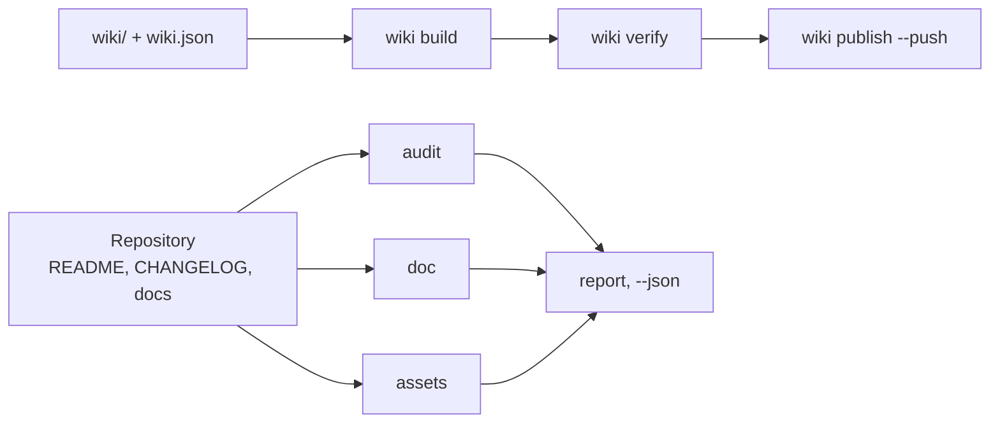

# github-agent

**GitHub repository and wiki steward for AI agents: audits README, CHANGELOG and community health, renders the banner and social preview, builds and publishes the wiki, checks links, anchors and topics — one command per job. Python 3, standard library only.**

[](https://github.com/paulmann/github-agent/actions/workflows/ci.yml)
[](LICENSE)
[](https://www.python.org/)
[](tools/ghagent.py)
[](tests/run_tests.py)


[**Installation**](#installation) · [**Usage**](#usage) · [**Images**](#images) · [**Wiki**](https://github.com/paulmann/github-agent/wiki) · [**AGENTS.md**](AGENTS.md) · [**Changelog**](CHANGELOG.md) · [**Issues**](https://github.com/paulmann/github-agent/issues) · [**Security**](SECURITY.md) · [**Русская версия**](README.ru.md)

A repository rarely fails on code; it fails on documentation. The README has no installation
section, the changelog has no dates, the wiki is three pages without navigation, the banner is
a broken image, the description is one word. `git push` succeeds, so the defect lives for years.

This pack puts a verifiable contract on each of those places and reduces the work to one
command. It does not write marketing copy and does not invent numbers: it checks what a human
wrote and refuses to publish what is broken.

> **Documentation status.** Every number in this README was measured on 2026-10-24 against
> version 1.0.0 with the commands named in the table. Long guides live in the
> [Wiki](https://github.com/paulmann/github-agent/wiki) and [`docs/`](docs/); the protocol for
> agents is [`AGENTS.md`](AGENTS.md).

## Contents

- [What the pack does](#what-the-pack-does)
- [In numbers](#in-numbers)
- [Installation](#installation)
- [Usage](#usage)
- [Checks that run](#checks-that-run)
- [Images](#images)
- [Import into another agent](#import-into-another-agent)
- [Wiki as documentation](#wiki-as-documentation)
- [Languages of the documentation](#languages-of-the-documentation)
- [How it is built](#how-it-is-built)
- [Limitations](#limitations)
- [Development](#development)
- [Contributing](#contributing)
- [License](#license)

---

## What the pack does

| Job | One command |
|---|---|
| Score a repository | `ghagent.py audit .` |
| Lint documents, links and anchors | `ghagent.py doc --root .` |
| Find secrets and machine paths | `ghagent.py privacy --root .` |
| Render the banner and social preview | `ghagent.py assets render --write` |
| Build, verify and publish the wiki | `ghagent.py wiki build`, `verify`, `publish --push` |
| Release a version | `ghagent.py changelog release 1.2.0 --write` |
| Fix description and topics | `ghagent.py meta apply --repo owner/name --write` |
| Install the skill into another agent | `ghagent.py install --profile harness --write` |

Each command prints findings as `file:line` with a rule id, and returns `0` clean, `1` with
errors, `2` on a usage problem. An agent therefore does not need to read the tree to learn its
state: one command and one exit code are enough.

## In numbers

Measured in this tree on 2026-10-24:

| Surface | Value | Measurement source |
|---|---:|---|
| Self-tests | 134 | `tests/run_tests.py` |
| CLI commands | 13 | `tools/ghagent.py --help` |
| Library modules | 11 | `tools/ghalib/*.py` |
| Rules examined on this tree | 17 | `doc --json`, field `rules_examined` |
| Runtime dependencies | 0 | imports in `tools/` |
| Platform traps recorded | 15 | [AGENTS.md](AGENTS.md#platform-traps) |
| Python lines | 3400 | `tools/**/*.py` |

## Installation

Only Python 3.11+ is required (verified on 3.13.15). No `pip install`, no build step. Pillow is
optional: with it `assets render` also produces a PNG, without it the SVG alone.

```bash
git clone https://github.com/paulmann/github-agent.git
cd github-agent

python tools/ghagent.py selftest
```

Installing the skill into an agent copies the pack into the agent's skill root, with a sha256
manifest:

```bash
python tools/ghagent.py install --profile autoclaw --write   # AutoClaw2
python tools/ghagent.py install --profile harness  --write   # HARNESS
python tools/ghagent.py install --target <dir>     --write   # SagaAI and anything else
```

Verification and rollback:

```bash
python tools/ghagent.py verify-install --profile autoclaw
python tools/ghagent.py uninstall --profile autoclaw --write
```

`uninstall` refuses to delete a directory that has no `.install.json`: it must not remove what
another tool installed.

## Usage

```bash
# 1. state of a local repository (exit 1 means errors)
python tools/ghagent.py audit .

# 2. the same for GitHub metadata
python tools/ghagent.py audit --repo owner/name --http

# 3. documents: BOM, CRLF, headings, tables, links, anchors, table of contents
python tools/ghagent.py doc --root .

# 4. images: render from metadata, then verify size, format and references
python tools/ghagent.py assets render --title "Project" --tagline "What it does." --write
python tools/ghagent.py assets check

# 5. wiki: build, verify, publish (without --push it is a dry run)
python tools/ghagent.py wiki build
python tools/ghagent.py wiki verify
python tools/ghagent.py wiki publish --repo owner/name --push

# 6. changelog
python tools/ghagent.py changelog check
python tools/ghagent.py changelog suggest --since v1.0.0
python tools/ghagent.py changelog release 1.1.0 --write
python tools/ghagent.py changelog notes 1.1.0

# 7. metadata: description and topics
python tools/ghagent.py meta suggest
python tools/ghagent.py meta apply --repo owner/name --description "…" --topics a,b --write

# 8. one combined report
python tools/ghagent.py report . --out AUDIT.md
```

Example `audit` output:

```text
[ERROR] repo.contributing        CONTRIBUTING.md is absent  hint: add CONTRIBUTING.md
[WARN ] readme.badges            only 1 badge(s)  hint: 3-8 badges: CI, release, license, runtime
[ERROR] changelog.date-missing   version 1.1.0 has no ISO date  CHANGELOG.md:14
score: 72.5% (22 scored, 1 skipped)
```

## Checks that run

| Group | Rules |
|---|---|
| Text | UTF-8 without BOM, LF instead of CRLF, final newline, no tab indentation |
| Structure | one `H1`, no skipped heading levels, closed code fences, language on every fence |
| Tables | the cell count of every row matches the header and the separator |
| Links | the relative file exists, the anchor exists (including Cyrillic) |
| Table of contents | every entry resolves, no `H2` is forgotten |
| Markup | the five alert types, alt text on images, no images over `http://` |
| Privacy | tokens, private keys, absolute machine paths, personal addresses |
| Images | banner referenced, preview is PNG/JPG/GIF, under 1 MB, at least 640×320 |
| Wiki | manifest and files agree, `Home`/`_Sidebar`/`_Footer` present, no `.md` links, no relative images |
| CHANGELOG | SemVer and ISO date per version, newest first, known types, no empty version, comparison links |
| Metadata | description under 200 characters without a wasted prefix, 8–20 lowercase-hyphenated topics |

A rule that examined zero objects is not passed: it is reported as `coverage.skipped`, and an
empty tree is `doc.no-text-files`.

## Images

The banner at the top of this file is generated by the pack itself:

```bash
python tools/ghagent.py assets render --title "github-agent" \
    --tagline "Repository and wiki steward for AI agents: one command per job." \
    --command "ghagent.py audit ." --chips "python,github,wiki,lint" --write
```

- `assets/social-preview.png` — 1280×640, under 1 MB, ready for **Settings → Social preview**.
- `assets/social-preview.svg` — vector twin for the README, no dependency needed.
- `assets check` verifies format, byte size, dimensions, alt text and that every referenced file
  exists. The repository copy is not the social preview automatically: that upload is a manual
  step, and the check prints the reminder.

## Import into another agent

| Agent | Skill root | What to do |
|---|---|---|
| AutoClaw2 | `%USERPROFILE%\.pi\agent\skills` | `install --profile autoclaw --write`, then paste the `snippet` block into its `AGENTS.md` |
| HARNESS | `%USERPROFILE%\.dsh\skills` | `install --profile harness --write`, same block |
| SagaAI | any directory | `install --target <dir> --write` and the block from `snippet --target <dir>` |

The `snippet` block names the pack path, the verification command and one rule: one job, one
command. After import the agent must run `verify-install` and get `0`; anything else means the
installed copy is not the tested one. Details: [docs/IMPORT.md](docs/IMPORT.md).

## Wiki as documentation

The wiki is maintained from the repository: pages live in `wiki/`, order is set by
`wiki/wiki.json`. `wiki build` rewrites links for the wiki namespace — internal links lose
`.md`, links into the repository tree become absolute, and a relative image is an error because
the wiki repository cannot see the project tree.

Built and verified with the pack's own commands. Publication needs one action in the GitHub
interface: `<repo>.wiki.git` does not exist until a first page is saved, and `git push` cannot
create it — `wiki publish` then returns `wiki.remote-missing` with that step.

## Languages of the documentation

English files are canonical; Russian translations carry the `.ru.md` suffix, the convention
GitHub itself uses (`README.ru.md`, `AGENTS.ru.md`, `wiki/01-Why.ru.md`).

| English | Russian |
|---|---|
| [README.md](README.md) | [README.ru.md](README.ru.md) |
| [AGENTS.md](AGENTS.md) | [AGENTS.ru.md](AGENTS.ru.md) |
| [CHANGELOG.md](CHANGELOG.md) | [CHANGELOG.ru.md](CHANGELOG.ru.md) |
| [CONTRIBUTING.md](CONTRIBUTING.md) | [CONTRIBUTING.ru.md](CONTRIBUTING.ru.md) |
| [SECURITY.md](SECURITY.md) | [SECURITY.ru.md](SECURITY.ru.md) |
| [SUPPORT.md](SUPPORT.md) | [SUPPORT.ru.md](SUPPORT.ru.md) |
| [CODE_OF_CONDUCT.md](CODE_OF_CONDUCT.md) | [CODE_OF_CONDUCT.ru.md](CODE_OF_CONDUCT.ru.md) |
| [GOVERNANCE.md](GOVERNANCE.md) | [GOVERNANCE.ru.md](GOVERNANCE.ru.md) |

Translations are updated in the same commit as the original. A translation that silently lags is
a documentation defect, and the wiki carries both sets: English pages as canonical, Russian as
`*.ru.md` pages in their own navigation group.

## How it is built



| Component | Responsibility |
|---|---|
| `tools/ghagent.py` | argument parsing, exit codes, report assembly |
| `tools/ghalib/mdcheck.py` | markdown, links, anchors, privacy |
| `tools/ghalib/audit.py` | required files, README and changelog contracts, score |
| `tools/ghalib/assets.py` | banner and social preview: render, check, suggest |
| `tools/ghalib/wiki.py` | manifest, link rewriting, sidebar and footer, publication |
| `tools/ghalib/changelog.py` | Keep a Changelog 2.0.0, release, draft from commits |
| `tools/ghalib/meta.py` | description, topics, homepage |
| `tools/ghalib/install.py` | skill installation, sha256 manifest, drift, removal |
| `tests/run_tests.py` | 134 self-tests with fixtures and decoys |

Anchors follow GitHub's rules: lowercase, punctuation dropped, spaces to hyphens, a repeated
heading gets `-1`. The rule was verified against a live table of contents: an em dash in a
heading produces a double hyphen.

## Limitations

- `audit --repo` and `meta` need `gh` or `GITHUB_TOKEN`. Without them the command returns an
  error instead of an empty success.
- External links are not fetched: relative paths, anchors and structure are checked. A network
  crawl is a separate decision, not a side effect of a linter.
- Wiki pages are barely discoverable through search engines: per GitHub documentation, only
  wikis with 500+ stars and public editing disabled are indexed. Use GitHub Pages for discovery.
- `changelog suggest` is a draft. It does not know what matters to a user.
- PNG rendering needs Pillow. Without it the SVG is produced and the check says why no PNG
  exists, instead of pretending a social preview is ready.

## Development

```bash
python tools/ghagent.py selftest
python tests/run_tests.py
python tools/ghagent.py doc --root .
python tools/ghagent.py audit .
python tools/ghagent.py assets check
```

A new rule arrives with a fixture that fails without it and a decoy that must stay quiet. A rule
without a fixture is removed: a check that cannot be proven is worse than no check.

## Contributing

Before a pull request: `python tests/run_tests.py` and `python tools/ghagent.py doc --root .`
must be green. One change, one reason. Rules: [CONTRIBUTING.md](CONTRIBUTING.md), security
policy: [SECURITY.md](SECURITY.md).

## License

[MIT](LICENSE).
