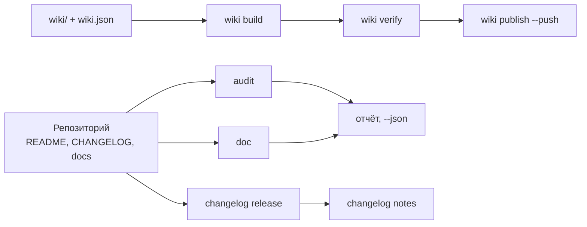

# github-agent

**GitHub repository and wiki steward for AI agents: audits README, CHANGELOG and community health, builds and publishes the wiki, checks links and anchors — one command per job. Python 3, standard library only.**

[](https://github.com/paulmann/github-agent/actions/workflows/ci.yml)
[](LICENSE)
[](https://www.python.org/)
[](tools/ghagent.py)
[](tests/run_tests.py)

## Содержание

- [Что делает пакет](#что-делает-пакет)
- [В цифрах](#в-цифрах)
- [Installation](#installation)
- [Usage](#usage)
- [Проверки, которые выполняются](#проверки-которые-выполняются)
- [Импорт в другие агенты](#импорт-в-другие-агенты)
- [Вики как источник документации](#вики-как-источник-документации)
- [Как это устроено](#как-это-устроено)
- [Ограничения](#ограничения)
- [Разработка](#разработка)
- [Участие в проекте](#участие-в-проекте)
- [License](#license)

---

## Что делает пакет

Репозиторий на GitHub проваливается не на коде, а на документации: README без установки,
CHANGELOG без дат, вики из трёх страниц без навигации, описание из одного слова, ссылки
в никуда. `git push` при этом проходит, поэтому дефект живёт годами.

Пакет ставит на эти места проверяемые контракты и сводит работу к одной команде:

| Задача | Одна команда |
|---|---|
| Оценить репозиторий | `ghagent.py audit .` |
| Проверить документы и ссылки | `ghagent.py doc --root .` |
| Собрать, проверить и опубликовать вики | `ghagent.py wiki build`, `verify`, `publish --push` |
| Выпустить версию | `ghagent.py changelog release 1.2.0 --write` |
| Привести описание и темы в порядок | `ghagent.py meta apply --repo owner/name --write` |
| Установить навык другому агенту | `ghagent.py install --profile harness --write` |

Пакет не пишет маркетинговый текст и не выдумывает числа: он проверяет то, что человек
написал, и отказывается публиковать то, что сломано.

## В цифрах

Измерено в этом дереве 2026-10-24 командой `python tools/ghagent.py selftest` и
`python tests/run_tests.py`:

| Поверхность | Значение | Источник измерения |
|---|---:|---|
| Самопроверок | 113 | `tests/run_tests.py` |
| Команд CLI | 12 | `tools/ghagent.py --help` |
| Модулей библиотеки | 10 | `tools/ghalib/*.py` |
| Правил осмотрено на этом дереве | 16 | `doc --json`, поле `rules_examined` |
| Внешних зависимостей | 0 | `tools/ghagent.py`, импорты |
| Проверенных ловушек платформы | 14 | таблица в [AGENTS.md](AGENTS.md#ловушки-платформы) |
| Строк Python | 3055 | `tools/**/*.py` |

## Installation

Требуется только Python 3.11+ (проверено на 3.13.15). Ни `pip install`, ни сборки нет.

```bash
git clone https://github.com/paulmann/github-agent.git
cd github-agent

python tools/ghagent.py selftest
```

Установка навыка агенту (копия пакета в каталоге навыков, с манифестом sha256):

```bash
python tools/ghagent.py install --profile autoclaw --write   # AutoClaw2
python tools/ghagent.py install --profile harness  --write   # HARNESS
python tools/ghagent.py install --target <каталог> --write   # SagaAI и любой другой
```

Проверка установки и откат:

```bash
python tools/ghagent.py verify-install --profile autoclaw
python tools/ghagent.py uninstall --profile autoclaw --write
```

`uninstall` отказывается удалять каталог без манифеста `.install.json`.

## Usage

```bash
# 1. состояние локального репозитория (код возврата 1 — есть ошибки)
python tools/ghagent.py audit .

# 2. то же по метаданным на GitHub
python tools/ghagent.py audit --repo owner/name

# 3. документы: BOM, CRLF, заголовки, таблицы, ссылки, якоря, оглавление
python tools/ghagent.py doc --root .

# 4. вики: сборка, проверка, публикация (без --push — сухой прогон)
python tools/ghagent.py wiki build
python tools/ghagent.py wiki verify
python tools/ghagent.py wiki publish --repo owner/name --push

# 5. журнал изменений
python tools/ghagent.py changelog check
python tools/ghagent.py changelog suggest --since v1.0.0
python tools/ghagent.py changelog release 1.1.0 --write
python tools/ghagent.py changelog notes 1.1.0

# 6. метаданные: описание и темы
python tools/ghagent.py meta suggest
python tools/ghagent.py meta apply --repo owner/name --description "…" --topics a,b --write

# 7. один отчёт по всем проверкам
python tools/ghagent.py report . --out AUDIT.md
```

Машинный вывод есть у каждой команды: `--json`. Коды возврата: `0` — чисто, `1` — есть
находки уровня `error`, `2` — ошибка вызова.

Пример вывода `audit`:

```text
[ERROR] repo.contributing        CONTRIBUTING.md is absent  hint: add CONTRIBUTING.md
[WARN ] readme.badges            only 1 badge(s)  hint: 3-8 badges: CI, release, license, runtime
[ERROR] changelog.date-missing   version 1.1.0 has no ISO date  CHANGELOG.md:14
PASS: 0 error(s) ... 
score: 72.5% (22 scored, 1 skipped)
```

## Проверки, которые выполняются

| Группа | Правила |
|---|---|
| Текст | UTF-8 без BOM, LF вместо CRLF, завершающий перевод строки, отсутствие табов |
| Структура | один `H1`, нет пропущенных уровней, закрытые блоки кода, язык у блока |
| Таблицы | число ячеек в строке совпадает с заголовком и разделителем |
| Ссылки | относительный файл существует, якорь существует (в том числе кириллический) |
| Оглавление | каждый пункт ведёт на существующий заголовок, ни один `H2` не забыт |
| Разметка | пять типов alerts, alt у картинок, отсутствие «жёстких» переносов |
| Приватность | токены, приватные ключи, абсолютные пути машины, личные адреса |
| Вики | страница из манифеста существует, все страницы перечислены, `Home`/`_Sidebar`/`_Footer` на месте, ссылки без `.md`, нет относительных картинок |
| CHANGELOG | SemVer и ISO-дата у каждой версии, порядок от новой к старой, известные типы, непустые версии, ссылки сравнения |
| Метаданные | описание до 200 символов и без «A tool that», 8–20 тем в нижнем регистре через дефис |

Правило, осмотревшее ноль объектов, не считается пройденным: в отчёте оно попадает в
`coverage.skipped`, а пустое дерево даёт ошибку `doc.no-text-files`.

## Импорт в другие агенты

Пакет импортируется не «магией», а файлом правил и каталогом навыков. Порядок для каждого
агента описан в [docs/IMPORT.md](docs/IMPORT.md); кратко:

| Агент | Каталог | Что сделать |
|---|---|---|
| AutoClaw2 | `%USERPROFILE%\.pi\agent\skills` | `install --profile autoclaw --write`, затем добавить блок из `snippet` в свой `AGENTS.md` |
| HARNESS | `%USERPROFILE%\.dsh\skills` | `install --profile harness --write`, тот же блок |
| SagaAI | любой каталог | `install --target <каталог> --write` и блок из `snippet --target <каталог>` |

Блок `snippet` содержит путь к пакету, команду проверки установки и правило «одна
задача — одна команда». После импорта агент обязан выполнить
`verify-install` и получить код `0`: иначе установленная копия не та, что тестировали.

## Вики как источник документации

Вики ведётся из репозитория: страницы лежат в `wiki/`, порядок задаёт `wiki/wiki.json`.
`wiki build` переписывает ссылки под вики-пространство — внутренние теряют `.md`,
ссылки в дерево репозитория становятся абсолютными, относительные картинки считаются
ошибкой, потому что вики-репозиторий дерева проекта не видит.

Вики собрана и проверена командой пакета: `wiki build` и `wiki verify` проходят на этом
дереве. Публикация требует одного действия в интерфейсе GitHub: `<repo>.wiki.git` не
существует, пока не сохранена первая страница, и `git push` его не создаёт — команда
`wiki publish` в этом случае возвращает `wiki.remote-missing` с этим шагом.

## Как это устроено



| Компонент | Ответственность |
|---|---|
| `tools/ghagent.py` | разбор аргументов, коды возврата, сборка отчёта |
| `tools/ghalib/mdcheck.py` | markdown, ссылки, якоря, приватность |
| `tools/ghalib/audit.py` | обязательные файлы, README- и CHANGELOG-контракты, оценка |
| `tools/ghalib/wiki.py` | манифест, переписывание ссылок, `_Sidebar`/`_Footer`, публикация |
| `tools/ghalib/changelog.py` | Keep a Changelog 2.0.0, выпуск версии, черновик из коммитов |
| `tools/ghalib/meta.py` | описание, темы, домашняя страница |
| `tools/ghalib/install.py` | установка навыка, манифест sha256, проверка, удаление |
| `tests/run_tests.py` | 113 самопроверок с фикстурами и приманками |

Якоря считаются по правилам GitHub: регистр приводится к нижнему, знаки препинания
удаляются, пробелы становятся дефисами, повтор заголовка получает `-1`. Правило
проверено на живом оглавлении: тире в заголовке даёт двойной дефис.

## Ограничения

- Аудит метаданных (`audit --repo`, `meta`) требует установленный `gh` или переменную
  `GITHUB_TOKEN`. Без них команда честно возвращает ошибку, а не пустой успех.
- Внешние ссылки не проверяются по сети: проверяются относительные пути, якоря и
  структура. Сетевой обход — отдельное решение, а не побочный эффект линтера.
- Вики-страницы не проверяются поисковиками: по документации GitHub индексируются только
  вики с 500+ звёзд и запретом публичного редактирования. Для поиска нужен GitHub Pages.
- `changelog suggest` — черновик. Он не знает, что важно пользователю, и не заменяет
  написанную запись.

## Разработка

```bash
python tools/ghagent.py selftest
python tests/run_tests.py            # то же, с подробностями по группам
python tools/ghagent.py doc --root .
python tools/ghagent.py audit .
```

Новое правило добавляется вместе с фикстурой, которая его ломает, и с приманкой, на
которой оно не должно срабатывать. Правило без фикстуры удаляется: проверка, которую
нельзя подтвердить, хуже отсутствия проверки.

## Участие в проекте

Перед pull request: `python tests/run_tests.py` и `python tools/ghagent.py doc --root .`
должны быть зелёными. Одна правка — одна причина. Правила — [CONTRIBUTING.md](CONTRIBUTING.md),
политика безопасности — [SECURITY.md](SECURITY.md).

## License

[MIT](LICENSE).
