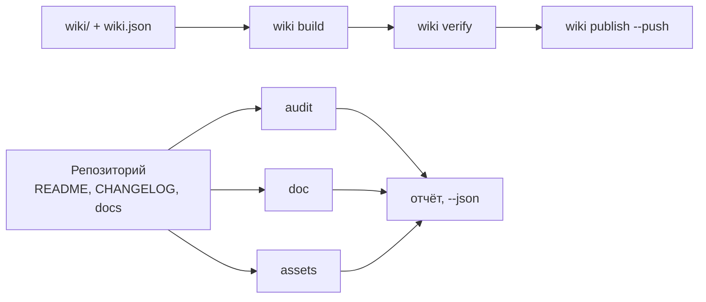

# github-agent

github-agent — консольный хранитель репозиториев GitHub и их вики на Python: оценивает README,
CHANGELOG и контракты сообщества, проверяет документы, ссылки, якоря и таблицы, ищет утечки
секретов, рисует баннер и социальное превью и ведёт вики в репозитории — одна команда на задачу.

<!-- md-i18n:switcher -->
**На других языках:** [English](README.md) · [Deutsch](README.de.md) · [中文](README.zh.md) · [हिन्दी](README.hi.md) · [Español](README.es.md) · Русский

[](https://github.com/paulmann/github-agent/actions/workflows/ci.yml)
[](https://pypi.org/project/github-agent-cli/)
[](https://www.python.org/)
[](LICENSE)
[](pyproject.toml)
[](tests/run_tests.py)


[**Установка**](#установка) · [**Использование**](#использование) · [**Вики**](https://github.com/paulmann/github-agent/wiki) · [**AGENTS.ru.md**](AGENTS.ru.md) · [**MIGRATION.md**](MIGRATION.md) · [**Упаковка**](docs/PACKAGING.md) · [**Changelog**](CHANGELOG.ru.md) · [**Issues**](https://github.com/paulmann/github-agent/issues) · [**Безопасность**](SECURITY.ru.md) · [**English version**](README.md)

Репозиторий проваливается не на коде, а на документации. В README нет раздела об установке,
в журнале изменений нет дат, вики — три страницы без навигации, баннер — битая картинка,
описание — одно слово. `git push` при этом проходит, поэтому дефект живёт годами.

Этот пакет ставит на каждое из этих мест проверяемый контракт и сводит работу к одной команде.
Он не пишет рекламных текстов и не выдумывает чисел: он проверяет то, что написал человек,
и отказывается публиковать сломанное.

> **Состояние документации.** Каждое число в этом README измерено 2026-10-30 на версии 1.2.2
> командами, названными в таблице. Подробные руководства лежат в
> [вики](https://github.com/paulmann/github-agent/wiki) и в [`docs/`](docs/IMPORT.ru.md);
> протокол для агентов — [`AGENTS.md`](AGENTS.ru.md), заметки об упаковке и миграции —
> [`docs/PACKAGING.md`](docs/PACKAGING.md) и [`MIGRATION.md`](MIGRATION.md).

> **Для агентов.** Начните с [`AGENTS.md`](AGENTS.ru.md): где лежит пакет, как доказать
> целостность установки и какая одна команда заменяет каждое многофайловое исследование.

## Содержание

- [Установка](#установка)
- [Использование](#использование)
- [Что делает пакет](#что-делает-пакет)
- [В цифрах](#в-цифрах)
- [Проверки, которые выполняются](#проверки-которые-выполняются)
- [Картинки](#картинки)
- [Импорт в другой агент](#импорт-в-другой-агент)
- [Вики как документация](#вики-как-документация)
- [Языки документации](#языки-документации)
- [Как это устроено](#как-это-устроено)
- [Ограничения](#ограничения)
- [Разработка](#разработка)
- [Участие в проекте](#участие-в-проекте)
- [Лицензия](#лицензия)

---

## Установка

Нужен Python 3.11 или новее; CI гоняет набор тестов на 3.11 и 3.13. Зависимостей при запуске
нет. Есть четыре пути установки, и они не взаимозаменяемы: пакетные менеджеры ставят CLI, а
клон нужен команде `ghagent install --profile ... --write`, потому что колесо содержит только
CLI.

### Пакетные менеджеры

```bash
uv tool install github-agent-cli        # uv, изолированное окружение инструмента
pipx install github-agent-cli           # pipx, изолированное виртуальное окружение
pip install github-agent-cli            # pip в текущее окружение
brew install paulmann/homebrew-github-agent-cli/github-agent-cli   # macOS и Linux
scoop bucket add github-agent-cli https://github.com/paulmann/scoop-github-agent-cli
scoop install github-agent-cli                                     # Windows
ghagent --version
```

> **Опубликовано на PyPI.** `github-agent-cli` 1.2.2 доступен с 2026-10-30:
> <https://pypi.org/project/github-agent-cli/>. Колесо содержит только CLI; пакет
> (скиллы, тесты, шаблоны, исходники вики) ставится из клона ниже.

Консольная команда — `ghagent`; имя дистрибутива — `github-agent`.

### Необязательная поддержка PNG

`assets render` всегда пишет SVG. Для PNG нужен Pillow, он подключается отдельным extras:

```bash
pip install "github-agent-cli[png]"
uv tool install --with pillow github-agent-cli
```

Без Pillow команда говорит, почему PNG нет, вместо того чтобы выдавать готовое социальное
превью за существующее.

### Из репозитория (клон)

Клон — второй путь установки и единственный, где есть `tests/`, `skills/`, `reference/`,
`wiki/` и шаблоны. Поэтому только из клона работают `install`, `verify-install`, `snippet` и
`uninstall`. Editable-установка добавляет команду `ghagent` из этого дерева:

```bash
git clone https://github.com/paulmann/github-agent.git
cd github-agent
pip install -e .
python tools/ghagent.py selftest
```

### Docker

В репозитории есть `Dockerfile`; соберите образ локально и смонтируйте проверяемый репозиторий
в `/repo` — это рабочий каталог образа:

```bash
docker build -t ghagent .
docker run --rm -v "$PWD:/repo" ghagent audit .
```

В Windows PowerShell тот же монтаж выглядит как `-v "${PWD}:/repo"`. Точка входа — `ghagent`,
поэтому первый аргумент после имени образа — это команда. В рамках 1.2.0 образ в реестр не
публикуется, и CI контейнер не собирает: тег — локальная договорённость. См.
[examples/docker.md](examples/docker.md).

### GitHub Action

Составное действие ставит пакет из своего же checkout, поэтому не зависит от релиза на PyPI и
работает сразу после появления тега:

```yaml
- uses: actions/checkout@v7
- uses: paulmann/github-agent@v1.2.2    # закрепите релизный тег
  with:
    command: audit .
    min-score: "80"
```

| Вход | По умолчанию | Назначение |
|---|---|---|
| `command` | `audit . --min-score 80` | любая команда `ghagent` без имени программы |
| `min-score` | `80` | порог оценки, применяется только если `command` начинается с `audit` и не передаёт флаг |
| `working-directory` | `.` | каталог запуска относительно `$GITHUB_WORKSPACE` |
| `python-version` | `3.13` | интерпретатор, который ставит `actions/setup-python` |
| `github-token` | `${{ github.token }}` | экспортируется как `GITHUB_TOKEN` для команд, работающих с API |

Для команды, отличной от `audit`, действие запускает ровно переданную строку аргументов,
например `command: doc --root .`. Выходов нет: результат — код возврата шага (`0` чисто,
`1` находки, `2` ошибка вызова или окружения). Полный workflow, включая второй job с `doc` и
вариант с Docker, — в [examples/ci-usage.md](examples/ci-usage.md).

### pre-commit

Репозиторий также служит источником хуков pre-commit; хуки называются `ghagent-doc`,
`ghagent-audit`, `ghagent-privacy` и `ghagent-changelog`:

```yaml
repos:
  - repo: https://github.com/paulmann/github-agent
    rev: v1.2.2     # заглушка: закрепите релизный тег, которому доверяете
    hooks:
      - id: ghagent-doc
      - id: ghagent-audit
      - id: ghagent-privacy
      - id: ghagent-changelog
```

Установите хуки в потребляющий репозиторий командой `pre-commit install`. Полный файл
потребителя — [examples/pre-commit-config.yaml](examples/pre-commit-config.yaml); определения
хуков — в [.pre-commit-hooks.yaml](.pre-commit-hooks.yaml). Хукам нужен релизный тег, потому
что pre-commit собирает инструмент из помеченного дерева.

### Проверка установки

После любой установки на вопрос, является ли CLI релизной сборкой, отвечает одна команда:

```bash
ghagent --version     # печатает версию, например github-agent 1.2.2
ghagent audit .       # 0 чисто, 1 находки уровня error, 2 ошибка вызова или окружения
```

В клоне запускается полный набор самопроверок; колесо содержит только CLI, поэтому
`ghagent selftest` там завершается кодом `2` с указанием на клон, а не выдаёт ложный `PASS`:

```bash
git clone https://github.com/paulmann/github-agent.git
cd github-agent
python tools/ghagent.py selftest    # 173/173 checks passed
```

## Использование

```bash
ghagent audit .                    # оценка гигиены репозитория, код 1 при ошибках
ghagent doc --root .               # markdown, ссылки, якоря, таблицы, оглавление
ghagent privacy --root .           # токены, приватные ключи, машинные пути, личные адреса
ghagent assets render --write      # баннер и социальное превью по метаданным репозитория
ghagent assets check               # формат, размеры, alt-текст, упомянутые файлы
ghagent wiki build                 # переписать ссылки под пространство вики
ghagent wiki verify                # каждая внутренняя ссылка разрешается
ghagent changelog check            # Keep a Changelog и SemVer
ghagent changelog release 1.2.0 --write
ghagent meta suggest               # описание и темы
```

Каждая проверочная команда принимает `--json`; находки печатаются как `файл:строка` с
идентификатором правила, поэтому вызывающему не нужно разбирать текст. `selftest` запускает
набор тестов, а `report` пишет сводный markdown-файл, поэтому машиночитаемый формат им не нужен.

| Код возврата | Значение |
|---|---|
| `0` | находок уровня `error` нет |
| `1` | есть находки уровня `error`, каждая печатается с `файл:строка` |
| `2` | ошибка вызова или окружения: неверный путь, нет файла, нет `gh` или токена |

Пример вывода `audit` — из намеренно сломанного репозитория, а не из этого дерева:

```text
[ERROR] repo.contributing        CONTRIBUTING.md is absent  hint: add CONTRIBUTING.md
[WARN ] readme.badges            only 1 badge(s)  hint: 3-8 badges: CI, release, license, runtime
[ERROR] changelog.date-missing   version 1.1.0 has no ISO date  CHANGELOG.md:14
score: 72.5% (22 scored, 1 skipped)
```

## Что делает пакет

| Задача | Одна команда |
|---|---|
| Оценить репозиторий | `ghagent audit .` |
| Проверить документы, ссылки и якоря | `ghagent doc --root .` |
| Найти секреты и машинные пути | `ghagent privacy --root .` |
| Нарисовать баннер и социальное превью | `ghagent assets render --write` |
| Собрать, проверить и опубликовать вики | `ghagent wiki build`, `verify`, `publish --push` |
| Выпустить версию | `ghagent changelog release 1.2.0 --write` |
| Привести в порядок описание и темы | `ghagent meta apply --repo owner/name --write` |
| Установить навык другому агенту | `ghagent install --profile harness --write` |

В CLI 13 команд; таблица называет те, что нужны каждый день. Остальные (`report`, `snippet`,
`verify-install`, `uninstall`, `selftest`, `assets suggest`, `changelog suggest`,
`changelog notes`, `meta suggest`, `wiki init`, `wiki publish`) несут свои флаги в
`ghagent --help`; повторяющиеся задачи сведены в [`AGENTS.md`](AGENTS.ru.md).

## В цифрах

Измерено в этом дереве 2026-10-30 на версии 1.2.2:

| Поверхность | Значение | Источник измерения |
|---|---:|---|
| Самопроверок | 173 | `python tests/run_tests.py` |
| Команд CLI | 13 | `ghagent --help` |
| Модулей библиотеки | 11 | `tools/ghalib/*.py` |
| Правил документов, осмотренных на этом дереве | 17 | `ghagent doc --json`, поле `rules_examined` |
| Зависимостей при запуске | 0 | `pyproject.toml`, `dependencies = []` |
| Записанных ловушек платформы | 15 | таблица ловушек в [docs/RULES.md](docs/RULES.md) |
| Строк Python | 4176 | `wc -l tools/ghagent.py tools/ghalib/*.py` |

## Проверки, которые выполняются

| Группа | Правила |
|---|---|
| Текст | UTF-8 без BOM, LF вместо CRLF, завершающий перевод строки, без отступов табами |
| Структура | один `H1`, без пропущенных уровней заголовков, закрытые блоки кода, язык у каждого блока |
| Таблицы | число ячеек в каждой строке совпадает с заголовком и разделителем |
| Ссылки | относительный файл существует, якорь существует (в том числе кириллический) |
| Оглавление | каждый пункт разрешается, ни один `H2` не забыт |
| Разметка | пять типов alert-блоков, alt-текст у картинок, нет картинок по `http://` |
| Приватность | токены, приватные ключи, абсолютные пути машины, личные адреса |
| Картинки | баннер подключён, превью в PNG/JPG/GIF, до 1 МБ, не меньше 640×320 |
| Вики | манифест и файлы согласованы, `Home`/`_Sidebar`/`_Footer` на месте, ссылки без `.md`, нет относительных картинок |
| CHANGELOG | SemVer и ISO-дата у каждой версии, новые сверху, известные типы, непустая версия, ссылки сравнения |
| Файл агентов | корневой `AGENTS.md` остаётся картой: больше 120 строк — предупреждение, детали живут в `docs/` |
| Метаданные | описание до 200 символов без потраченного впустую префикса, 8–20 тем в нижнем регистре через дефис |

Правило, осмотревшее ноль объектов, не считается пройденным: в отчёте оно попадает
в `coverage.skipped`, а пустое дерево даёт `doc.no-text-files`.

## Картинки

Баннер в начале этого файла создаёт сам пакет:

```bash
ghagent assets render --title "github-agent" \
    --tagline "Repository and wiki steward for AI agents: one command per job." \
    --command "ghagent audit ." --chips "python,github,wiki,lint" --write
```

- `assets/social-preview.png` — 1280×640, до 1 МБ, готов к загрузке
  в **Settings → Social preview**.
- `assets/social-preview.svg` — векторный двойник для README, ничего не требует.
- `assets check` проверяет формат, размер в байтах, размеры в пикселях, alt-текст и наличие
  каждого упомянутого файла. Копия в репозитории не становится социальным превью сама: эта
  загрузка — отдельный шаг, и проверка об этом напоминает.

## Импорт в другой агент

| Агент | Корень навыков | Что сделать |
|---|---|---|
| AutoClaw2 | `%USERPROFILE%\.pi\agent\skills` | `install --profile autoclaw --write`, затем вставить блок из `snippet` в его `AGENTS.md` |
| HARNESS | `%USERPROFILE%\.dsh\skills` | `install --profile harness --write`, тот же блок |
| SagaAI | любой каталог | `install --target <dir> --write` и блок из `snippet --target <dir>` |

Блок `snippet` называет путь к пакету, команду проверки установки и одно правило: одна задача —
одна команда. После импорта агент обязан выполнить `verify-install` и получить `0`; любой
другой код означает, что установленная копия — не та, которую тестировали. Импорт — единственный
сценарий, где нужен клон, а не колесо: колесо содержит только CLI. Подробности:
[docs/IMPORT.ru.md](docs/IMPORT.ru.md).

## Вики как документация

Вики ведётся из репозитория: страницы лежат в `wiki/`, порядок задаёт `wiki/wiki.json`.
`wiki build` переписывает ссылки под пространство вики — внутренние теряют `.md`, ссылки
в дерево репозитория становятся абсолютными, а относительная картинка считается ошибкой,
потому что вики-репозиторий дерева проекта не видит.

Вики собрана и проверена собственными командами пакета. Публикация требует одного действия
в интерфейсе GitHub: `<repo>.wiki.git` не существует, пока не сохранена первая страница,
и `git push` его не создаёт — в этом случае `wiki publish` возвращает `wiki.remote-missing`
с указанием на этот шаг. Полный порядок — в [docs/WIKI.md](docs/WIKI.md).

## Языки документации

Основные файлы — английские; русские переводы несут суффикс `.ru.md`, ту же конвенцию
использует сам GitHub (`README.ru.md`, `AGENTS.ru.md`, `wiki/01-Why.ru.md`).

| Английский | Русский |
|---|---|
| [README.md](README.md) | [README.ru.md](README.ru.md) |
| [AGENTS.md](AGENTS.md) | [AGENTS.ru.md](AGENTS.ru.md) |
| [CHANGELOG.md](CHANGELOG.md) | [CHANGELOG.ru.md](CHANGELOG.ru.md) |
| [CONTRIBUTING.md](CONTRIBUTING.md) | [CONTRIBUTING.ru.md](CONTRIBUTING.ru.md) |
| [SECURITY.md](SECURITY.md) | [SECURITY.ru.md](SECURITY.ru.md) |
| [SUPPORT.md](SUPPORT.md) | [SUPPORT.ru.md](SUPPORT.ru.md) |
| [CODE_OF_CONDUCT.md](CODE_OF_CONDUCT.md) | [CODE_OF_CONDUCT.ru.md](CODE_OF_CONDUCT.ru.md) |
| [GOVERNANCE.md](GOVERNANCE.md) | [GOVERNANCE.ru.md](GOVERNANCE.ru.md) |

Переводы правятся в том же коммите, что и оригинал. Перевод, который молча отстаёт, — дефект
документации. Вики несёт оба набора: английские страницы как основные, русские — как страницы
`*.ru.md` в своей группе навигации.

## Как это устроено



| Компонент | Ответственность |
|---|---|
| `tools/ghagent.py` | разбор аргументов, коды возврата, сборка отчёта |
| `tools/ghalib/mdcheck.py` | markdown, ссылки, якоря, приватность |
| `tools/ghalib/audit.py` | обязательные файлы, контракты README и журнала изменений, оценка |
| `tools/ghalib/assets.py` | баннер и социальное превью: отрисовка, проверка, подсказки |
| `tools/ghalib/wiki.py` | манифест, переписывание ссылок, сайдбар и футер, публикация |
| `tools/ghalib/changelog.py` | Keep a Changelog 2.0.0, выпуск версии, черновик из коммитов |
| `tools/ghalib/meta.py` | описание, темы, домашняя страница |
| `tools/ghalib/install.py` | установка навыка, манифест sha256, расхождения, удаление |
| `tools/ghalib/report.py` | находки, уровни, markdown- и `--json`-вывод |
| `tools/ghalib/config.py`, `tools/ghalib/util.py` | `.ghagent.json`, пути, ввод-вывод текста, якоря |
| `tests/run_tests.py` | 173 самопроверок с фикстурами и приманками |

Якоря считаются по правилам GitHub: нижний регистр, пунктуация отбрасывается, пробелы
становятся дефисами, повтор заголовка получает `-1`. Правило сверено с живым оглавлением:
тире в заголовке даёт двойной дефис. Заметки об архитектуре — в
[docs/ARCHITECTURE.md](docs/ARCHITECTURE.md).

## Ограничения

- `audit --repo` и `meta` требуют `gh` или `GITHUB_TOKEN`. Без них команда возвращает ошибку,
  а не пустой успех.
- Внешние ссылки не запрашиваются: проверяются относительные пути, якоря и структура. Сетевой
  обход — отдельное решение, а не побочный эффект линтера.
- Вики-страницы почти не находятся через поисковики: по документации GitHub индексируются
  только вики с 500+ звёзд и запретом публичного редактирования. Для поисковой выдачи нужен
  GitHub Pages.
- `changelog suggest` — черновик. Он не знает, что важно пользователю.
- Отрисовка PNG требует Pillow. Без него выпускается SVG, а проверка говорит, почему PNG нет,
  вместо того чтобы выдавать готовое превью за существующее.

## Разработка

```bash
python tools/ghagent.py selftest
python tests/run_tests.py
python tools/ghagent.py doc --root .
python tools/ghagent.py audit .
python tools/ghagent.py assets check
```

Новое правило приходит вместе с фикстурой, которая без него падает, и с приманкой, на которой
оно должно молчать. Правило без фикстуры удаляется: проверка, которую нельзя доказать, хуже
отсутствия проверки. Упаковка и раскладка колеса описаны в
[docs/PACKAGING.md](docs/PACKAGING.md); изменения 1.1.0 → 1.2.0 — в
[MIGRATION.md](MIGRATION.md).

## Участие в проекте

Перед pull request: `python tests/run_tests.py` и `python tools/ghagent.py doc --root .` должны
быть зелёными. Одна правка — одна причина. Правила: [CONTRIBUTING.ru.md](CONTRIBUTING.ru.md),
политика безопасности: [SECURITY.ru.md](SECURITY.ru.md).

## Лицензия

[MIT](LICENSE).
