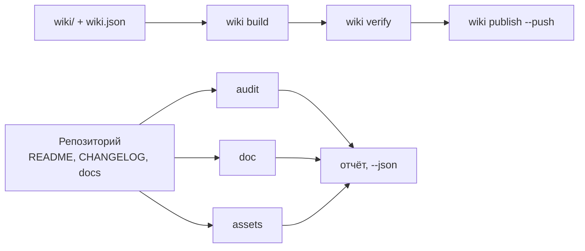

# github-agent

<!-- md-i18n:switcher -->
**На других языках:** [English](README.md) · [Deutsch](README.de.md) · [中文](README.zh.md) · [हिन्दी](README.hi.md) · [Español](README.es.md) · Русский

**Хранитель репозитория и вики GitHub для ИИ-агентов: проверяет README, CHANGELOG и состояние
сообщества, рисует баннер и социальное превью, собирает и публикует вики, проверяет ссылки,
якоря и темы — одна команда на задачу. Python 3, только стандартная библиотека.**

[](https://github.com/paulmann/github-agent/actions/workflows/ci.yml)
[](LICENSE)
[](https://www.python.org/)
[](tools/ghagent.py)
[](tests/run_tests.py)


[**Установка**](#установка) · [**Использование**](#использование) · [**Картинки**](#картинки) · [**Вики**](https://github.com/paulmann/github-agent/wiki) · [**AGENTS.md**](AGENTS.ru.md) · [**Changelog**](CHANGELOG.ru.md) · [**Issues**](https://github.com/paulmann/github-agent/issues) · [**Безопасность**](SECURITY.ru.md) · [**English version**](README.md)

Репозиторий проваливается не на коде, а на документации. В README нет раздела об установке,
в журнале изменений нет дат, вики — три страницы без навигации, баннер — битая картинка,
описание — одно слово. `git push` при этом проходит, поэтому дефект живёт годами.

Этот пакет ставит на каждое из этих мест проверяемый контракт и сводит работу к одной команде.
Он не пишет рекламных текстов и не выдумывает чисел: он проверяет то, что написал человек,
и отказывается публиковать сломанное.

> **Состояние документации.** Каждое число в этом README измерено 2026-10-24 на версии 1.1.0
> командами, названными в таблице. Подробные руководства лежат в
> [вики](https://github.com/paulmann/github-agent/wiki) и в [`docs/`](docs/); протокол для
> агентов — [`AGENTS.md`](AGENTS.ru.md).

## Содержание

- [Что делает пакет](#что-делает-пакет)
- [В цифрах](#в-цифрах)
- [Установка](#установка)
- [Использование](#использование)
- [Проверки, которые выполняются](#проверки-которые-выполняются)
- [Картинки](#картинки)
- [Импорт в другой агент](#импорт-в-другой-агент)
- [Вики как документация](#вики-как-документация)
- [Языки документации](#языки-документации)
- [Как это устроено](#как-это-устроено)
- [Ограничения](#ограничения)
- [Разработка](#разработка)
- [Участие в проекте](#участие-в-проекте)
- [Лицензия](#лицензия)

---

## Что делает пакет

| Задача | Одна команда |
|---|---|
| Оценить репозиторий | `ghagent.py audit .` |
| Проверить документы, ссылки и якоря | `ghagent.py doc --root .` |
| Найти секреты и машинные пути | `ghagent.py privacy --root .` |
| Нарисовать баннер и социальное превью | `ghagent.py assets render --write` |
| Собрать, проверить и опубликовать вики | `ghagent.py wiki build`, `verify`, `publish --push` |
| Выпустить версию | `ghagent.py changelog release 1.2.0 --write` |
| Привести в порядок описание и темы | `ghagent.py meta apply --repo owner/name --write` |
| Установить навык другому агенту | `ghagent.py install --profile harness --write` |

Каждая команда печатает находки как `file:line` с идентификатором правила и возвращает `0`
при чистом результате, `1` при ошибках, `2` при ошибке вызова. Поэтому агенту не нужно читать
дерево, чтобы узнать его состояние: достаточно одной команды и одного кода возврата.

## В цифрах

Измерено в этом дереве 2026-10-24:

| Поверхность | Значение | Источник измерения |
|---|---:|---|
| Самопроверок | 134 | `tests/run_tests.py` |
| Команд CLI | 13 | `tools/ghagent.py --help` |
| Модулей библиотеки | 11 | `tools/ghalib/*.py` |
| Правил осмотрено на этом дереве | 17 | `doc --json`, поле `rules_examined` |
| Зависимостей при запуске | 0 | импорты в `tools/` |
| Записанных ловушек платформы | 15 | [AGENTS.ru.md](AGENTS.ru.md#ловушки-платформы) |
| Строк Python | 3400 | `tools/**/*.py` |

## Установка

Нужен только Python 3.11+ (проверено на 3.13.15). Ни `pip install`, ни шага сборки. Pillow
необязателен: с ним `assets render` выпускает ещё и PNG, без него — только SVG.

```bash
git clone https://github.com/paulmann/github-agent.git
cd github-agent

python tools/ghagent.py selftest
```

Установка навыка в агента копирует пакет в корень навыков этого агента вместе с манифестом
sha256:

```bash
python tools/ghagent.py install --profile autoclaw --write   # AutoClaw2
python tools/ghagent.py install --profile harness  --write   # HARNESS
python tools/ghagent.py install --target <каталог> --write   # SagaAI и любой другой агент
```

Проверка установки и откат:

```bash
python tools/ghagent.py verify-install --profile autoclaw
python tools/ghagent.py uninstall --profile autoclaw --write
```

`uninstall` отказывается удалять каталог без файла `.install.json`: он не должен сносить то,
что установил другой инструмент.

## Использование

```bash
# 1. состояние локального репозитория (код возврата 1 — есть ошибки)
python tools/ghagent.py audit .

# 2. то же по метаданным на GitHub
python tools/ghagent.py audit --repo owner/name --http

# 3. документы: BOM, CRLF, заголовки, таблицы, ссылки, якоря, оглавление
python tools/ghagent.py doc --root .

# 4. картинки: отрисовать по метаданным, затем проверить размер, формат и ссылки
python tools/ghagent.py assets render --title "Project" --tagline "What it does." --write
python tools/ghagent.py assets check

# 5. вики: сборка, проверка, публикация (без --push — сухой прогон)
python tools/ghagent.py wiki build
python tools/ghagent.py wiki verify
python tools/ghagent.py wiki publish --repo owner/name --push

# 6. журнал изменений
python tools/ghagent.py changelog check
python tools/ghagent.py changelog suggest --since v1.0.0
python tools/ghagent.py changelog release 1.1.0 --write
python tools/ghagent.py changelog notes 1.1.0

# 7. метаданные: описание и темы
python tools/ghagent.py meta suggest
python tools/ghagent.py meta apply --repo owner/name --description "…" --topics a,b --write

# 8. один сводный отчёт
python tools/ghagent.py report . --out AUDIT.md
```

Пример вывода `audit`:

```text
[ERROR] repo.contributing        CONTRIBUTING.md is absent  hint: add CONTRIBUTING.md
[WARN ] readme.badges            only 1 badge(s)  hint: 3-8 badges: CI, release, license, runtime
[ERROR] changelog.date-missing   version 1.1.0 has no ISO date  CHANGELOG.md:14
score: 72.5% (22 scored, 1 skipped)
```

## Проверки, которые выполняются

| Группа | Правила |
|---|---|
| Текст | UTF-8 без BOM, LF вместо CRLF, завершающий перевод строки, без отступов табами |
| Структура | один `H1`, без пропущенных уровней заголовков, закрытые блоки кода, язык у каждого блока |
| Таблицы | число ячеек в каждой строке совпадает с заголовком и разделителем |
| Ссылки | относительный файл существует, якорь существует (в том числе кириллический) |
| Оглавление | каждый пункт разрешается, ни один `H2` не забыт |
| Разметка | пять типов alert-блоков, alt-текст у картинок, нет картинок по `http://` |
| Приватность | токены, приватные ключи, абсолютные пути машины, личные адреса |
| Картинки | баннер подключён, превью в PNG/JPG/GIF, до 1 МБ, не меньше 640×320 |
| Вики | манифест и файлы согласованы, `Home`/`_Sidebar`/`_Footer` на месте, ссылки без `.md`, нет относительных картинок |
| CHANGELOG | SemVer и ISO-дата у каждой версии, новые сверху, известные типы, непустая версия, ссылки сравнения |
| Метаданные | описание до 200 символов без потраченного впустую префикса, 8–20 тем в нижнем регистре через дефис |

Правило, осмотревшее ноль объектов, не считается пройденным: в отчёте оно попадает
в `coverage.skipped`, а пустое дерево даёт `doc.no-text-files`.

## Картинки

Баннер в начале этого файла создаёт сам пакет:

```bash
python tools/ghagent.py assets render --title "github-agent" \
    --tagline "Repository and wiki steward for AI agents: one command per job." \
    --command "ghagent.py audit ." --chips "python,github,wiki,lint" --write
```

- `assets/social-preview.png` — 1280×640, до 1 МБ, готов к загрузке
  в **Settings → Social preview**.
- `assets/social-preview.svg` — векторный двойник для README, ничего не требует.
- `assets check` проверяет формат, размер в байтах, размеры в пикселях, alt-текст и наличие
  каждого упомянутого файла. Копия в репозитории не становится социальным превью сама: эта
  загрузка — отдельный шаг, и проверка об этом напоминает.

## Импорт в другой агент

| Агент | Корень навыков | Что сделать |
|---|---|---|
| AutoClaw2 | `%USERPROFILE%\.pi\agent\skills` | `install --profile autoclaw --write`, затем вставить блок из `snippet` в его `AGENTS.md` |
| HARNESS | `%USERPROFILE%\.dsh\skills` | `install --profile harness --write`, тот же блок |
| SagaAI | любой каталог | `install --target <dir> --write` и блок из `snippet --target <dir>` |

Блок `snippet` называет путь к пакету, команду проверки установки и одно правило: одна задача —
одна команда. После импорта агент обязан выполнить `verify-install` и получить `0`; любой
другой код означает, что установленная копия — не та, которую тестировали. Подробности:
[docs/IMPORT.ru.md](docs/IMPORT.ru.md).

## Вики как документация

Вики ведётся из репозитория: страницы лежат в `wiki/`, порядок задаёт `wiki/wiki.json`.
`wiki build` переписывает ссылки под пространство вики — внутренние теряют `.md`, ссылки
в дерево репозитория становятся абсолютными, а относительная картинка считается ошибкой,
потому что вики-репозиторий дерева проекта не видит.

Вики собрана и проверена собственными командами пакета. Публикация требует одного действия
в интерфейсе GitHub: `<repo>.wiki.git` не существует, пока не сохранена первая страница,
и `git push` его не создаёт — в этом случае `wiki publish` возвращает `wiki.remote-missing`
с указанием на этот шаг.

## Языки документации

Основные файлы — английские; русские переводы несут суффикс `.ru.md`, ту же конвенцию
использует сам GitHub (`README.ru.md`, `AGENTS.ru.md`, `wiki/01-Why.ru.md`).

| Английский | Русский |
|---|---|
| [README.md](README.md) | [README.ru.md](README.ru.md) |
| [AGENTS.md](AGENTS.md) | [AGENTS.ru.md](AGENTS.ru.md) |
| [CHANGELOG.md](CHANGELOG.md) | [CHANGELOG.ru.md](CHANGELOG.ru.md) |
| [CONTRIBUTING.md](CONTRIBUTING.md) | [CONTRIBUTING.ru.md](CONTRIBUTING.ru.md) |
| [SECURITY.md](SECURITY.md) | [SECURITY.ru.md](SECURITY.ru.md) |
| [SUPPORT.md](SUPPORT.md) | [SUPPORT.ru.md](SUPPORT.ru.md) |
| [CODE_OF_CONDUCT.md](CODE_OF_CONDUCT.md) | [CODE_OF_CONDUCT.ru.md](CODE_OF_CONDUCT.ru.md) |
| [GOVERNANCE.md](GOVERNANCE.md) | [GOVERNANCE.ru.md](GOVERNANCE.ru.md) |

Переводы правятся в том же коммите, что и оригинал. Перевод, который молча отстаёт, — дефект
документации. Вики несёт оба набора: английские страницы как основные, русские — как страницы
`*.ru.md` в своей группе навигации.

## Как это устроено



| Компонент | Ответственность |
|---|---|
| `tools/ghagent.py` | разбор аргументов, коды возврата, сборка отчёта |
| `tools/ghalib/mdcheck.py` | markdown, ссылки, якоря, приватность |
| `tools/ghalib/audit.py` | обязательные файлы, контракты README и журнала изменений, оценка |
| `tools/ghalib/assets.py` | баннер и социальное превью: отрисовка, проверка, подсказки |
| `tools/ghalib/wiki.py` | манифест, переписывание ссылок, сайдбар и футер, публикация |
| `tools/ghalib/changelog.py` | Keep a Changelog 2.0.0, выпуск версии, черновик из коммитов |
| `tools/ghalib/meta.py` | описание, темы, домашняя страница |
| `tools/ghalib/install.py` | установка навыка, манифест sha256, расхождения, удаление |
| `tests/run_tests.py` | 134 самопроверки с фикстурами и приманками |

Якоря считаются по правилам GitHub: нижний регистр, пунктуация отбрасывается, пробелы
становятся дефисами, повтор заголовка получает `-1`. Правило сверено с живым оглавлением:
тире в заголовке даёт двойной дефис.

## Ограничения

- `audit --repo` и `meta` требуют `gh` или `GITHUB_TOKEN`. Без них команда возвращает ошибку,
  а не пустой успех.
- Внешние ссылки не запрашиваются: проверяются относительные пути, якоря и структура. Сетевой
  обход — отдельное решение, а не побочный эффект линтера.
- Вики-страницы почти не находятся через поисковики: по документации GitHub индексируются
  только вики с 500+ звёзд и запретом публичного редактирования. Для поисковой выдачи нужен
  GitHub Pages.
- `changelog suggest` — черновик. Он не знает, что важно пользователю.
- Отрисовка PNG требует Pillow. Без него выпускается SVG, а проверка говорит, почему PNG нет,
  вместо того чтобы выдавать готовое превью за существующее.

## Разработка

```bash
python tools/ghagent.py selftest
python tests/run_tests.py
python tools/ghagent.py doc --root .
python tools/ghagent.py audit .
python tools/ghagent.py assets check
```

Новое правило приходит вместе с фикстурой, которая без него падает, и с приманкой, на которой
оно должно молчать. Правило без фикстуры удаляется: проверка, которую нельзя доказать, хуже
отсутствия проверки.

## Участие в проекте

Перед pull request: `python tests/run_tests.py` и `python tools/ghagent.py doc --root .` должны
быть зелёными. Одна правка — одна причина. Правила: [CONTRIBUTING.ru.md](CONTRIBUTING.ru.md),
политика безопасности: [SECURITY.ru.md](SECURITY.ru.md).

## Лицензия

[MIT](LICENSE).
