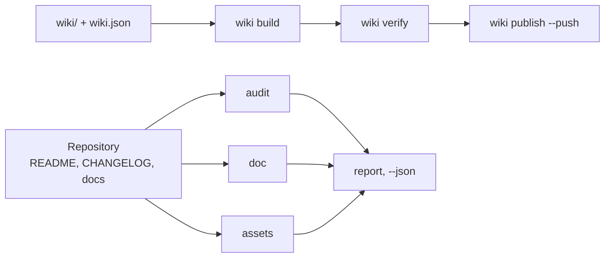

# github-agent

github-agent 是一个用于 GitHub 仓库及其维基的 Python 命令行管家：它为 README、CHANGELOG 与社区
规范打分，检查文档、链接、锚点与表格，扫描泄露的密钥，渲染横幅与社交预览，并把维基保存在仓库
中 —— 一项任务一条命令。

<!-- md-i18n:switcher -->
**其他语言：** [English](README.md) · [Deutsch](README.de.md) · 中文 · [हिन्दी](README.hi.md) · [Español](README.es.md) · [Русский](README.ru.md)

[](https://github.com/paulmann/github-agent/actions/workflows/ci.yml)
[](https://pypi.org/project/github-agent-cli/)
[](https://www.python.org/)
[](LICENSE)
[](pyproject.toml)
[](tests/run_tests.py)


[**安装**](#安装) · [**用法**](#用法) · [**维基**](https://github.com/paulmann/github-agent/wiki) · [**AGENTS.md**](AGENTS.md) · [**MIGRATION.md**](MIGRATION.md) · [**打包**](docs/PACKAGING.md) · [**更新日志**](CHANGELOG.md) · [**问题反馈**](https://github.com/paulmann/github-agent/issues) · [**安全**](SECURITY.md) · [**Русская версия**](README.ru.md)

仓库很少因为代码而失败，失败往往在文档上。README 没有安装章节，CHANGELOG 没有日期，
维基只有三页且没有导航，横幅是一张打不开的图片，仓库描述只有一个词。而 `git push` 依然
成功，于是这些缺陷能存活好几年。

本工具包为上述每一处都建立了可验证的约定，并把这项工作压缩到一条命令。它不写营销文案，
也不编造数字：它检查人写下的内容，并拒绝发布已经损坏的东西。

> **文档状态。** 本 README 中的每个数字都在 2026-10-30 针对 1.2.1 版本、用表格中列出的命令
> 实测得出。较长的指南放在
> [维基](https://github.com/paulmann/github-agent/wiki) 与 [`docs/`](docs/IMPORT.md) 中；面向
> 智能体的协议是 [`AGENTS.md`](AGENTS.md)，打包与迁移说明见
> [`docs/PACKAGING.md`](docs/PACKAGING.md) 与 [`MIGRATION.md`](MIGRATION.md)。

> **给智能体。** 从 [`AGENTS.md`](AGENTS.md) 开始：工具包在哪里、如何证明安装完好，以及用来
> 取代每一项多文件排查的那一条命令。

## 目录

- [安装](#安装)
- [用法](#用法)
- [工具包做什么](#工具包做什么)
- [数据一览](#数据一览)
- [执行的检查](#执行的检查)
- [图片](#图片)
- [导入到其他智能体](#导入到其他智能体)
- [以维基作为文档](#以维基作为文档)
- [文档语言](#文档语言)
- [实现方式](#实现方式)
- [限制](#限制)
- [开发](#开发)
- [贡献](#贡献)
- [许可证](#许可证)

---

## 安装

需要 Python 3.11 或更新版本；CI 在 3.11 与 3.13 上运行测试套件。没有运行时依赖。共有四条安装
路径，它们不能互换：包管理器安装的是 CLI，而克隆才是 `ghagent install --profile ... --write`
所需要的，因为 wheel 只包含 CLI。

### 包管理器

```bash
uv tool install github-agent-cli        # uv，隔离的工具环境
pipx install github-agent-cli           # pipx，隔离的虚拟环境
pip install github-agent-cli            # pip 装入当前环境
ghagent --version
```

> **已发布到 PyPI。** `github-agent-cli` 1.2.1 自 2026-10-30 起可用:
> <https://pypi.org/project/github-agent-cli/>。wheel 只包含 CLI；完整包
> (skills、tests、reference、wiki 源) 从下方克隆安装。

控制台脚本名为 `ghagent`；PyPI 上的包名为 `github-agent`。

### 可选的 PNG 支持

`assets render` 始终写出 SVG。PNG 输出需要 Pillow，它是一个可选附加项：

```bash
pip install "github-agent-cli[png]"
uv tool install --with pillow github-agent-cli
```

没有 Pillow 时，命令会说明为什么没有 PNG，而不是假装社交预览已经就绪。

### 从源码安装（克隆）

克隆是第二条安装路径，也是唯一带有 `tests/`、`skills/`、`reference/`、`wiki/` 与模板的路径；
因此 `install`、`verify-install`、`snippet` 与 `uninstall` 都需要它。可编辑安装会把 `ghagent`
命令加入检出目录：

```bash
git clone https://github.com/paulmann/github-agent.git
cd github-agent
pip install -e .
python tools/ghagent.py selftest
```

### Docker

仓库带有 `Dockerfile`；在本地构建它，并把待检查的仓库挂载到 `/repo`，即镜像的工作目录：

```bash
docker build -t ghagent .
docker run --rm -v "$PWD:/repo" ghagent audit .
```

在 Windows PowerShell 中，同样的挂载写作 `-v "${PWD}:/repo"`。入口点是 `ghagent`，因此镜像名
之后的第一个参数就是命令。1.2.1 不发布任何镜像仓库中的镜像，CI 也不构建容器：这个标签是本地
约定。参见 [examples/docker.md](examples/docker.md)。

### GitHub Action

这个复合 action 从自己的检出目录安装工具包，因此不依赖 PyPI 发布，标签存在即可使用：

```yaml
- uses: actions/checkout@v7
- uses: paulmann/github-agent@v1.2.1    # 固定发布标签
  with:
    command: audit .
    min-score: "80"
```

| 输入 | 默认值 | 用途 |
|---|---|---|
| `command` | `audit . --min-score 80` | 任意 `ghagent` 命令，不含程序名 |
| `min-score` | `80` | 分数阈值，仅当 `command` 以 `audit` 开头且未传标志时生效 |
| `working-directory` | `.` | 命令运行的仓库目录，相对于 `$GITHUB_WORKSPACE` |
| `python-version` | `3.13` | 由 `actions/setup-python` 安装的解释器 |
| `github-token` | `${{ github.token }}` | 导出为 `GITHUB_TOKEN`，供元数据命令使用 |

对于非 audit 命令，action 会原样运行给定的参数字符串，例如 `command: doc --root .`。没有任何
输出：步骤的退出码就是结果（`0` 干净、`1` 有发现、`2` 用法或环境问题）。完整工作流，包括运行
`doc` 的第二个作业和 Docker 方案，见 [examples/ci-usage.md](examples/ci-usage.md)。

### pre-commit

本仓库同时也是 pre-commit 钩子的来源；钩子有 `ghagent-doc`、`ghagent-audit`、
`ghagent-privacy` 与 `ghagent-changelog`：

```yaml
repos:
  - repo: https://github.com/paulmann/github-agent
    rev: v1.2.1     # 占位符：固定你信任的发布标签
    hooks:
      - id: ghagent-doc
      - id: ghagent-audit
      - id: ghagent-privacy
      - id: ghagent-changelog
```

用 `pre-commit install` 把钩子安装到使用的仓库。完整的配置文件见
[examples/pre-commit-config.yaml](examples/pre-commit-config.yaml)；钩子定义在
[.pre-commit-hooks.yaml](.pre-commit-hooks.yaml)。钩子需要一个已发布的标签，因为 pre-commit 会
从打了标签的树构建工具。

### 验证安装

安装之后，一条命令即可回答 CLI 是否为已发布的构建：

```bash
ghagent --version     # 打印版本，例如 github-agent 1.2.1
ghagent audit .       # 0 干净，1 有错误级发现，2 用法或环境问题
```

在克隆中会运行完整自检套件；wheel 只包含 CLI，因此在其中执行 `ghagent selftest` 会以 `2` 退出
并提示使用克隆，而不是错误地报告 `PASS`：

```bash
git clone https://github.com/paulmann/github-agent.git
cd github-agent
python tools/ghagent.py selftest    # 173/173 项检查通过
```

## 用法

```bash
ghagent audit .                    # 给仓库卫生打分，有错误时退出 1
ghagent doc --root .               # markdown、链接、锚点、表格、目录
ghagent privacy --root .           # 令牌、私钥、本机路径、个人地址
ghagent assets render --write      # 从仓库元数据渲染横幅与社交预览
ghagent assets check               # 格式、尺寸、替代文本、被引用的文件
ghagent wiki build                 # 为维基命名空间重写链接
ghagent wiki verify                # 每个内部链接都能解析
ghagent changelog check            # Keep a Changelog 与 SemVer
ghagent changelog release 1.2.0 --write
ghagent meta suggest               # 描述与主题
```

每条命令都接受 `--json`；发现以 `file:line` 加规则编号的形式打印，调用方无需解析散文。

| 退出码 | 含义 |
|---|---|
| `0` | 没有错误级别的发现 |
| `1` | 存在错误级别的发现，每条都带 `file:line` 打印 |
| `2` | 用法或环境问题：路径错误、文件缺失、缺少 `gh` 或令牌 |

`audit` 输出示例，来自一个故意失败的仓库，而非本仓库：

```text
[ERROR] repo.contributing        CONTRIBUTING.md is absent  hint: add CONTRIBUTING.md
[WARN ] readme.badges            only 1 badge(s)  hint: 3-8 badges: CI, release, license, runtime
[ERROR] changelog.date-missing   version 1.1.0 has no ISO date  CHANGELOG.md:14
score: 72.5% (22 scored, 1 skipped)
```

## 工具包做什么

| 任务 | 一条命令 |
|---|---|
| 给仓库打分 | `ghagent audit .` |
| 检查文档、链接与锚点 | `ghagent doc --root .` |
| 查找密钥与本机路径 | `ghagent privacy --root .` |
| 渲染横幅与社交预览 | `ghagent assets render --write` |
| 构建、校验并发布维基 | `ghagent wiki build`、`verify`、`publish --push` |
| 发布一个版本 | `ghagent changelog release 1.2.0 --write` |
| 修正描述与主题 | `ghagent meta apply --repo owner/name --write` |
| 把技能安装到其他智能体 | `ghagent install --profile harness --write` |

CLI 共有 13 条命令；表格列出的是日常使用的那几条。其余命令（`report`、`snippet`、
`verify-install`、`uninstall`、`selftest`、`assets suggest`、`changelog suggest`、
`changelog notes`、`meta suggest`、`wiki init`、`wiki publish`）连同标志列在
[`AGENTS.md`](AGENTS.md) 中。

## 数据一览

在本仓库中于 2026-10-30 针对 1.2.1 版本实测：

| 项目 | 数值 | 测量来源 |
|---|---:|---|
| 自检 | 173 | `python tests/run_tests.py` |
| CLI 命令 | 13 | `ghagent --help` |
| 库模块 | 11 | `tools/ghalib/*.py` |
| 在本仓库上检查的文档规则 | 17 | `ghagent doc --json`，字段 `rules_examined` |
| 运行时依赖 | 0 | `pyproject.toml`，`dependencies = []` |
| 记录的平台陷阱 | 15 | [docs/RULES.md](docs/RULES.md#platform-traps) 中的陷阱表 |
| Python 行数 | 4176 | `wc -l tools/ghagent.py tools/ghalib/*.py` |

## 执行的检查

| 分组 | 规则 |
|---|---|
| 文本 | UTF-8 不带 BOM，用 LF 而非 CRLF，结尾有换行，不用制表符缩进 |
| 结构 | 只有一个 `H1`，标题不跳级，代码围栏闭合，每个围栏都标语言 |
| 表格 | 每行的单元格数量与表头、分隔行一致 |
| 链接 | 相对文件存在，锚点存在（包括西里尔字母） |
| 目录 | 每个条目都能解析，没有漏掉的 `H2` |
| 标记 | 五种提示块类型，图片带替代文本，不用 `http://` 图片 |
| 隐私 | 令牌、私钥、本机绝对路径、个人地址 |
| 图片 | 横幅被引用，预览为 PNG/JPG/GIF，小于 1 MB，至少 640×320 |
| 维基 | 清单与文件一致，存在 `Home`/`_Sidebar`/`_Footer`，链接不带 `.md`，无相对图片 |
| CHANGELOG | 每个版本符合 SemVer 与 ISO 日期，最新在上，类型已知，无空版本，有比较链接 |
| 智能体文件 | 根目录的规范 `AGENTS.md` 保持为一张地图：超过 120 行即警告，细节属于 `docs/` |
| 元数据 | 描述少于 200 字符且无冗余前缀，8–20 个小写连字符主题 |

检查了零个对象的规则不算通过：它会报告为 `coverage.skipped`，而空目录树会得到
`doc.no-text-files`。

## 图片

本文件顶部的横幅由工具包自身生成：

```bash
ghagent assets render --title "github-agent" \
    --tagline "Repository and wiki steward for AI agents: one command per job." \
    --command "ghagent audit ." --chips "python,github,wiki,lint" --write
```

- `assets/social-preview.png` —— 1280×640，小于 1 MB，可直接用于 **Settings → Social preview**。
- `assets/social-preview.svg` —— 供 README 使用的矢量版本，无需额外依赖。
- `assets check` 校验格式、字节大小、尺寸、替代文本，以及每个被引用的文件是否存在。仓库中的
  副本不会自动成为社交预览：那一步需要手动上传，检查会打印这条提醒。

## 导入到其他智能体

| 智能体 | 技能根目录 | 要做的事 |
|---|---|---|
| AutoClaw2 | `%USERPROFILE%\.pi\agent\skills` | `install --profile autoclaw --write`，然后把 `snippet` 块粘贴到它的 `AGENTS.md` |
| HARNESS | `%USERPROFILE%\.dsh\skills` | `install --profile harness --write`，同一个块 |
| SagaAI | 任意目录 | `install --target <dir> --write`，加上 `snippet --target <dir>` 给出的块 |

`snippet` 块给出工具包路径、校验命令和一条规则：一项任务，一条命令。导入之后智能体必须
运行 `verify-install` 并得到 `0`；否则说明安装的副本不是通过测试的那一份。这是唯一需要克隆
而非 wheel 的工作流，因为 wheel 只包含 CLI。细节见 [docs/IMPORT.md](docs/IMPORT.md)。

## 以维基作为文档

维基从仓库维护：页面放在 `wiki/`，顺序由 `wiki/wiki.json` 决定。`wiki build` 会为维基
命名空间重写链接 —— 内部链接去掉 `.md`，指向仓库目录树的链接变成绝对地址，而相对图片会
报错，因为维基仓库看不到项目目录树。

构建与校验都用工具包自身的命令完成。发布需要在 GitHub 界面里做一个动作：在第一次保存页面
之前 `<repo>.wiki.git` 并不存在，`git push` 也无法创建它 —— 此时 `wiki publish` 会返回
`wiki.remote-missing` 并说明该步骤。完整工作流见 [docs/WIKI.md](docs/WIKI.md)。

## 文档语言

英文文件是基准；俄语译文带 `.ru.md` 后缀，这也是 GitHub 自身使用的约定
（`README.ru.md`、`AGENTS.ru.md`、`wiki/01-Why.ru.md`）。

| 英文 | 俄语 |
|---|---|
| [README.md](README.md) | [README.ru.md](README.ru.md) |
| [AGENTS.md](AGENTS.md) | [AGENTS.ru.md](AGENTS.ru.md) |
| [CHANGELOG.md](CHANGELOG.md) | [CHANGELOG.ru.md](CHANGELOG.ru.md) |
| [CONTRIBUTING.md](CONTRIBUTING.md) | [CONTRIBUTING.ru.md](CONTRIBUTING.ru.md) |
| [SECURITY.md](SECURITY.md) | [SECURITY.ru.md](SECURITY.ru.md) |
| [SUPPORT.md](SUPPORT.md) | [SUPPORT.ru.md](SUPPORT.ru.md) |
| [CODE_OF_CONDUCT.md](CODE_OF_CONDUCT.md) | [CODE_OF_CONDUCT.ru.md](CODE_OF_CONDUCT.ru.md) |
| [GOVERNANCE.md](GOVERNANCE.md) | [GOVERNANCE.ru.md](GOVERNANCE.ru.md) |

译文与原文件在同一个提交中更新。悄悄落后于原文的译文属于文档缺陷。维基同时带两套页面：
英文页面作为基准，俄语页面作为独立的 `*.ru.md` 页面放在自己的导航分组里。

## 实现方式



| 组件 | 职责 |
|---|---|
| `tools/ghagent.py` | 参数解析、退出码、报告组装 |
| `tools/ghalib/mdcheck.py` | markdown、链接、锚点、隐私 |
| `tools/ghalib/audit.py` | 必需文件、README 与 changelog 约定、评分 |
| `tools/ghalib/assets.py` | 横幅与社交预览：渲染、检查、建议 |
| `tools/ghalib/wiki.py` | 清单、链接重写、侧边栏与页脚、发布 |
| `tools/ghalib/changelog.py` | Keep a Changelog 2.0.0、发布、从提交生成草稿 |
| `tools/ghalib/meta.py` | 描述、主题、主页 |
| `tools/ghalib/install.py` | 技能安装、sha256 清单、差异、卸载 |
| `tools/ghalib/report.py` | 发现、严重级别、Markdown 与 `--json` 输出 |
| `tools/ghalib/config.py`、`tools/ghalib/util.py` | `.ghagent.json`、路径、文本输入输出、锚点 |
| `tests/run_tests.py` | 173 个自检，带用例与诱饵 |

锚点遵循 GitHub 的规则：小写、去掉标点、空格转连字符，重复的标题加 `-1`。这条规则在真实
的目录上验证过：标题里的破折号会产生双连字符。架构说明见 [docs/ARCHITECTURE.md](docs/ARCHITECTURE.md)。

## 限制

- `audit --repo` 与 `meta` 需要 `gh` 或 `GITHUB_TOKEN`。没有它们，命令返回错误，而不是空的
  成功。
- 不抓取外部链接：只检查相对路径、锚点和结构。网络爬取是一个单独的决定，不是 linter 的
  副作用。
- 维基页面几乎无法通过搜索引擎发现：按 GitHub 文档，只有 500+ 星标且关闭公开编辑的维基
  才会被索引。做可发现性请用 GitHub Pages。
- `changelog suggest` 只是草稿。它不知道什么对用户重要。
- 渲染 PNG 需要 Pillow。没有它时只生成 SVG，检查会说明为什么没有 PNG，而不是假装社交预览
  已经就绪。

## 开发

```bash
python tools/ghagent.py selftest
python tests/run_tests.py
python tools/ghagent.py doc --root .
python tools/ghagent.py audit .
python tools/ghagent.py assets check
```

新增规则时，要一起带来一个“去掉规则就会失败”的用例，以及一个必须保持安静的诱饵用例。
没有用例的规则会被删除：无法证明的检查比没有检查更糟。打包与 wheel 布局见
[docs/PACKAGING.md](docs/PACKAGING.md)；1.1.0 → 1.2.0 的变更见 [MIGRATION.md](MIGRATION.md)。

## 贡献

提交 pull request 之前：`python tests/run_tests.py` 和 `python tools/ghagent.py doc --root .`
必须通过。一处改动，一个理由。规则见 [CONTRIBUTING.md](CONTRIBUTING.md)，安全策略见
[SECURITY.md](SECURITY.md)。

## 许可证

[MIT](LICENSE)。
