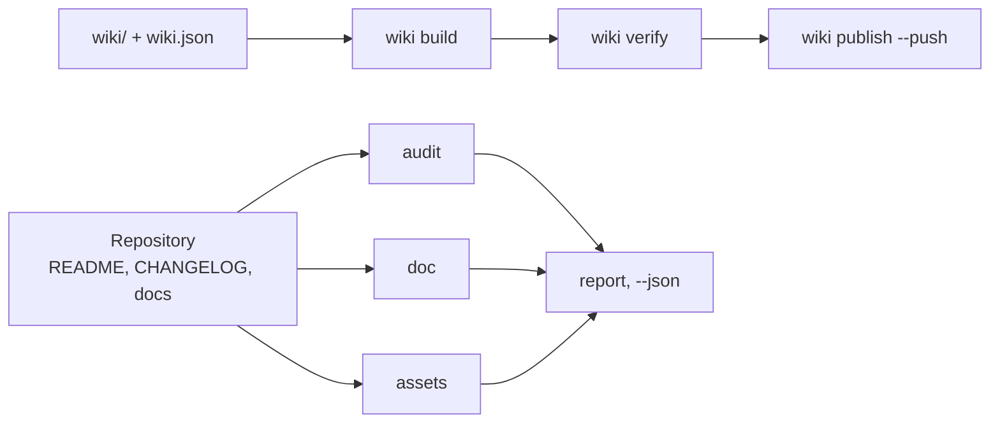

# github-agent

<!-- md-i18n:switcher -->
**其他语言：** [English](README.md) · [Deutsch](README.de.md) · 中文 · [हिन्दी](README.hi.md) · [Español](README.es.md) · [Русский](README.ru.md)

**面向 AI 智能体的 GitHub 仓库与维基管家：检查 README、CHANGELOG 与社区健康度，渲染横幅与社交预览，构建并发布维基，校验链接、锚点与主题 —— 一项任务一条命令。仅用 Python 3 标准库。**

[](https://github.com/paulmann/github-agent/actions/workflows/ci.yml)
[](LICENSE)
[](https://www.python.org/)
[](tools/ghagent.py)
[](tests/run_tests.py)


[**安装**](#安装) · [**用法**](#用法) · [**图片**](#图片) · [**维基**](https://github.com/paulmann/github-agent/wiki) · [**AGENTS.md**](AGENTS.md) · [**更新日志**](CHANGELOG.md) · [**问题反馈**](https://github.com/paulmann/github-agent/issues) · [**安全**](SECURITY.md) · [**Русская версия**](README.ru.md)

仓库很少因为代码而失败，失败往往在文档上。README 没有安装章节，CHANGELOG 没有日期，
维基只有三页且没有导航，横幅是一张打不开的图片，仓库描述只有一个词。而 `git push` 依然
成功，于是这些缺陷能存活好几年。

本工具包为上述每一处都建立了可验证的约定，并把这项工作压缩到一条命令。它不写营销文案，
也不编造数字：它检查人写下的内容，并拒绝发布已经损坏的东西。

> **文档状态。** 本 README 中的每个数字都在 2026-10-24 针对 1.1.0 版本、用表格中列出的命令
> 实测得出。较长的指南放在
> [维基](https://github.com/paulmann/github-agent/wiki) 与 [`docs/`](docs/) 中；面向智能体的
> 协议是 [`AGENTS.md`](AGENTS.md)。

## 目录

- [工具包做什么](#工具包做什么)
- [数据一览](#数据一览)
- [安装](#安装)
- [用法](#用法)
- [执行的检查](#执行的检查)
- [图片](#图片)
- [导入到其他智能体](#导入到其他智能体)
- [以维基作为文档](#以维基作为文档)
- [文档语言](#文档语言)
- [实现方式](#实现方式)
- [限制](#限制)
- [开发](#开发)
- [贡献](#贡献)
- [许可证](#许可证)

---

## 工具包做什么

| 任务 | 一条命令 |
|---|---|
| 给仓库打分 | `ghagent.py audit .` |
| 检查文档、链接与锚点 | `ghagent.py doc --root .` |
| 查找密钥与本机路径 | `ghagent.py privacy --root .` |
| 渲染横幅与社交预览 | `ghagent.py assets render --write` |
| 构建、校验并发布维基 | `ghagent.py wiki build`、`verify`、`publish --push` |
| 发布一个版本 | `ghagent.py changelog release 1.2.0 --write` |
| 修正描述与主题 | `ghagent.py meta apply --repo owner/name --write` |
| 把技能安装到其他智能体 | `ghagent.py install --profile harness --write` |

每条命令都以 `file:line` 加规则编号的形式打印结果，返回 `0` 表示干净，`1` 表示存在错误，
`2` 表示调用方式有问题。因此智能体不需要读取整个目录树才能知道状态：一条命令加一个
退出码就够了。

## 数据一览

在本仓库中于 2026-10-24 实测：

| 项目 | 数值 | 测量来源 |
|---|---:|---|
| 自检 | 134 | `tests/run_tests.py` |
| CLI 命令 | 13 | `tools/ghagent.py --help` |
| 库模块 | 11 | `tools/ghalib/*.py` |
| 在本仓库上检查的规则 | 17 | `doc --json`，字段 `rules_examined` |
| 运行时依赖 | 0 | `tools/` 中的导入 |
| 记录的平台陷阱 | 15 | [AGENTS.md](AGENTS.md#platform-traps) |
| Python 行数 | 3400 | `tools/**/*.py` |

## 安装

只需要 Python 3.11+（已在 3.13.15 上验证）。无需 `pip install`，没有构建步骤。Pillow 是
可选的：装了它 `assets render` 还会生成 PNG，不装则只生成 SVG。

```bash
git clone https://github.com/paulmann/github-agent.git
cd github-agent

python tools/ghagent.py selftest
```

把技能安装到某个智能体时，工具包会被复制到该智能体的技能根目录，并附带一份 sha256 清单：

```bash
python tools/ghagent.py install --profile autoclaw --write   # AutoClaw2
python tools/ghagent.py install --profile harness  --write   # HARNESS
python tools/ghagent.py install --target <dir>     --write   # SagaAI and anything else
```

校验与回滚：

```bash
python tools/ghagent.py verify-install --profile autoclaw
python tools/ghagent.py uninstall --profile autoclaw --write
```

`uninstall` 拒绝删除没有 `.install.json` 的目录：它不能删掉由其他工具安装的内容。

## 用法

```bash
# 1. state of a local repository (exit 1 means errors)
python tools/ghagent.py audit .

# 2. the same for GitHub metadata
python tools/ghagent.py audit --repo owner/name --http

# 3. documents: BOM, CRLF, headings, tables, links, anchors, table of contents
python tools/ghagent.py doc --root .

# 4. images: render from metadata, then verify size, format and references
python tools/ghagent.py assets render --title "Project" --tagline "What it does." --write
python tools/ghagent.py assets check

# 5. wiki: build, verify, publish (without --push it is a dry run)
python tools/ghagent.py wiki build
python tools/ghagent.py wiki verify
python tools/ghagent.py wiki publish --repo owner/name --push

# 6. changelog
python tools/ghagent.py changelog check
python tools/ghagent.py changelog suggest --since v1.0.0
python tools/ghagent.py changelog release 1.1.0 --write
python tools/ghagent.py changelog notes 1.1.0

# 7. metadata: description and topics
python tools/ghagent.py meta suggest
python tools/ghagent.py meta apply --repo owner/name --description "…" --topics a,b --write

# 8. one combined report
python tools/ghagent.py report . --out AUDIT.md
```

`audit` 输出示例：

```text
[ERROR] repo.contributing        CONTRIBUTING.md is absent  hint: add CONTRIBUTING.md
[WARN ] readme.badges            only 1 badge(s)  hint: 3-8 badges: CI, release, license, runtime
[ERROR] changelog.date-missing   version 1.1.0 has no ISO date  CHANGELOG.md:14
score: 72.5% (22 scored, 1 skipped)
```

## 执行的检查

| 分组 | 规则 |
|---|---|
| 文本 | UTF-8 不带 BOM，用 LF 而非 CRLF，结尾有换行，不用制表符缩进 |
| 结构 | 只有一个 `H1`，标题不跳级，代码围栏闭合，每个围栏都标语言 |
| 表格 | 每行的单元格数量与表头、分隔行一致 |
| 链接 | 相对文件存在，锚点存在（包括西里尔字母） |
| 目录 | 每个条目都能解析，没有漏掉的 `H2` |
| 标记 | 五种提示块类型，图片带替代文本，不用 `http://` 图片 |
| 隐私 | 令牌、私钥、本机绝对路径、个人地址 |
| 图片 | 横幅被引用，预览为 PNG/JPG/GIF，小于 1 MB，至少 640×320 |
| 维基 | 清单与文件一致，存在 `Home`/`_Sidebar`/`_Footer`，链接不带 `.md`，无相对图片 |
| CHANGELOG | 每个版本符合 SemVer 与 ISO 日期，最新在上，类型已知，无空版本，有比较链接 |
| 元数据 | 描述少于 200 字符且无冗余前缀，8–20 个小写连字符主题 |

检查了零个对象的规则不算通过：它会报告为 `coverage.skipped`，而空目录树会得到
`doc.no-text-files`。

## 图片

本文件顶部的横幅由工具包自身生成：

```bash
python tools/ghagent.py assets render --title "github-agent" \
    --tagline "Repository and wiki steward for AI agents: one command per job." \
    --command "ghagent.py audit ." --chips "python,github,wiki,lint" --write
```

- `assets/social-preview.png` —— 1280×640，小于 1 MB，可直接用于 **Settings → Social preview**。
- `assets/social-preview.svg` —— 供 README 使用的矢量版本，无需额外依赖。
- `assets check` 校验格式、字节大小、尺寸、替代文本，以及每个被引用的文件是否存在。仓库中的
  副本不会自动成为社交预览：那一步需要手动上传，检查会打印这条提醒。

## 导入到其他智能体

| 智能体 | 技能根目录 | 要做的事 |
|---|---|---|
| AutoClaw2 | `%USERPROFILE%\.pi\agent\skills` | `install --profile autoclaw --write`，然后把 `snippet` 块粘贴到它的 `AGENTS.md` |
| HARNESS | `%USERPROFILE%\.dsh\skills` | `install --profile harness --write`，同一个块 |
| SagaAI | 任意目录 | `install --target <dir> --write`，加上 `snippet --target <dir>` 给出的块 |

`snippet` 块给出工具包路径、校验命令和一条规则：一项任务，一条命令。导入之后智能体必须
运行 `verify-install` 并得到 `0`；否则说明安装的副本不是通过测试的那一份。细节见
[docs/IMPORT.md](docs/IMPORT.md)。

## 以维基作为文档

维基从仓库维护：页面放在 `wiki/`，顺序由 `wiki/wiki.json` 决定。`wiki build` 会为维基
命名空间重写链接 —— 内部链接去掉 `.md`，指向仓库目录树的链接变成绝对地址，而相对图片会
报错，因为维基仓库看不到项目目录树。

构建与校验都用工具包自身的命令完成。发布需要在 GitHub 界面里做一个动作：在第一次保存页面
之前 `<repo>.wiki.git` 并不存在，`git push` 也无法创建它 —— 此时 `wiki publish` 会返回
`wiki.remote-missing` 并说明该步骤。

## 文档语言

英文文件是基准；俄语译文带 `.ru.md` 后缀，这也是 GitHub 自身使用的约定
（`README.ru.md`、`AGENTS.ru.md`、`wiki/01-Why.ru.md`）。

| 英文 | 俄语 |
|---|---|
| [README.md](README.md) | [README.ru.md](README.ru.md) |
| [AGENTS.md](AGENTS.md) | [AGENTS.ru.md](AGENTS.ru.md) |
| [CHANGELOG.md](CHANGELOG.md) | [CHANGELOG.ru.md](CHANGELOG.ru.md) |
| [CONTRIBUTING.md](CONTRIBUTING.md) | [CONTRIBUTING.ru.md](CONTRIBUTING.ru.md) |
| [SECURITY.md](SECURITY.md) | [SECURITY.ru.md](SECURITY.ru.md) |
| [SUPPORT.md](SUPPORT.md) | [SUPPORT.ru.md](SUPPORT.ru.md) |
| [CODE_OF_CONDUCT.md](CODE_OF_CONDUCT.md) | [CODE_OF_CONDUCT.ru.md](CODE_OF_CONDUCT.ru.md) |
| [GOVERNANCE.md](GOVERNANCE.md) | [GOVERNANCE.ru.md](GOVERNANCE.ru.md) |

译文与原文件在同一个提交中更新。悄悄落后于原文的译文属于文档缺陷。维基同时带两套页面：
英文页面作为基准，俄语页面作为独立的 `*.ru.md` 页面放在自己的导航分组里。

## 实现方式



| 组件 | 职责 |
|---|---|
| `tools/ghagent.py` | 参数解析、退出码、报告组装 |
| `tools/ghalib/mdcheck.py` | markdown、链接、锚点、隐私 |
| `tools/ghalib/audit.py` | 必需文件、README 与 changelog 约定、评分 |
| `tools/ghalib/assets.py` | 横幅与社交预览：渲染、检查、建议 |
| `tools/ghalib/wiki.py` | 清单、链接重写、侧边栏与页脚、发布 |
| `tools/ghalib/changelog.py` | Keep a Changelog 2.0.0、发布、从提交生成草稿 |
| `tools/ghalib/meta.py` | 描述、主题、主页 |
| `tools/ghalib/install.py` | 技能安装、sha256 清单、差异、卸载 |
| `tests/run_tests.py` | 134 个自检，带用例与诱饵 |

锚点遵循 GitHub 的规则：小写、去掉标点、空格转连字符，重复的标题加 `-1`。这条规则在真实
的目录上验证过：标题里的破折号会产生双连字符。

## 限制

- `audit --repo` 与 `meta` 需要 `gh` 或 `GITHUB_TOKEN`。没有它们，命令返回错误，而不是空的
  成功。
- 不抓取外部链接：只检查相对路径、锚点和结构。网络爬取是一个单独的决定，不是 linter 的
  副作用。
- 维基页面几乎无法通过搜索引擎发现：按 GitHub 文档，只有 500+ 星标且关闭公开编辑的维基
  才会被索引。做可发现性请用 GitHub Pages。
- `changelog suggest` 只是草稿。它不知道什么对用户重要。
- 渲染 PNG 需要 Pillow。没有它时只生成 SVG，检查会说明为什么没有 PNG，而不是假装社交预览
  已经就绪。

## 开发

```bash
python tools/ghagent.py selftest
python tests/run_tests.py
python tools/ghagent.py doc --root .
python tools/ghagent.py audit .
python tools/ghagent.py assets check
```

新增规则时，要一起带来一个“去掉规则就会失败”的用例，以及一个必须保持安静的诱饵用例。
没有用例的规则会被删除：无法证明的检查比没有检查更糟。

## 贡献

提交 pull request 之前：`python tests/run_tests.py` 和 `python tools/ghagent.py doc --root .`
必须通过。一处改动，一个理由。规则见 [CONTRIBUTING.md](CONTRIBUTING.md)，安全策略见
[SECURITY.md](SECURITY.md)。

## 许可证

[MIT](LICENSE)。
